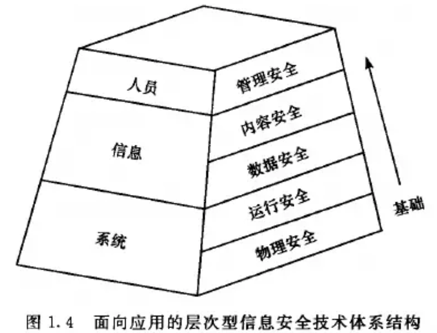
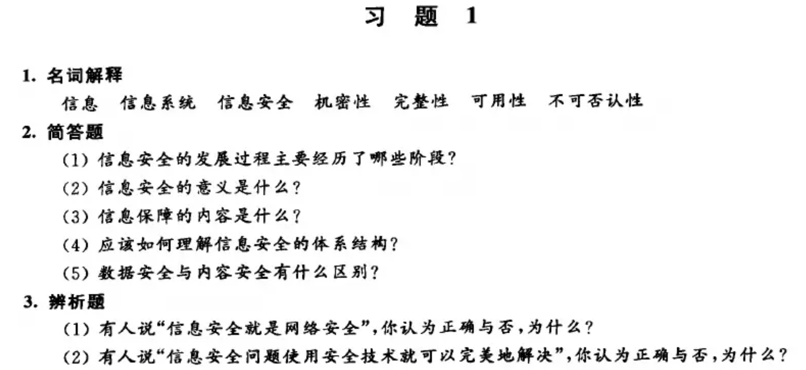
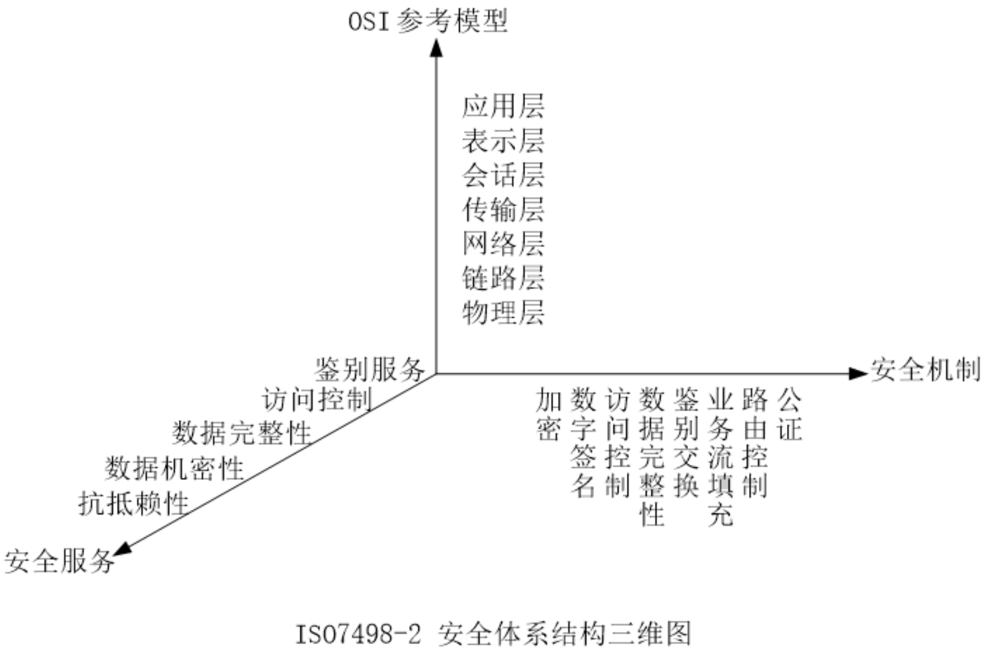

# 信息安全的基本概念

## 信息安全的三个发展阶段？
1. **通信安全**阶段
2. **信息安全**阶段
3. **信息保障**阶段

## 信息安全基本属性？
### 三个属性 / 三个基本方面 / 信息安全三个基本目标？
- C：**机密性**(Confidentiality)：信息在**存储、传输、使用过程**中，不会**泄漏**给非授权用户或实体。
- I：**完整性**(Integrity)：信息在存储、使用、传输过程中，不会被**非授权用户篡改**或防止授权用户对信息进行**不恰当的篡改**。
- A：**可用性**(Availability)：确保授权用户或实体对信息资源的正常使用**不会被异常拒绝**，允许其**可靠而及时***地访问信息资源。
### 五个属性 / 信息的安全属性？
- C：机密性(Confidentiality)
- I：完整性(Integrity)
- A：可用性(Availability)
- C：可控性(Controllability)
- N：不可否认性(Non-Repudation)
### 与 CIA 相对的属性？
DAD：泄露、篡改、破坏
- 泄露（Disclosure）
- 篡改（Alteration）
- 破坏（Destruction）

## 信息保障主要方面 / PDRR 准则？
- **保护** Protect
- **检测** Detect
- **反应** React
- **恢复** Restore

## 信息保障阶段三大要素？
- **人**是**基础**
- **技术**是**核心**
- **管理**是**关键**

## 信息系统的基本要素、五个安全层次以及对应关系？
- **信息系统基本要素：** 人员、信息、系统
- **五个安全层次：** 管理安全、内容安全、数据安全、运行安全、物理安全
- **对应关系** 

## 详细解释五个安全层次？
1. **物理安全：** 物理安全指对网络及信息系统**物理装备**的保护。
2. **运行安全：** 运行安全指对网络及信息系统的**运行过程和运行状态**的保护。
3. **数据安全：** 数据安全指对数据收集、处理、存储、检索、传输等过程中的保护。
4. **内容安全：** 内容安全指依据信息的具体内涵判断其是否违反特定安全策略，并采取相应的安全措施，对信息的机密性、真实性、可控性、可用性进行保护。
5. **管理安全：** 管理安全指通过针对人的信息行为的规范和约束，提供对信息的机密性、完整性、可用性以及可控性的保护。

## 安全服务的种类？
数据机密性，数据完整性，鉴别服务，访问控制，抗抵赖（即不可否认）

## 安全机制的种类？
加密，数据完整性，鉴别交换，访问控制，数字签名，公证，业务流填充，路由控制

---
# 课后习题
答案从书上找的，和上文有所出入但无根本区别，个人认为哪个简单背哪个

## 1.名词解释
### 信息 信息系统 信息安全 机密性 完整性 可用性 不可否认性
1. **信息**：信息是通过施加于数据上的某些约定而赋予这些数据的特定含义
2. **信息系统**：           
信息系统是由**人员、信息和系统**构成的有机整体，通过对信息进行**采集、存储、处理、传输和使用**，实现特定的信息处理与业务目标。从信息安全角度看，信息系统的安全涉及**管理安全、内容安全、数据安全、运行安全和物理安全**五个层次。
3. **信息安全**：       
在技术上和管理上为数据处理系统建立的安全保护，保护系统的硬件、软件以及相关数据不因偶然或恶意原因遭泄露、篡改、破坏 (DAD)
4. **机密性（Confidentiality）**：指信息只能为授权者使用而不泄漏给未经授权者的特性。
5. **完整性（Integrity）**：指保证信息在存储和传输过程中未经授权不能被改变的特性。
6. **可用性（Availability）**：指保证信息和信息系统随时为授权者提供服务的有效特性。
7. **可控性（Controllability）**：指授权实体可以控制信息系统和信息使用的特性。
8. **不可否认性（Non-repudiation）**：指任何实体均无法否认其实施过的信息行为的特性，也称为抗抵赖性。

## 2.简答题
### （1）信息安全的发展过程主要经历了哪些阶段？
**通信安全**阶段、**信息安全**阶段、**信息保障**阶段
### （2）信息安全的意义是什么？
信息安全是保障国家安全、社会稳定和经济发展的重要基础，其意义主要包括：①保障国家安全和社会公共利益；②保护组织的信息资产和合法权益；③保护个人隐私及信息权益；④保障信息系统正常运行和业务连续性；⑤促进信息化建设和数字经济健康发展。
### （3）信息保障的内容是什么？
信息保障主要包括**保护(Protect)、检测(Detect)、反应(React)、恢复(Restore)**四个方面，其目的是动态地、全方位地保护信息系统。
### （4）应该如何理解信息安全的体系结构？
体系结构的建立需要在特定的视觉角度下进行分析归纳，而不同的视觉角度会形成不同的
体系结构。      
可以分四个层面来理解：      
1. **面向目标的知识体系结构：**
信息安全通常强调所谓CIA三元组，实际上是信息安全的三个最基本的目标，与之相反的是 DAD 三元组
2. **面向应用的层次性技术体系架构：**
- 信息系统的基本要素为**人员、信息、系统**，也可以看做三个组成部分。
- 针对三个不同部分存在**五个安全层次与之对应**，分别为系统部分对应物理安全和运行安全，信息部分对应数据安全和内容安全，而人员部分的安全需要通过管理安全来保证。
- 五个层次存在着一定的顺序关系，每个层次均为其上层提供基础安全保证。各个安全层次均依靠相应的安全技术来提供保障。
3. **面向过程的信息安全保障体系**       
信息安全保障体系包括四部分内容，即人们常提到的 PDRR.
4. **OSI 开放系统互连安全体系结构**     

### （5） 数据安全与内容安全有什么区别？
- **数据安全：** 数据安全指对数据收集、处理、存储、检索、传输等过程中的保护。
- **内容安全：** 内容安全指依据信息的具体内涵判断其是否违反特定安全策略，并采取相应的安全措施，对信息的机密性、真实性、可控性、可用性进行保护。

## 3.辨析题
### （1）有人说“信息安全就是网络安全”，你认为正确与否，汐什么？
**错误。** 信息安全的范围大于网络安全。信息安全保护信息在采集、处理、存储、传输和使用等全过程中的安全，涉及物理安全、运行安全、数据安全、内容安全和管理安全等多个层次；网络安全主要关注网络及其相关活动的安全。
### （2）有人说“信息安全问题使用安全技术就可以完美地解决”，你认为正确与否，为什么？
**错误。** 信息安全问题不能仅依靠安全技术解决。信息安全是一个综合性问题，除了采用加密、访问控制、入侵检测等技术措施外，还需要完善安全管理制度、法律法规和道德规范，并加强人员管理，形成技术、管理与制度相结合的综合防护体系。