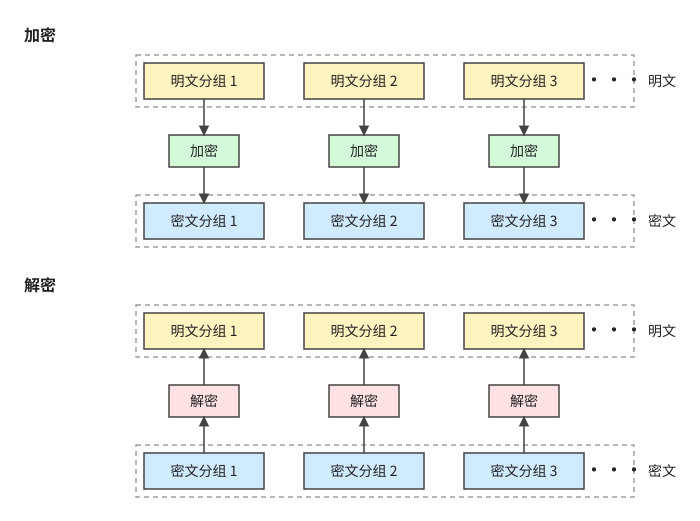
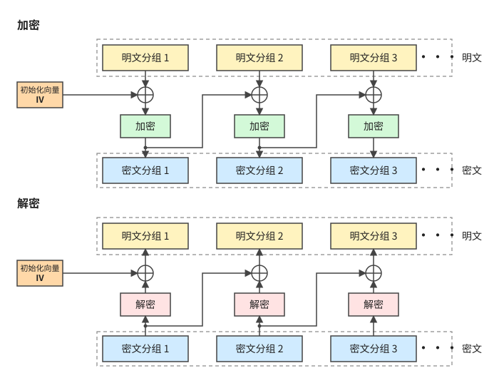
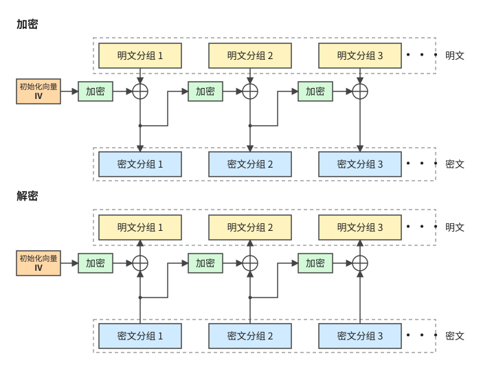
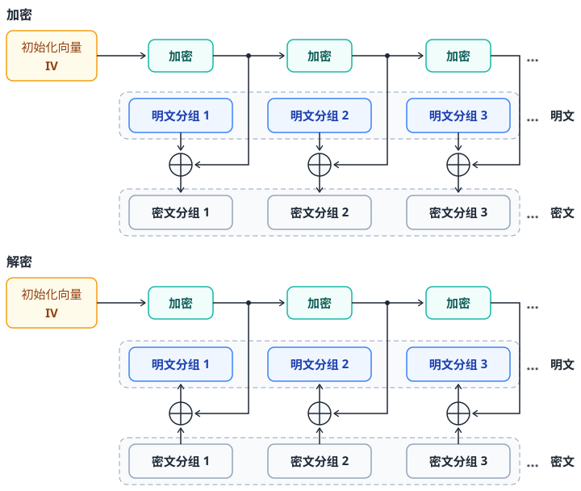
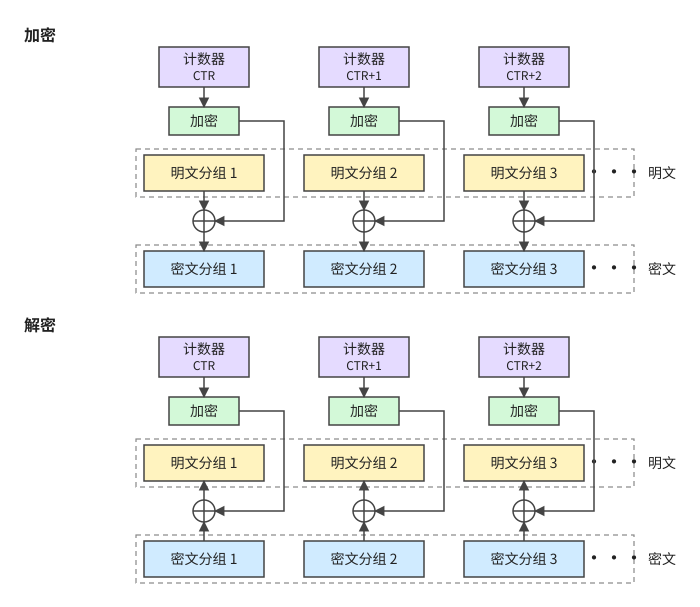

# 对称密钥密码与 DES


## 1 对称密钥密码

### 1.1 分组密码（Block Cipher）

把明文划分成若干个 $L$ bit 的**明文分组**，每个分组在同一个密钥 `key` 下用加密算法 $E$ 单独加密，得到 $m$ bit 的**密文分组**；解密时用解密算法 $D$ 逐组还原为 $L$ bit 的明文分组。

<svg xmlns="http://www.w3.org/2000/svg" viewBox="0 0 720 454" width="720" height="454" role="img" aria-label="分组密码：明文分组经加密得到密文分组，再经解密还原">
  <title>分组密码加密与解密结构</title>
  <desc>明文按每组 L bit 划分为独立分组，各自用同一个密钥 key 经加密算法 E 得到 m bit 密文分组，再经解密算法 D 逐组还原。</desc>
  <defs>
    <marker id="bc-k" viewBox="0 0 10 10" refX="8" refY="5" markerWidth="6" markerHeight="6" orient="auto">
      <path d="M2 1L8 5L2 9" fill="none" stroke="#1f2937" stroke-width="1.5" stroke-linecap="round" stroke-linejoin="round"/>
    </marker>
  </defs>
  <g font-family="'PingFang SC','Noto Sans SC','Microsoft YaHei',system-ui,sans-serif">
    <text x="8" y="45" text-anchor="start" font-size="15" font-weight="600" fill="#1e40af" paint-order="stroke" stroke="#f7f6f2" stroke-width="2" stroke-linejoin="round">明文分组</text>
    <text x="8" y="232" text-anchor="start" font-size="15" font-weight="600" fill="#1f2937" paint-order="stroke" stroke="#f7f6f2" stroke-width="2" stroke-linejoin="round">密文分组</text>
    <text x="8" y="419" text-anchor="start" font-size="15" font-weight="600" fill="#1e40af" paint-order="stroke" stroke="#f7f6f2" stroke-width="2" stroke-linejoin="round">明文分组</text>
    <rect x="200" y="8" width="160" height="64" rx="8" fill="#eff6ff" stroke="#3b82f6" stroke-width="1.5"/>
    <text x="280" y="33" text-anchor="middle" font-size="15" font-weight="600" fill="#1e40af">BLOCK 1</text>
    <text x="280" y="57" text-anchor="middle" font-size="15" font-weight="400" fill="#1e40af">L bit</text>
    <rect x="480" y="8" width="160" height="64" rx="8" fill="#eff6ff" stroke="#3b82f6" stroke-width="1.5"/>
    <text x="560" y="33" text-anchor="middle" font-size="15" font-weight="600" fill="#1e40af">BLOCK 2</text>
    <text x="560" y="57" text-anchor="middle" font-size="15" font-weight="400" fill="#1e40af">L bit</text>
    <rect x="200" y="106" width="160" height="44" rx="8" fill="#f0fdfa" stroke="#14b8a6" stroke-width="1.5"/>
    <text x="280" y="134" text-anchor="middle" font-size="15" font-weight="600" fill="#115e59">加密 E</text>
    <text x="142" y="134" text-anchor="middle" font-size="15" font-weight="600" fill="#92400e" paint-order="stroke" stroke="#f7f6f2" stroke-width="2" stroke-linejoin="round">key</text>
    <rect x="480" y="106" width="160" height="44" rx="8" fill="#f0fdfa" stroke="#14b8a6" stroke-width="1.5"/>
    <text x="560" y="134" text-anchor="middle" font-size="15" font-weight="600" fill="#115e59">加密 E</text>
    <text x="422" y="134" text-anchor="middle" font-size="15" font-weight="600" fill="#92400e" paint-order="stroke" stroke="#f7f6f2" stroke-width="2" stroke-linejoin="round">key</text>
    <rect x="200" y="194" width="160" height="64" rx="8" fill="#f8fafc" stroke="#94a3b8" stroke-width="1.5"/>
    <text x="280" y="219" text-anchor="middle" font-size="15" font-weight="600" fill="#1f2937">密文 1</text>
    <text x="280" y="243" text-anchor="middle" font-size="15" font-weight="400" fill="#4b5563">m bit</text>
    <rect x="480" y="194" width="160" height="64" rx="8" fill="#f8fafc" stroke="#94a3b8" stroke-width="1.5"/>
    <text x="560" y="219" text-anchor="middle" font-size="15" font-weight="600" fill="#1f2937">密文 2</text>
    <text x="560" y="243" text-anchor="middle" font-size="15" font-weight="400" fill="#4b5563">m bit</text>
    <rect x="200" y="292" width="160" height="44" rx="8" fill="#fef2f2" stroke="#ef4444" stroke-width="1.5"/>
    <text x="280" y="320" text-anchor="middle" font-size="15" font-weight="600" fill="#991b1b">解密 D</text>
    <text x="142" y="320" text-anchor="middle" font-size="15" font-weight="600" fill="#92400e" paint-order="stroke" stroke="#f7f6f2" stroke-width="2" stroke-linejoin="round">key</text>
    <rect x="480" y="292" width="160" height="44" rx="8" fill="#fef2f2" stroke="#ef4444" stroke-width="1.5"/>
    <text x="560" y="320" text-anchor="middle" font-size="15" font-weight="600" fill="#991b1b">解密 D</text>
    <text x="422" y="320" text-anchor="middle" font-size="15" font-weight="600" fill="#92400e" paint-order="stroke" stroke="#f7f6f2" stroke-width="2" stroke-linejoin="round">key</text>
    <rect x="200" y="382" width="160" height="64" rx="8" fill="#eff6ff" stroke="#3b82f6" stroke-width="1.5"/>
    <text x="280" y="407" text-anchor="middle" font-size="15" font-weight="600" fill="#1e40af">BLOCK 1</text>
    <text x="280" y="431" text-anchor="middle" font-size="15" font-weight="400" fill="#1e40af">L bit</text>
    <rect x="480" y="382" width="160" height="64" rx="8" fill="#eff6ff" stroke="#3b82f6" stroke-width="1.5"/>
    <text x="560" y="407" text-anchor="middle" font-size="15" font-weight="600" fill="#1e40af">BLOCK 2</text>
    <text x="560" y="431" text-anchor="middle" font-size="15" font-weight="400" fill="#1e40af">L bit</text>
    <text x="712" y="45" text-anchor="end" font-size="18" font-weight="600" fill="#4b5563" paint-order="stroke" stroke="#f7f6f2" stroke-width="2" stroke-linejoin="round">…</text>
    <text x="712" y="232" text-anchor="end" font-size="18" font-weight="600" fill="#4b5563" paint-order="stroke" stroke="#f7f6f2" stroke-width="2" stroke-linejoin="round">…</text>
    <text x="712" y="419" text-anchor="end" font-size="18" font-weight="600" fill="#4b5563" paint-order="stroke" stroke="#f7f6f2" stroke-width="2" stroke-linejoin="round">…</text>
    <g fill="none" stroke="#1f2937" stroke-width="1.5" marker-end="url(#bc-k)">
      <path d="M280 72 V100"/><path d="M560 72 V100"/>
      <path d="M280 150 V188"/><path d="M560 150 V188"/>
      <path d="M280 258 V286"/><path d="M560 258 V286"/>
      <path d="M280 336 V376"/><path d="M560 336 V376"/>
      <path d="M162 128 H194"/><path d="M442 128 H474"/>
      <path d="M162 314 H194"/><path d="M442 314 H474"/>
    </g>
  </g>
</svg>

#### 分组密码的工作模式

##### ECB：电子编码本模式（Electronic Codebook Mode）

各分组独立加密，互不影响：

$$
C_i = E_K(P_i),\qquad P_i = D_K(C_i)
$$
ECB（电子密码本）模式下，所有分组通常使用同一个密钥进行独立加密。



##### CBC：密码分组链接模式（Cipher Block Chaining Mode）

每个明文分组先与前一个密文分组异或再加密，第一组与初始化向量 IV 异或（$C_0 = IV$）：

$$
C_i = E_K(P_i \oplus C_{i-1}),\qquad P_i = D_K(C_i) \oplus C_{i-1}
$$



##### CFB：密码反馈模式（Cipher Feedback Mode）

先加密前一个密文分组（第一组加密 IV），再与明文异或得到密文。解密时用的仍是**加密**函数 $E_K$：

$$
C_i = P_i \oplus E_K(C_{i-1}),\qquad P_i = C_i \oplus E_K(C_{i-1}),\qquad C_0 = IV
$$



##### OFB：输出反馈模式（Output Feedback Mode）

加密器自成一条链，不断对前一次的输出再加密，产生密钥流，再与明文（密文）异或。加密与解密完全对称：

$$
O_0 = IV,\quad O_i = E_K(O_{i-1}),\qquad C_i = P_i \oplus O_i,\quad P_i = C_i \oplus O_i
$$



##### CTR：计数器模式（Counter Mode）

对递增的计数器（CTR、CTR+1、CTR+2、…）加密产生密钥流，再与明文（密文）异或。加密与解密完全对称：

$$
C_i = P_i \oplus E_K(\mathrm{CTR} + i - 1),\qquad P_i = C_i \oplus E_K(\mathrm{CTR} + i - 1)
$$



##### 并行化能力（笔记总结）

| | ECB | CBC | CFB | OFB | CTR |
| :-- | :-: | :-: | :-: | :-: | :-: |
| 加密可并行 | ✓ | ✗ | ✗ | ✗ | ✓ |
| 解密可并行 | ✓ | ✓ | — | ✗ | ✓ |
### 1.2 序列密码（Stream Cipher）

通过**伪随机数发生器**产生性能良好的伪随机序列（密钥流）。加密时把明文字节流与伪随机字节 $K$ 逐字节异或，解密时用同样的密钥生成相同的伪随机字节再异或一次，即可还原明文：

$$
c_i = m_i \oplus k_i,\qquad m_i = c_i \oplus k_i
$$

<svg xmlns="http://www.w3.org/2000/svg" viewBox="0 0 720 282" width="720" height="282" role="img" aria-label="序列密码：密钥经伪随机字节发生器产生密钥流，与明文字节流异或加密，再异或解密">
  <title>序列密码加密与解密原理</title>
  <desc>密钥经伪随机字节发生器生成伪随机密钥流 K，加密端与明文字节流逐字节异或得到密文，解密端再用相同密钥流异或还原明文。</desc>
  <defs>
    <marker id="sc-k" viewBox="0 0 10 10" refX="8" refY="5" markerWidth="6" markerHeight="6" orient="auto">
      <path d="M2 1L8 5L2 9" fill="none" stroke="#1f2937" stroke-width="1.5" stroke-linecap="round" stroke-linejoin="round"/>
    </marker>
  </defs>
  <g font-family="'PingFang SC','Noto Sans SC','Microsoft YaHei',system-ui,sans-serif">
    <text x="68" y="146" text-anchor="middle" font-size="15" font-weight="600" fill="#1e40af" paint-order="stroke" stroke="#f7f6f2" stroke-width="2" stroke-linejoin="round">明文字节流</text>
    <rect x="8" y="160" width="120" height="114" rx="8" fill="#eff6ff" stroke="#3b82f6" stroke-width="1.5"/>
    <text x="68" y="184" text-anchor="middle" font-size="15" font-weight="400" fill="#1e40af">10000110</text>
    <text x="68" y="208" text-anchor="middle" font-size="15" font-weight="400" fill="#1e40af">00011000</text>
    <text x="68" y="232" text-anchor="middle" font-size="15" font-weight="400" fill="#1e40af">01011100</text>
    <text x="68" y="256" text-anchor="middle" font-size="15" font-weight="600" fill="#1e40af">…</text>
    <text x="234" y="24" text-anchor="middle" font-size="15" font-weight="600" fill="#92400e" paint-order="stroke" stroke="#f7f6f2" stroke-width="2" stroke-linejoin="round">密钥 key</text>
    <rect x="148" y="54" width="172" height="46" rx="8" fill="#f0fdfa" stroke="#14b8a6" stroke-width="1.5"/>
    <text x="234" y="83" text-anchor="middle" font-size="15" font-weight="600" fill="#115e59">伪随机字节发生器</text>
    <text x="234" y="144" text-anchor="middle" font-size="15" font-weight="400" fill="#115e59" paint-order="stroke" stroke="#f7f6f2" stroke-width="2" stroke-linejoin="round">伪随机字节 K</text>
    <circle cx="234" cy="217" r="14" fill="#f8fafc" stroke="#1f2937" stroke-width="1.5"/>
    <path d="M220 217 H248 M234 203 V231" fill="none" stroke="#1f2937" stroke-width="1.5"/>
    <text x="234" y="262" text-anchor="middle" font-size="15" font-weight="600" fill="#1f2937" paint-order="stroke" stroke="#f7f6f2" stroke-width="2" stroke-linejoin="round">加密</text>
    <text x="360" y="222" text-anchor="middle" font-size="15" font-weight="600" fill="#991b1b" paint-order="stroke" stroke="#f7f6f2" stroke-width="2" stroke-linejoin="round">密文字节流 C</text>
    <text x="486" y="24" text-anchor="middle" font-size="15" font-weight="600" fill="#92400e" paint-order="stroke" stroke="#f7f6f2" stroke-width="2" stroke-linejoin="round">密钥 key</text>
    <rect x="400" y="54" width="172" height="46" rx="8" fill="#f0fdfa" stroke="#14b8a6" stroke-width="1.5"/>
    <text x="486" y="83" text-anchor="middle" font-size="15" font-weight="600" fill="#115e59">伪随机字节发生器</text>
    <text x="486" y="144" text-anchor="middle" font-size="15" font-weight="400" fill="#115e59" paint-order="stroke" stroke="#f7f6f2" stroke-width="2" stroke-linejoin="round">伪随机字节 K</text>
    <circle cx="486" cy="217" r="14" fill="#f8fafc" stroke="#1f2937" stroke-width="1.5"/>
    <path d="M472 217 H500 M486 203 V231" fill="none" stroke="#1f2937" stroke-width="1.5"/>
    <text x="486" y="262" text-anchor="middle" font-size="15" font-weight="600" fill="#1f2937" paint-order="stroke" stroke="#f7f6f2" stroke-width="2" stroke-linejoin="round">解密</text>
    <text x="652" y="146" text-anchor="middle" font-size="15" font-weight="600" fill="#1e40af" paint-order="stroke" stroke="#f7f6f2" stroke-width="2" stroke-linejoin="round">明文字节流</text>
    <rect x="592" y="160" width="120" height="114" rx="8" fill="#eff6ff" stroke="#3b82f6" stroke-width="1.5"/>
    <text x="652" y="184" text-anchor="middle" font-size="15" font-weight="400" fill="#1e40af">10000110</text>
    <text x="652" y="208" text-anchor="middle" font-size="15" font-weight="400" fill="#1e40af">00011000</text>
    <text x="652" y="232" text-anchor="middle" font-size="15" font-weight="400" fill="#1e40af">01011100</text>
    <text x="652" y="256" text-anchor="middle" font-size="15" font-weight="600" fill="#1e40af">…</text>
    <g fill="none" stroke="#1f2937" stroke-width="1.5" marker-end="url(#sc-k)">
      <path d="M128 217 H214"/>
      <path d="M234 32 V48"/><path d="M234 100 V124"/><path d="M234 156 V197"/>
      <path d="M248 217 H304"/><path d="M416 217 H466"/>
      <path d="M486 32 V48"/><path d="M486 100 V124"/><path d="M486 156 V197"/>
      <path d="M500 217 H586"/>
    </g>
  </g>
</svg>

---

## 2 数据加密标准 DES

### 2.1 DES 加密过程

输入 64 bit 明文数据 → 初始置换 IP → 密钥控制下的 16 轮迭代 → 交换左右 32 bit → 初始逆置换 $IP^{-1}$ → 输出 64 bit 数据。

<svg xmlns="http://www.w3.org/2000/svg" viewBox="0 0 720 172" width="720" height="172" role="img" aria-label="DES 加密总体流程">
  <title>DES 加密总体流程</title>
  <desc>展示 64 bit 明文数据经过初始置换 IP、16 轮迭代、左右 32 bit 交换及初始逆置换输出 64 bit 密文数据的总体流程。</desc>
  <defs>
    <marker id="deso-k" viewBox="0 0 10 10" refX="8" refY="5" markerWidth="6" markerHeight="6" orient="auto">
      <path d="M2 1L8 5L2 9" fill="none" stroke="#1f2937" stroke-width="1.5" stroke-linecap="round" stroke-linejoin="round"/>
    </marker>
  </defs>
  <g font-family="'PingFang SC','Noto Sans SC','Microsoft YaHei',system-ui,sans-serif">
    <rect x="8" y="8" width="212" height="52" rx="8" fill="#fffbeb" stroke="#f59e0b" stroke-width="1.5"/>
    <text x="114" y="40" text-anchor="middle" font-size="15" font-weight="600" fill="#92400e">输入 64 bit 明文数据</text>
    <rect x="254" y="8" width="212" height="52" rx="8" fill="#f0fdfa" stroke="#14b8a6" stroke-width="1.5"/>
    <text x="360" y="40" text-anchor="middle" font-size="15" font-weight="600" fill="#115e59">初始置换 IP</text>
    <rect x="500" y="8" width="212" height="52" rx="8" fill="#eff6ff" stroke="#3b82f6" stroke-width="1.5"/>
    <text x="606" y="40" text-anchor="middle" font-size="15" font-weight="600" fill="#1e40af">密钥控制下 16 轮迭代</text>
    <rect x="500" y="112" width="212" height="52" rx="8" fill="#fef2f2" stroke="#ef4444" stroke-width="1.5"/>
    <text x="606" y="144" text-anchor="middle" font-size="15" font-weight="600" fill="#991b1b">交换左右 32 bit</text>
    <rect x="254" y="112" width="212" height="52" rx="8" fill="#f0fdfa" stroke="#14b8a6" stroke-width="1.5"/>
    <text x="360" y="144" text-anchor="middle" font-size="15" font-weight="600" fill="#115e59">初始逆置换 IP⁻¹</text>
    <rect x="8" y="112" width="212" height="52" rx="8" fill="#fffbeb" stroke="#f59e0b" stroke-width="1.5"/>
    <text x="114" y="144" text-anchor="middle" font-size="15" font-weight="600" fill="#92400e">输出 64 bit 数据</text>
    <g fill="none" stroke="#1f2937" stroke-width="1.5" marker-end="url(#deso-k)">
      <path d="M220 34 H248"/><path d="M466 34 H494"/>
      <path d="M606 60 V106"/>
      <path d="M500 138 H472"/><path d="M254 138 H226"/>
    </g>
  </g>
</svg>

### 2.2 DES 加密算法：初始置换与 Feistel 网络结构

64 bit 明文先经**初始置换（IP 置换）**，再拆成左右两半 $L_0$、$R_0$（各 32 位），进入多轮 Feistel 结构。每一轮：

$$
L_i = R_{i-1},\qquad R_i = L_{i-1} \oplus f(R_{i-1}, K_i)
$$

DES 共进行 $n = 16$ 轮；最后交换左右两半，再做 $IP^{-1}$。

<svg xmlns="http://www.w3.org/2000/svg" viewBox="0 0 720 726" width="720" height="726" role="img" aria-label="Feistel 网络结构：每轮 R 经过 f 与子密钥后与 L 异或，左右交叉">
  <title>Feistel 网络多轮结构</title>
  <desc>64 位明文经过初始置换拆分为左右 32 位，每轮由 R 经轮函数 f 和子密钥 K 后与 L 异或并左右交叉，共迭代 n 轮。</desc>
  <defs>
    <marker id="fst-k" viewBox="0 0 10 10" refX="8" refY="5" markerWidth="6" markerHeight="6" orient="auto">
      <path d="M2 1L8 5L2 9" fill="none" stroke="#1f2937" stroke-width="1.5" stroke-linecap="round" stroke-linejoin="round"/>
    </marker>
  </defs>
  <g font-family="'PingFang SC','Noto Sans SC','Microsoft YaHei',system-ui,sans-serif">
    <text x="254" y="22" text-anchor="middle" font-size="15" font-weight="400" fill="#4b5563" paint-order="stroke" stroke="#f7f6f2" stroke-width="2" stroke-linejoin="round">64 bits</text>
    <line x1="254" y1="34" x2="254" y2="54" stroke="#1f2937" stroke-width="1.5" marker-end="url(#fst-k)"/>
    <rect x="144" y="60" width="220" height="44" rx="8" fill="#f0fdfa" stroke="#14b8a6" stroke-width="1.5"/>
    <text x="254" y="88" text-anchor="middle" font-size="15" font-weight="600" fill="#115e59">初始置换 (IP 置换)</text>
    <path d="M254 104 V120 H93 V132 M254 120 H415 V132" fill="none" stroke="#1f2937" stroke-width="1.5" marker-end="url(#fst-k)"/>
    <rect x="8" y="138" width="170" height="44" rx="8" fill="#fffbeb" stroke="#f59e0b" stroke-width="1.5"/>
    <text x="93" y="166" text-anchor="middle" font-size="15" font-weight="600" fill="#92400e">L₀ (32 位)</text>
    <rect x="330" y="138" width="170" height="44" rx="8" fill="#eff6ff" stroke="#3b82f6" stroke-width="1.5"/>
    <text x="415" y="166" text-anchor="middle" font-size="15" font-weight="600" fill="#1e40af">R₀ (32 位)</text>
    <text x="272" y="182" text-anchor="middle" font-size="15" font-weight="600" fill="#115e59" paint-order="stroke" stroke="#f7f6f2" stroke-width="2" stroke-linejoin="round">K₁</text>
    <line x1="272" y1="194" x2="272" y2="212" stroke="#1f2937" stroke-width="1.5" marker-end="url(#fst-k)"/>
    <rect x="234" y="216" width="76" height="40" rx="8" fill="#f0fdfa" stroke="#14b8a6" stroke-width="1.5"/>
    <text x="272" y="242" text-anchor="middle" font-size="16" font-weight="600" fill="#115e59">f</text>
    <circle cx="93" cy="236" r="14" fill="#f8fafc" stroke="#1f2937" stroke-width="1.5"/>
    <path d="M79 236 H107 M93 222 V250" fill="none" stroke="#1f2937" stroke-width="1.5"/>
    <g fill="none" stroke="#1f2937" stroke-width="1.5" marker-end="url(#fst-k)">
      <path d="M93 182 V216"/>
      <path d="M415 182 V236 H316"/>
      <path d="M234 236 H113"/>
      <path d="M415 182 V256 L93 276 V284"/>
      <path d="M93 250 V256 L415 276 V284"/>
    </g>
    <rect x="8" y="288" width="170" height="44" rx="8" fill="#fffbeb" stroke="#f59e0b" stroke-width="1.5"/>
    <text x="93" y="316" text-anchor="middle" font-size="15" font-weight="600" fill="#92400e">L₁ (32 位)</text>
    <rect x="330" y="288" width="170" height="44" rx="8" fill="#eff6ff" stroke="#3b82f6" stroke-width="1.5"/>
    <text x="415" y="316" text-anchor="middle" font-size="15" font-weight="600" fill="#1e40af">R₁ (32 位)</text>
    <text x="272" y="332" text-anchor="middle" font-size="15" font-weight="600" fill="#115e59" paint-order="stroke" stroke="#f7f6f2" stroke-width="2" stroke-linejoin="round">K₂</text>
    <line x1="272" y1="344" x2="272" y2="362" stroke="#1f2937" stroke-width="1.5" marker-end="url(#fst-k)"/>
    <rect x="234" y="366" width="76" height="40" rx="8" fill="#f0fdfa" stroke="#14b8a6" stroke-width="1.5"/>
    <text x="272" y="392" text-anchor="middle" font-size="16" font-weight="600" fill="#115e59">f</text>
    <circle cx="93" cy="386" r="14" fill="#f8fafc" stroke="#1f2937" stroke-width="1.5"/>
    <path d="M79 386 H107 M93 372 V400" fill="none" stroke="#1f2937" stroke-width="1.5"/>
    <g fill="none" stroke="#1f2937" stroke-width="1.5" marker-end="url(#fst-k)">
      <path d="M93 332 V366"/>
      <path d="M415 332 V386 H316"/>
      <path d="M234 386 H113"/>
      <path d="M415 332 V406 L93 426 V434"/>
      <path d="M93 400 V406 L415 426 V434"/>
    </g>
    <rect x="8" y="438" width="170" height="44" rx="8" fill="#fffbeb" stroke="#f59e0b" stroke-width="1.5"/>
    <text x="93" y="466" text-anchor="middle" font-size="15" font-weight="600" fill="#92400e">L₂ (32 位)</text>
    <rect x="330" y="438" width="170" height="44" rx="8" fill="#eff6ff" stroke="#3b82f6" stroke-width="1.5"/>
    <text x="415" y="466" text-anchor="middle" font-size="15" font-weight="600" fill="#1e40af">R₂ (32 位)</text>
    <path d="M93 482 V520 M415 482 V520" fill="none" stroke="#94a3b8" stroke-width="1.5" stroke-dasharray="4 4"/>
    <text x="272" y="568" text-anchor="middle" font-size="15" font-weight="600" fill="#115e59" paint-order="stroke" stroke="#f7f6f2" stroke-width="2" stroke-linejoin="round">Kₙ</text>
    <line x1="272" y1="580" x2="272" y2="598" stroke="#1f2937" stroke-width="1.5" marker-end="url(#fst-k)"/>
    <rect x="234" y="602" width="76" height="40" rx="8" fill="#f0fdfa" stroke="#14b8a6" stroke-width="1.5"/>
    <text x="272" y="628" text-anchor="middle" font-size="16" font-weight="600" fill="#115e59">f</text>
    <circle cx="93" cy="622" r="14" fill="#f8fafc" stroke="#1f2937" stroke-width="1.5"/>
    <path d="M79 622 H107 M93 608 V636" fill="none" stroke="#1f2937" stroke-width="1.5"/>
    <g fill="none" stroke="#1f2937" stroke-width="1.5" marker-end="url(#fst-k)">
      <path d="M93 568 V602"/>
      <path d="M415 568 V622 H316"/>
      <path d="M234 622 H113"/>
      <path d="M415 568 V642 L93 662 V670"/>
      <path d="M93 636 V642 L415 662 V670"/>
    </g>
    <rect x="8" y="674" width="170" height="44" rx="8" fill="#fffbeb" stroke="#f59e0b" stroke-width="1.5"/>
    <text x="93" y="702" text-anchor="middle" font-size="15" font-weight="600" fill="#92400e">Lₙ (32 位)</text>
    <rect x="330" y="674" width="170" height="44" rx="8" fill="#eff6ff" stroke="#3b82f6" stroke-width="1.5"/>
    <text x="415" y="702" text-anchor="middle" font-size="15" font-weight="600" fill="#1e40af">Rₙ (32 位)</text>
    <path d="M518 152 Q536 152 536 172 V412 Q536 428 552 428 Q536 428 536 444 V684 Q536 704 518 704" fill="none" stroke="#94a3b8" stroke-width="1.5"/>
    <text x="712" y="434" text-anchor="end" font-size="16" font-weight="600" fill="#1f2937" paint-order="stroke" stroke="#f7f6f2" stroke-width="2" stroke-linejoin="round">Feistel 网络结构</text>
  </g>
</svg>

**初始置换 IP 表**：将原位于第 58 个位置的数据放在第 1 个位置，第 50 个放在第 2 个位置，以此类推。

```
58 50 42 34 26 18 10  2
60 52 44 36 28 20 12  4
62 54 46 38 30 22 14  6
64 56 48 40 32 24 16  8
57 49 41 33 25 17  9  1
59 51 43 35 27 19 11  3
61 53 45 37 29 21 13  5
63 55 47 39 31 23 15  7
```

### 2.3 DES 加密轮函数 $f$

轮函数输入 32 bit 的 $R$ 和 48 bit 的子密钥 $K$，输出 32 bit：

$$
f(R, K) = P\big(S(E(R) \oplus K)\big)
$$

<svg xmlns="http://www.w3.org/2000/svg" viewBox="0 0 720 504" width="720" height="504" role="img" aria-label="DES 轮函数：E 扩展、与子密钥异或、八个 S 盒、P 盒">
  <title>DES 轮函数 f 内部结构</title>
  <desc>展示 32 位 R 经 E 扩展置换为 48 位并与 48 位子密钥 K 异或，经过 8 个 6 进 4 出的 S 盒压缩及 P 盒置换输出 32 位。</desc>
  <defs>
    <marker id="fbox-k" viewBox="0 0 10 10" refX="8" refY="5" markerWidth="6" markerHeight="6" orient="auto">
      <path d="M2 1L8 5L2 9" fill="none" stroke="#1f2937" stroke-width="1.5" stroke-linecap="round" stroke-linejoin="round"/>
    </marker>
  </defs>
  <g font-family="'PingFang SC','Noto Sans SC','Microsoft YaHei',system-ui,sans-serif">
    <rect x="200" y="8" width="160" height="44" rx="8" fill="#fffbeb" stroke="#f59e0b" stroke-width="1.5"/>
    <text x="280" y="36" text-anchor="middle" font-size="15" font-weight="600" fill="#92400e">R (32 比特)</text>
    <line x1="280" y1="52" x2="280" y2="68" stroke="#1f2937" stroke-width="1.5" marker-end="url(#fbox-k)"/>
    <rect x="176" y="74" width="208" height="44" rx="8" fill="#f0fdfa" stroke="#14b8a6" stroke-width="1.5"/>
    <text x="280" y="102" text-anchor="middle" font-size="15" font-weight="600" fill="#115e59">E 扩展置换 (32→48)</text>
    <line x1="280" y1="118" x2="280" y2="134" stroke="#1f2937" stroke-width="1.5" marker-end="url(#fbox-k)"/>
    <rect x="196" y="140" width="168" height="44" rx="8" fill="#eff6ff" stroke="#3b82f6" stroke-width="1.5"/>
    <text x="280" y="168" text-anchor="middle" font-size="15" font-weight="600" fill="#1e40af">Input (48 比特)</text>
    <rect x="444" y="140" width="168" height="44" rx="8" fill="#eff6ff" stroke="#3b82f6" stroke-width="1.5"/>
    <text x="528" y="168" text-anchor="middle" font-size="15" font-weight="600" fill="#1e40af">K (48 比特)</text>
    <circle cx="404" cy="218" r="14" fill="#f8fafc" stroke="#1f2937" stroke-width="1.5"/>
    <path d="M390 218 H418 M404 204 V232" fill="none" stroke="#1f2937" stroke-width="1.5"/>
    <path d="M280 184 V218 H384 M528 184 V218 H424" fill="none" stroke="#1f2937" stroke-width="1.5" marker-end="url(#fbox-k)"/>
    <path d="M404 232 V262 M103 262 H677" fill="none" stroke="#1f2937" stroke-width="1.5"/>
    <text x="8" y="312" text-anchor="start" font-size="15" font-weight="600" fill="#4b5563" paint-order="stroke" stroke="#f7f6f2" stroke-width="2" stroke-linejoin="round">6 → 4</text>
    <rect x="68" y="284" width="70" height="44" rx="6" fill="#fef2f2" stroke="#ef4444" stroke-width="1.5"/>
    <text x="103" y="312" text-anchor="middle" font-size="15" font-weight="600" fill="#991b1b">S₁</text>
    <line x1="103" y1="262" x2="103" y2="278" stroke="#1f2937" stroke-width="1.5" marker-end="url(#fbox-k)"/>
    <line x1="103" y1="328" x2="103" y2="354" stroke="#1f2937" stroke-width="1.5"/>
    <rect x="150" y="284" width="70" height="44" rx="6" fill="#fef2f2" stroke="#ef4444" stroke-width="1.5"/>
    <text x="185" y="312" text-anchor="middle" font-size="15" font-weight="600" fill="#991b1b">S₂</text>
    <line x1="185" y1="262" x2="185" y2="278" stroke="#1f2937" stroke-width="1.5" marker-end="url(#fbox-k)"/>
    <line x1="185" y1="328" x2="185" y2="354" stroke="#1f2937" stroke-width="1.5"/>
    <rect x="232" y="284" width="70" height="44" rx="6" fill="#fef2f2" stroke="#ef4444" stroke-width="1.5"/>
    <text x="267" y="312" text-anchor="middle" font-size="15" font-weight="600" fill="#991b1b">S₃</text>
    <line x1="267" y1="262" x2="267" y2="278" stroke="#1f2937" stroke-width="1.5" marker-end="url(#fbox-k)"/>
    <line x1="267" y1="328" x2="267" y2="354" stroke="#1f2937" stroke-width="1.5"/>
    <rect x="314" y="284" width="70" height="44" rx="6" fill="#fef2f2" stroke="#ef4444" stroke-width="1.5"/>
    <text x="349" y="312" text-anchor="middle" font-size="15" font-weight="600" fill="#991b1b">S₄</text>
    <line x1="349" y1="262" x2="349" y2="278" stroke="#1f2937" stroke-width="1.5" marker-end="url(#fbox-k)"/>
    <line x1="349" y1="328" x2="349" y2="354" stroke="#1f2937" stroke-width="1.5"/>
    <rect x="396" y="284" width="70" height="44" rx="6" fill="#fef2f2" stroke="#ef4444" stroke-width="1.5"/>
    <text x="431" y="312" text-anchor="middle" font-size="15" font-weight="600" fill="#991b1b">S₅</text>
    <line x1="431" y1="262" x2="431" y2="278" stroke="#1f2937" stroke-width="1.5" marker-end="url(#fbox-k)"/>
    <line x1="431" y1="328" x2="431" y2="354" stroke="#1f2937" stroke-width="1.5"/>
    <rect x="478" y="284" width="70" height="44" rx="6" fill="#fef2f2" stroke="#ef4444" stroke-width="1.5"/>
    <text x="513" y="312" text-anchor="middle" font-size="15" font-weight="600" fill="#991b1b">S₆</text>
    <line x1="513" y1="262" x2="513" y2="278" stroke="#1f2937" stroke-width="1.5" marker-end="url(#fbox-k)"/>
    <line x1="513" y1="328" x2="513" y2="354" stroke="#1f2937" stroke-width="1.5"/>
    <rect x="560" y="284" width="70" height="44" rx="6" fill="#fef2f2" stroke="#ef4444" stroke-width="1.5"/>
    <text x="595" y="312" text-anchor="middle" font-size="15" font-weight="600" fill="#991b1b">S₇</text>
    <line x1="595" y1="262" x2="595" y2="278" stroke="#1f2937" stroke-width="1.5" marker-end="url(#fbox-k)"/>
    <line x1="595" y1="328" x2="595" y2="354" stroke="#1f2937" stroke-width="1.5"/>
    <rect x="642" y="284" width="70" height="44" rx="6" fill="#fef2f2" stroke="#ef4444" stroke-width="1.5"/>
    <text x="677" y="312" text-anchor="middle" font-size="15" font-weight="600" fill="#991b1b">S₈</text>
    <line x1="677" y1="262" x2="677" y2="278" stroke="#1f2937" stroke-width="1.5" marker-end="url(#fbox-k)"/>
    <line x1="677" y1="328" x2="677" y2="354" stroke="#1f2937" stroke-width="1.5"/>
    <path d="M103 354 H677 M390 354 V376" fill="none" stroke="#1f2937" stroke-width="1.5"/>
    <line x1="390" y1="364" x2="390" y2="378" stroke="#1f2937" stroke-width="1.5" marker-end="url(#fbox-k)"/>
    <rect x="310" y="384" width="160" height="44" rx="8" fill="#f0fdfa" stroke="#14b8a6" stroke-width="1.5"/>
    <text x="390" y="412" text-anchor="middle" font-size="15" font-weight="600" fill="#115e59">P 盒</text>
    <text x="488" y="412" text-anchor="start" font-size="15" font-weight="400" fill="#4b5563" paint-order="stroke" stroke="#f7f6f2" stroke-width="2" stroke-linejoin="round">← 打乱其原有排列规律</text>
    <line x1="390" y1="428" x2="390" y2="446" stroke="#1f2937" stroke-width="1.5" marker-end="url(#fbox-k)"/>
    <rect x="310" y="452" width="160" height="44" rx="8" fill="#fffbeb" stroke="#f59e0b" stroke-width="1.5"/>
    <text x="390" y="480" text-anchor="middle" font-size="15" font-weight="600" fill="#92400e">32 比特输出</text>
  </g>
</svg>

**① 扩展置换 E（32 → 48 位）**：把 32 位按 4 位一组分成 8 组，每组前面补上前一组的最后一位、后面补上后一组的第一位（首尾循环相接），变成 8 组 × 6 位。

```
32 01 02 03 04 05
04 05 06 07 08 09
08 09 10 11 12 13
12 13 14 15 16 17
16 17 18 19 20 21
20 21 22 23 24 25
24 25 26 27 28 29
28 29 30 31 32 01
```

**② 与子密钥异或**：48 位的 Input 与 48 位的 $K$ 做 XOR。

**③ S 盒（6 → 4）**：48 位分成 8 组 6 位，分别送入 $S_1 \sim S_8$。对每个 S 盒，6 位输入 $B_1B_2B_3B_4B_5B_6$ 的查表过程为：

1. 取 $B_1B_6$（二进制）→ 转为十进制，作为**行号**
2. 取 $B_2B_3B_4B_5$（二进制）→ 转为十进制，作为**列号**
3. 在 S 盒中**查找**对应表项（十进制）→ 转为 4 位二进制，即 S 盒输出（笔记记作 $S_1S_2S_3S_4$）

8 个 S 盒共输出 $8 \times 4 = 32$ 位。

**④ P 盒置换**：打乱其原有排列规律，得到 32 比特输出。

```
16 07 20 21 29 12 28 17
01 15 23 26 05 18 31 10
02 08 24 14 32 27 03 09
19 13 30 06 22 11 04 25
```

**扩散与混淆**

- **扩散**：① P 盒重新排列；② 多轮 Feistel 叠加
- **混淆**：① S 盒查表映射；② E 扩展保证多处参与；③ XOR 异或操作让密钥影响高度掺杂

### 2.4 子密钥 $K_i$ 的生成

64 位密钥先经**置换选择 1（PC-1）**，**舍弃掉每 8 位数据的最后一位**（校验位），得到 56 位并拆成 $C_0$、$D_0$（各 28 位）。之后每一轮对 $C$、$D$ 分别**循环左移**，再合并后经**置换选择 2（PC-2）**压缩成 48 位子密钥 $k_i$。

<svg xmlns="http://www.w3.org/2000/svg" viewBox="0 0 720 578" width="720" height="578" role="img" aria-label="DES 子密钥生成：PC-1、循环左移、PC-2">
  <title>DES 子密钥 Ki 生成过程</title>
  <desc>64 位密钥经 PC-1 置换选择去校验位得 56 位 C0/D0，每轮分别循环左移后合并经 PC-2 压缩输出 48 位轮子密钥 k1 到 ki。</desc>
  <defs>
    <marker id="sk-k" viewBox="0 0 10 10" refX="8" refY="5" markerWidth="6" markerHeight="6" orient="auto">
      <path d="M2 1L8 5L2 9" fill="none" stroke="#1f2937" stroke-width="1.5" stroke-linecap="round" stroke-linejoin="round"/>
    </marker>
  </defs>
  <g font-family="'PingFang SC','Noto Sans SC','Microsoft YaHei',system-ui,sans-serif">
    <rect x="114" y="8" width="168" height="44" rx="8" fill="#fffbeb" stroke="#f59e0b" stroke-width="1.5"/>
    <text x="198" y="36" text-anchor="middle" font-size="15" font-weight="600" fill="#92400e">64 位密钥</text>
    <line x1="198" y1="52" x2="198" y2="68" stroke="#1f2937" stroke-width="1.5" marker-end="url(#sk-k)"/>
    <rect x="92" y="74" width="212" height="44" rx="8" fill="#f0fdfa" stroke="#14b8a6" stroke-width="1.5"/>
    <text x="198" y="102" text-anchor="middle" font-size="15" font-weight="600" fill="#115e59">置换选择 1 (PC-1)</text>
    <path d="M198 118 V136 H86 V148 M198 136 H310 V148" fill="none" stroke="#1f2937" stroke-width="1.5" marker-end="url(#sk-k)"/>
    <rect x="8" y="154" width="156" height="44" rx="8" fill="#eff6ff" stroke="#3b82f6" stroke-width="1.5"/>
    <text x="86" y="182" text-anchor="middle" font-size="15" font-weight="600" fill="#1e40af">C₀ (28 位)</text>
    <rect x="232" y="154" width="156" height="44" rx="8" fill="#eff6ff" stroke="#3b82f6" stroke-width="1.5"/>
    <text x="310" y="182" text-anchor="middle" font-size="15" font-weight="600" fill="#1e40af">D₀ (28 位)</text>
    <line x1="86" y1="198" x2="86" y2="216" stroke="#1f2937" stroke-width="1.5" marker-end="url(#sk-k)"/>
    <line x1="310" y1="198" x2="310" y2="216" stroke="#1f2937" stroke-width="1.5" marker-end="url(#sk-k)"/>
    <rect x="8" y="222" width="156" height="44" rx="8" fill="#fef2f2" stroke="#ef4444" stroke-width="1.5"/>
    <text x="86" y="250" text-anchor="middle" font-size="15" font-weight="600" fill="#991b1b">循环左移</text>
    <rect x="232" y="222" width="156" height="44" rx="8" fill="#fef2f2" stroke="#ef4444" stroke-width="1.5"/>
    <text x="310" y="250" text-anchor="middle" font-size="15" font-weight="600" fill="#991b1b">循环左移</text>
    <line x1="86" y1="266" x2="86" y2="284" stroke="#1f2937" stroke-width="1.5" marker-end="url(#sk-k)"/>
    <line x1="310" y1="266" x2="310" y2="284" stroke="#1f2937" stroke-width="1.5" marker-end="url(#sk-k)"/>
    <rect x="8" y="290" width="156" height="44" rx="8" fill="#eff6ff" stroke="#3b82f6" stroke-width="1.5"/>
    <text x="86" y="318" text-anchor="middle" font-size="15" font-weight="600" fill="#1e40af">C₁ (28 位)</text>
    <rect x="232" y="290" width="156" height="44" rx="8" fill="#eff6ff" stroke="#3b82f6" stroke-width="1.5"/>
    <text x="310" y="318" text-anchor="middle" font-size="15" font-weight="600" fill="#1e40af">D₁ (28 位)</text>
    <path d="M86 334 V364 H456 M310 334 V364" fill="none" stroke="#1f2937" stroke-width="1.5" marker-end="url(#sk-k)"/>
    <text x="424" y="346" text-anchor="middle" font-size="15" font-weight="400" fill="#4b5563" paint-order="stroke" stroke="#f7f6f2" stroke-width="2" stroke-linejoin="round">56 位</text>
    <rect x="462" y="342" width="160" height="44" rx="8" fill="#f0fdfa" stroke="#14b8a6" stroke-width="1.5"/>
    <text x="542" y="370" text-anchor="middle" font-size="15" font-weight="600" fill="#115e59">PC-2 压缩</text>
    <line x1="622" y1="364" x2="640" y2="364" stroke="#1f2937" stroke-width="1.5" marker-end="url(#sk-k)"/>
    <text x="648" y="370" text-anchor="start" font-size="15" font-weight="600" fill="#1f2937" paint-order="stroke" stroke="#f7f6f2" stroke-width="2" stroke-linejoin="round">k₁ (48位)</text>
    <line x1="86" y1="364" x2="86" y2="408" stroke="#1f2937" stroke-width="1.5" stroke-dasharray="4 4" marker-end="url(#sk-k)"/>
    <line x1="310" y1="364" x2="310" y2="408" stroke="#1f2937" stroke-width="1.5" stroke-dasharray="4 4" marker-end="url(#sk-k)"/>
    <rect x="8" y="414" width="156" height="44" rx="8" fill="#fef2f2" stroke="#ef4444" stroke-width="1.5"/>
    <text x="86" y="442" text-anchor="middle" font-size="15" font-weight="600" fill="#991b1b">循环左移</text>
    <rect x="232" y="414" width="156" height="44" rx="8" fill="#fef2f2" stroke="#ef4444" stroke-width="1.5"/>
    <text x="310" y="442" text-anchor="middle" font-size="15" font-weight="600" fill="#991b1b">循环左移</text>
    <line x1="86" y1="458" x2="86" y2="476" stroke="#1f2937" stroke-width="1.5" marker-end="url(#sk-k)"/>
    <line x1="310" y1="458" x2="310" y2="476" stroke="#1f2937" stroke-width="1.5" marker-end="url(#sk-k)"/>
    <rect x="8" y="482" width="156" height="44" rx="8" fill="#eff6ff" stroke="#3b82f6" stroke-width="1.5"/>
    <text x="86" y="510" text-anchor="middle" font-size="15" font-weight="600" fill="#1e40af">Cᵢ (28 位)</text>
    <rect x="232" y="482" width="156" height="44" rx="8" fill="#eff6ff" stroke="#3b82f6" stroke-width="1.5"/>
    <text x="310" y="510" text-anchor="middle" font-size="15" font-weight="600" fill="#1e40af">Dᵢ (28 位)</text>
    <path d="M86 526 V548 H456 M310 526 V548" fill="none" stroke="#1f2937" stroke-width="1.5" marker-end="url(#sk-k)"/>
    <text x="424" y="532" text-anchor="middle" font-size="15" font-weight="400" fill="#4b5563" paint-order="stroke" stroke="#f7f6f2" stroke-width="2" stroke-linejoin="round">56 位</text>
    <rect x="462" y="526" width="160" height="44" rx="8" fill="#f0fdfa" stroke="#14b8a6" stroke-width="1.5"/>
    <text x="542" y="554" text-anchor="middle" font-size="15" font-weight="600" fill="#115e59">PC-2 压缩</text>
    <line x1="622" y1="548" x2="640" y2="548" stroke="#1f2937" stroke-width="1.5" marker-end="url(#sk-k)"/>
    <text x="648" y="554" text-anchor="start" font-size="15" font-weight="600" fill="#1f2937" paint-order="stroke" stroke="#f7f6f2" stroke-width="2" stroke-linejoin="round">kᵢ (48位)</text>
  </g>
</svg>

**置换选择 1（PC-1）**：第 57 位比特被放到第 1 位，以此类推；每 8 位数据的最后一位（第 8、16、…、64 位）被舍弃。

```
57 49 41 33 25 17  9
 1 58 50 42 34 26 18
10  2 59 51 43 35 27
19 11  3 60 52 44 36
63 55 47 39 31 23 15
 7 62 54 46 38 30 22
14  6 61 53 45 37 29
21 13  5 28 20 12  4
```

**循环左移位数（密钥表的计算逻辑）**：第 1、2、9、16 轮左移 1 位，其他轮左移 2 位。

| 轮数 | 1 | 2 | 3 | 4 | 5 | 6 | 7 | 8 | 9 | 10 | 11 | 12 | 13 | 14 | 15 | 16 |
| :-: | :-: | :-: | :-: | :-: | :-: | :-: | :-: | :-: | :-: | :-: | :-: | :-: | :-: | :-: | :-: | :-: |
| 左移位数 | 1 | 1 | 2 | 2 | 2 | 2 | 2 | 2 | 1 | 2 | 2 | 2 | 2 | 2 | 2 | 1 |

**置换选择 2（PC-2）**：56 位 → 48 位。

```
14 17 11 24  1  5
 3 28 15  6 21 10
23 19 12  4 26  8
16  7 27 20 13  2
41 52 31 37 47 55
30 40 51 45 33 48
44 49 39 56 34 53
46 42 50 36 29 32
```

---

## 3 三重 DES

使用 3 个不同的密钥对数据块进行三次加密，三个密钥相互独立。

<svg xmlns="http://www.w3.org/2000/svg" viewBox="0 0 720 104" width="720" height="104" role="img" aria-label="三重 DES：明文依次经三个独立密钥加密得到密文">
  <title>三重 DES 加密结构</title>
  <desc>明文 m 依次经过三个相互独立密钥 K1、K2、K3 的加密运算输出密文 C。</desc>
  <defs>
    <marker id="tdes-k" viewBox="0 0 10 10" refX="8" refY="5" markerWidth="6" markerHeight="6" orient="auto">
      <path d="M2 1L8 5L2 9" fill="none" stroke="#1f2937" stroke-width="1.5" stroke-linecap="round" stroke-linejoin="round"/>
    </marker>
  </defs>
  <g font-family="'PingFang SC','Noto Sans SC','Microsoft YaHei',system-ui,sans-serif">
    <rect x="8" y="8" width="112" height="52" rx="8" fill="#fffbeb" stroke="#f59e0b" stroke-width="1.5"/>
    <text x="64" y="40" text-anchor="middle" font-size="15" font-weight="600" fill="#92400e">明文 m</text>
    <line x1="120" y1="34" x2="138" y2="34" stroke="#1f2937" stroke-width="1.5" marker-end="url(#tdes-k)"/>
    <rect x="144" y="8" width="128" height="52" rx="8" fill="#f0fdfa" stroke="#14b8a6" stroke-width="1.5"/>
    <text x="208" y="40" text-anchor="middle" font-size="15" font-weight="600" fill="#115e59">加密 (K₁)</text>
    <line x1="272" y1="34" x2="290" y2="34" stroke="#1f2937" stroke-width="1.5" marker-end="url(#tdes-k)"/>
    <rect x="296" y="8" width="128" height="52" rx="8" fill="#f0fdfa" stroke="#14b8a6" stroke-width="1.5"/>
    <text x="360" y="40" text-anchor="middle" font-size="15" font-weight="600" fill="#115e59">加密 (K₂)</text>
    <line x1="424" y1="34" x2="442" y2="34" stroke="#1f2937" stroke-width="1.5" marker-end="url(#tdes-k)"/>
    <rect x="448" y="8" width="128" height="52" rx="8" fill="#f0fdfa" stroke="#14b8a6" stroke-width="1.5"/>
    <text x="512" y="40" text-anchor="middle" font-size="15" font-weight="600" fill="#115e59">加密 (K₃)</text>
    <line x1="576" y1="34" x2="594" y2="34" stroke="#1f2937" stroke-width="1.5" marker-end="url(#tdes-k)"/>
    <rect x="600" y="8" width="112" height="52" rx="8" fill="#eff6ff" stroke="#3b82f6" stroke-width="1.5"/>
    <text x="656" y="40" text-anchor="middle" font-size="15" font-weight="600" fill="#1e40af">密文 C</text>
    <text x="360" y="92" text-anchor="middle" font-size="15" font-weight="400" fill="#4b5563" paint-order="stroke" stroke="#f7f6f2" stroke-width="2" stroke-linejoin="round">三个密钥 K₁、K₂、K₃ 相互独立</text>
  </g>
</svg>