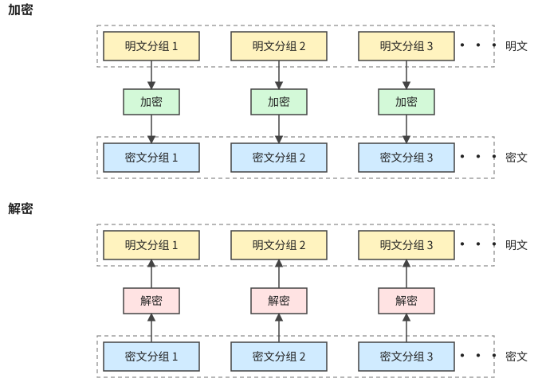
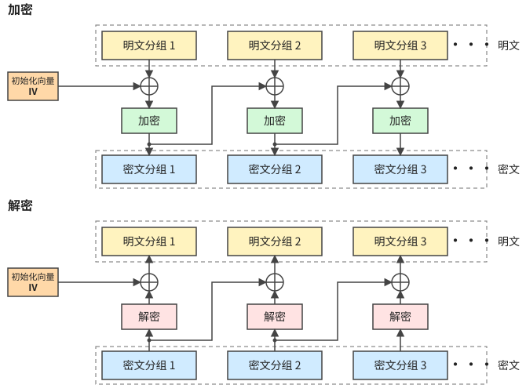
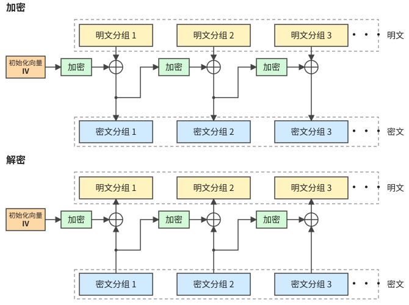
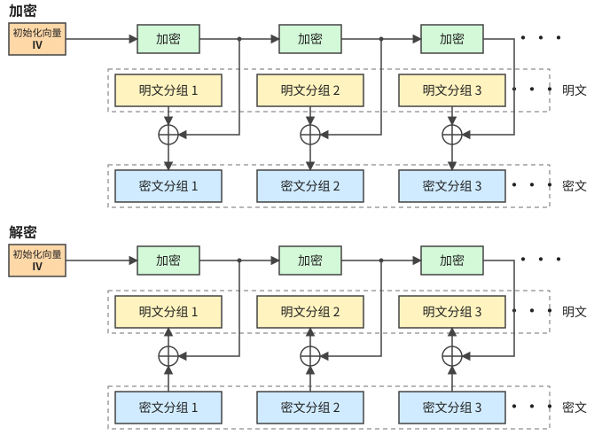
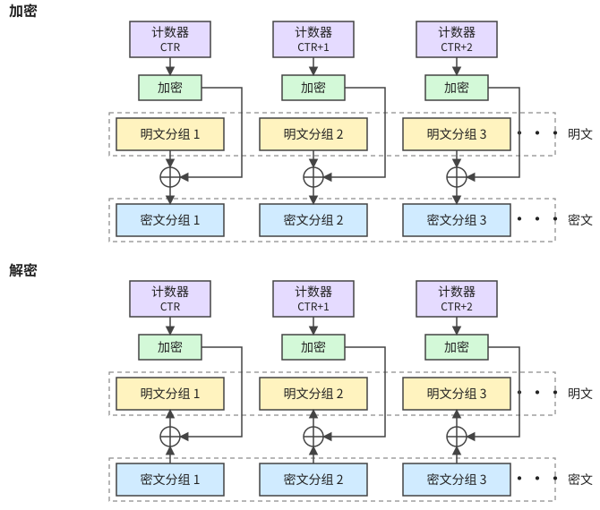

# b：对称密钥密码与 DES


## 1 对称密钥密码

### 1.1 分组密码（Block Cipher）

把明文划分成若干个 $L$ bit 的**明文分组**，每个分组在同一个密钥 `key` 下用加密算法 $E$ 单独加密，得到 $m$ bit 的**密文分组**；解密时用解密算法 $D$ 逐组还原为 $L$ bit 的明文分组。

<svg xmlns="http://www.w3.org/2000/svg" viewBox="0 0 600 390" width="600" role="img" aria-label="分组密码：明文分组经加密得到密文分组，再经解密还原">
<style>
text{font-family:'PingFang SC','Microsoft YaHei','Noto Sans CJK SC',sans-serif;fill:#222;text-anchor:middle;font-size:14px}
.t{font-size:12px}
.bx{fill:#fff;stroke:#444;stroke-width:1.5}
.y{fill:#fff3bf}.g{fill:#d3f9d8}.bl{fill:#d0ebff}.p{fill:#ffe3e3}
</style>
<defs><marker id="a1" viewBox="0 0 10 10" refX="9" refY="5" markerWidth="7" markerHeight="7" orient="auto"><path d="M0 0L10 5L0 10z" fill="#444"/></marker></defs>
<rect width="600" height="390" fill="#fff"/>
<text x="50" y="49">明文分组</text>
<text x="50" y="199">密文分组</text>
<text x="50" y="349">明文分组</text>
<rect class="bx y" x="150" y="20" width="120" height="48"/>
<text x="210" y="42">BLOCK 1</text><text class="t" x="210" y="60">L bit</text>
<rect class="bx y" x="380" y="20" width="120" height="48"/>
<text x="440" y="42">BLOCK 2</text><text class="t" x="440" y="60">L bit</text>
<rect class="bx g" x="150" y="102" width="120" height="34"/>
<text x="210" y="124">加密 E</text>
<rect class="bx g" x="380" y="102" width="120" height="34"/>
<text x="440" y="124">加密 E</text>
<rect class="bx bl" x="150" y="170" width="120" height="48"/>
<text x="210" y="192">密文 1</text><text class="t" x="210" y="210">m bit</text>
<rect class="bx bl" x="380" y="170" width="120" height="48"/>
<text x="440" y="192">密文 2</text><text class="t" x="440" y="210">m bit</text>
<rect class="bx p" x="150" y="252" width="120" height="34"/>
<text x="210" y="274">解密 D</text>
<rect class="bx p" x="380" y="252" width="120" height="34"/>
<text x="440" y="274">解密 D</text>
<rect class="bx y" x="150" y="320" width="120" height="48"/>
<text x="210" y="342">BLOCK 1</text><text class="t" x="210" y="360">L bit</text>
<rect class="bx y" x="380" y="320" width="120" height="48"/>
<text x="440" y="342">BLOCK 2</text><text class="t" x="440" y="360">L bit</text>
<text x="110" y="124">key</text><text x="345" y="124">key</text>
<text x="110" y="274">key</text><text x="345" y="274">key</text>
<text x="550" y="50" style="font-size:20px">···</text>
<text x="550" y="200" style="font-size:20px">···</text>
<text x="550" y="350" style="font-size:20px">···</text>
<g fill="none" stroke="#444" stroke-width="1.5" marker-end="url(#a1)">
<path d="M210 68V102"/><path d="M440 68V102"/>
<path d="M210 136V170"/><path d="M440 136V170"/>
<path d="M210 218V252"/><path d="M440 218V252"/>
<path d="M210 286V320"/><path d="M440 286V320"/>
<path d="M126 119H150"/><path d="M362 119H380"/>
<path d="M126 269H150"/><path d="M362 269H380"/>
</g>
</svg>

#### 分组密码的工作模式

##### ECB：电子编码本模式（Electronic Codebook Mode）

各分组独立加密，互不影响：

$$
C_i = E_K(P_i),\qquad P_i = D_K(C_i)
$$
ECB（电子密码本）模式下，所有分组通常使用同一个密钥进行独立加密。



##### CBC：密码分组链接模式（Cipher Block Chaining Mode）

每个明文分组先与前一个密文分组异或再加密，第一组与初始化向量 IV 异或（$C_0 = IV$）：

$$
C_i = E_K(P_i \oplus C_{i-1}),\qquad P_i = D_K(C_i) \oplus C_{i-1}
$$



##### CFB：密码反馈模式（Cipher Feedback Mode）

先加密前一个密文分组（第一组加密 IV），再与明文异或得到密文。解密时用的仍是**加密**函数 $E_K$：

$$
C_i = P_i \oplus E_K(C_{i-1}),\qquad P_i = C_i \oplus E_K(C_{i-1}),\qquad C_0 = IV
$$



##### OFB：输出反馈模式（Output Feedback Mode）

加密器自成一条链，不断对前一次的输出再加密，产生密钥流，再与明文（密文）异或。加密与解密完全对称：

$$
O_0 = IV,\quad O_i = E_K(O_{i-1}),\qquad C_i = P_i \oplus O_i,\quad P_i = C_i \oplus O_i
$$



##### CTR：计数器模式（Counter Mode）

对递增的计数器（CTR、CTR+1、CTR+2、…）加密产生密钥流，再与明文（密文）异或。加密与解密完全对称：

$$
C_i = P_i \oplus E_K(\mathrm{CTR} + i - 1),\qquad P_i = C_i \oplus E_K(\mathrm{CTR} + i - 1)
$$



##### 并行化能力（笔记总结）

| | ECB | CBC | CFB | OFB | CTR |
| :-- | :-: | :-: | :-: | :-: | :-: |
| 加密可并行 | ✓ | ✗ | ✗ | ✗ | ✓ |
| 解密可并行 | ✓ | ✓ | — | ✗ | ✓ |
### 1.2 序列密码（Stream Cipher）

通过**伪随机数发生器**产生性能良好的伪随机序列（密钥流）。加密时把明文字节流与伪随机字节 $K$ 逐字节异或，解密时用同样的密钥生成相同的伪随机字节再异或一次，即可还原明文：

$$
c_i = m_i \oplus k_i,\qquad m_i = c_i \oplus k_i
$$

<svg xmlns="http://www.w3.org/2000/svg" viewBox="0 0 760 300" width="760" role="img" aria-label="序列密码：密钥经伪随机字节发生器产生密钥流，与明文字节流异或加密，再异或解密">
<style>
text{font-family:'PingFang SC','Microsoft YaHei','Noto Sans CJK SC',sans-serif;fill:#222;text-anchor:middle;font-size:14px}
.m{font-family:ui-monospace,Menlo,Consolas,monospace;font-size:13px}
.bx{fill:#fff;stroke:#444;stroke-width:1.5}
.y{fill:#fff3bf}.g{fill:#d3f9d8}.bl{fill:#d0ebff}
</style>
<defs><marker id="a2" viewBox="0 0 10 10" refX="9" refY="5" markerWidth="7" markerHeight="7" orient="auto"><path d="M0 0L10 5L0 10z" fill="#444"/></marker></defs>
<rect width="760" height="300" fill="#fff"/>
<text x="85" y="140">明文字节流</text>
<rect class="bx y" x="30" y="150" width="110" height="100"/>
<text class="m" x="85" y="174">10000110</text>
<text class="m" x="85" y="198">00011000</text>
<text class="m" x="85" y="222">01011100</text>
<text class="m" x="85" y="244">···</text>
<text x="240" y="20">密钥 key</text>
<rect class="bx g" x="170" y="44" width="140" height="34"/>
<text x="240" y="66">伪随机字节发生器</text>
<text x="240" y="124">伪随机字节 K</text>
<circle cx="240" cy="215" r="14" class="bx"/>
<path d="M226 215H254M240 201V229" stroke="#444" stroke-width="1.5" fill="none"/>
<text x="240" y="252">加密</text>
<text x="370" y="220">密文字节流 C</text>
<text x="520" y="20">密钥 key</text>
<rect class="bx g" x="450" y="44" width="140" height="34"/>
<text x="520" y="66">伪随机字节发生器</text>
<text x="520" y="124">伪随机字节 K</text>
<circle cx="520" cy="215" r="14" class="bx"/>
<path d="M506 215H534M520 201V229" stroke="#444" stroke-width="1.5" fill="none"/>
<text x="520" y="252">解密</text>
<text x="675" y="140">明文字节流</text>
<rect class="bx y" x="620" y="150" width="110" height="100"/>
<text class="m" x="675" y="174">10000110</text>
<text class="m" x="675" y="198">00011000</text>
<text class="m" x="675" y="222">01011100</text>
<text class="m" x="675" y="244">···</text>
<g fill="none" stroke="#444" stroke-width="1.5" marker-end="url(#a2)">
<path d="M14 150V250"/><path d="M746 150V250"/>
<path d="M140 215H224"/>
<path d="M240 26V44"/><path d="M240 78V106"/><path d="M240 132V200"/>
<path d="M254 215H312"/><path d="M428 215H506"/>
<path d="M520 26V44"/><path d="M520 78V106"/><path d="M520 132V200"/>
<path d="M534 215H620"/>
</g>
</svg>

---

## 2 数据加密标准 DES

### 2.1 DES 加密过程

输入 64 bit 明文数据 → 初始置换 IP → 密钥控制下的 16 轮迭代 → 交换左右 32 bit → 初始逆置换 $IP^{-1}$ → 输出 64 bit 数据。

<svg xmlns="http://www.w3.org/2000/svg" viewBox="0 0 750 180" width="750" role="img" aria-label="DES 加密总体流程">
<style>
text{font-family:'PingFang SC','Microsoft YaHei','Noto Sans CJK SC',sans-serif;fill:#222;text-anchor:middle;font-size:14px}
.bx{fill:#fff;stroke:#444;stroke-width:1.5}
.y{fill:#fff3bf}.g{fill:#d3f9d8}.bl{fill:#d0ebff}.p{fill:#ffe3e3}
</style>
<defs><marker id="a3" viewBox="0 0 10 10" refX="9" refY="5" markerWidth="7" markerHeight="7" orient="auto"><path d="M0 0L10 5L0 10z" fill="#444"/></marker></defs>
<rect width="750" height="180" fill="#fff"/>
<rect class="bx y" x="20" y="20" width="190" height="44"/>
<text x="115" y="47">输入 64 bit 明文数据</text>
<rect class="bx g" x="280" y="20" width="190" height="44"/>
<text x="375" y="47">初始置换 IP</text>
<rect class="bx bl" x="540" y="20" width="190" height="44"/>
<text x="635" y="47">密钥控制下 16 轮迭代</text>
<rect class="bx p" x="540" y="116" width="190" height="44"/>
<text x="635" y="143">交换左右 32 bit</text>
<rect class="bx g" x="280" y="116" width="190" height="44"/>
<text x="375" y="143">初始逆置换 IP⁻¹</text>
<rect class="bx y" x="20" y="116" width="190" height="44"/>
<text x="115" y="143">输出 64 bit 数据</text>
<g fill="none" stroke="#444" stroke-width="1.5" marker-end="url(#a3)">
<path d="M210 42H280"/><path d="M470 42H540"/>
<path d="M635 64V116"/>
<path d="M540 138H470"/><path d="M280 138H210"/>
</g>
</svg>

### 2.2 DES 加密算法：初始置换与 Feistel 网络结构

64 bit 明文先经**初始置换（IP 置换）**，再拆成左右两半 $L_0$、$R_0$（各 32 位），进入多轮 Feistel 结构。每一轮：

$$
L_i = R_{i-1},\qquad R_i = L_{i-1} \oplus f(R_{i-1}, K_i)
$$

DES 共进行 $n = 16$ 轮；最后交换左右两半，再做 $IP^{-1}$。

<svg xmlns="http://www.w3.org/2000/svg" viewBox="0 0 680 620" width="680" role="img" aria-label="Feistel 网络结构：每轮 R 经过 f 与子密钥后与 L 异或，左右交叉">
<style>
text{font-family:'PingFang SC','Microsoft YaHei','Noto Sans CJK SC',sans-serif;fill:#222;text-anchor:middle;font-size:14px}
.t{font-size:12px}
.s{text-anchor:start;font-size:16px}
.bx{fill:#fff;stroke:#444;stroke-width:1.5}
.y{fill:#fff3bf}.g{fill:#d3f9d8}.bl{fill:#d0ebff}.p{fill:#ffe3e3}
</style>
<defs><marker id="a4" viewBox="0 0 10 10" refX="9" refY="5" markerWidth="7" markerHeight="7" orient="auto"><path d="M0 0L10 5L0 10z" fill="#444"/></marker></defs>
<rect width="680" height="620" fill="#fff"/>
<text class="t" x="285" y="14">64 bits</text>
<rect class="bx g" x="185" y="30" width="200" height="32"/>
<text x="285" y="51">初始置换 (IP 置换)</text>
<rect class="bx y" x="95" y="98" width="150" height="32"/><text x="170" y="119">L₀ (32 位)</text>
<rect class="bx bl" x="325" y="98" width="150" height="32"/><text x="400" y="119">R₀ (32 位)</text>
<rect class="bx g" x="275" y="174" width="50" height="28"/><text x="300" y="193">f</text>
<text x="300" y="154">K₁</text>
<circle cx="170" cy="188" r="11" class="bx"/><path d="M159 188H181M170 177V199" stroke="#444" stroke-width="1.5" fill="none"/>
<rect class="bx y" x="95" y="242" width="150" height="32"/><text x="170" y="263">L₁ (32 位)</text>
<rect class="bx bl" x="325" y="242" width="150" height="32"/><text x="400" y="263">R₁ (32 位)</text>
<rect class="bx g" x="275" y="318" width="50" height="28"/><text x="300" y="337">f</text>
<text x="300" y="298">K₂</text>
<circle cx="170" cy="332" r="11" class="bx"/><path d="M159 332H181M170 321V343" stroke="#444" stroke-width="1.5" fill="none"/>
<rect class="bx y" x="95" y="386" width="150" height="32"/><text x="170" y="407">L₂ (32 位)</text>
<rect class="bx bl" x="325" y="386" width="150" height="32"/><text x="400" y="407">R₂ (32 位)</text>
<rect class="bx g" x="275" y="502" width="50" height="28"/><text x="300" y="521">f</text>
<text x="300" y="482">Kₙ</text>
<circle cx="170" cy="516" r="11" class="bx"/><path d="M159 516H181M170 505V527" stroke="#444" stroke-width="1.5" fill="none"/>
<rect class="bx y" x="95" y="570" width="150" height="32"/><text x="170" y="591">Lₙ (32 位)</text>
<rect class="bx bl" x="325" y="570" width="150" height="32"/><text x="400" y="591">Rₙ (32 位)</text>
<path d="M170 418V458M400 418V458" stroke="#444" stroke-width="1.5" stroke-dasharray="4 4" fill="none"/>
<path d="M516 114Q516 98 500 98M516 114V336Q516 350 530 350Q516 350 516 364V586Q516 602 500 602" stroke="#444" stroke-width="1.5" fill="none"/>
<text class="s" x="542" y="356">Feistel 网络结构</text>
<g fill="none" stroke="#444" stroke-width="1.5" marker-end="url(#a4)">
<path d="M285 18V30"/>
<path d="M285 62V80H170V98"/><path d="M285 80H400V98"/>
<path d="M300 158V174"/><path d="M170 130V177"/><path d="M275 188H181"/><path d="M400 188H325"/>
<path d="M400 130V212L170 228V242"/><path d="M170 199V212L400 228V242"/>
<path d="M300 302V318"/><path d="M170 274V321"/><path d="M275 332H181"/><path d="M400 332H325"/>
<path d="M400 274V356L170 372V386"/><path d="M170 343V356L400 372V386"/>
<path d="M300 486V502"/><path d="M170 458V505"/><path d="M275 516H181"/><path d="M400 516H325"/>
<path d="M400 458V540L170 556V570"/><path d="M170 527V540L400 556V570"/>
</g>
</svg>

**初始置换 IP 表**：将原位于第 58 个位置的数据放在第 1 个位置，第 50 个放在第 2 个位置，以此类推。

```
58 50 42 34 26 18 10  2
60 52 44 36 28 20 12  4
62 54 46 38 30 22 14  6
64 56 48 40 32 24 16  8
57 49 41 33 25 17  9  1
59 51 43 35 27 19 11  3
61 53 45 37 29 21 13  5
63 55 47 39 31 23 15  7
```

### 2.3 DES 加密轮函数 $f$

轮函数输入 32 bit 的 $R$ 和 48 bit 的子密钥 $K$，输出 32 bit：

$$
f(R, K) = P\big(S(E(R) \oplus K)\big)
$$

<svg xmlns="http://www.w3.org/2000/svg" viewBox="0 0 700 480" width="700" role="img" aria-label="DES 轮函数：E 扩展、与子密钥异或、八个 S 盒、P 盒">
<style>
text{font-family:'PingFang SC','Microsoft YaHei','Noto Sans CJK SC',sans-serif;fill:#222;text-anchor:middle;font-size:14px}
.t{font-size:13px}
.s{text-anchor:start}
.bx{fill:#fff;stroke:#444;stroke-width:1.5}
.y{fill:#fff3bf}.g{fill:#d3f9d8}.bl{fill:#d0ebff}.p{fill:#ffe3e3}
</style>
<defs><marker id="a5" viewBox="0 0 10 10" refX="9" refY="5" markerWidth="7" markerHeight="7" orient="auto"><path d="M0 0L10 5L0 10z" fill="#444"/></marker></defs>
<rect width="700" height="480" fill="#fff"/>
<rect class="bx y" x="205" y="14" width="130" height="32"/><text x="270" y="35">R (32 比特)</text>
<rect class="bx g" x="170" y="70" width="200" height="32"/><text x="270" y="91">E 扩展置换 (32→48)</text>
<rect class="bx bl" x="195" y="126" width="150" height="32"/><text x="270" y="147">Input (48 比特)</text>
<rect class="bx bl" x="425" y="126" width="150" height="32"/><text x="500" y="147">K (48 比特)</text>
<circle cx="385" cy="200" r="12" class="bx"/><path d="M373 200H397M385 188V212" stroke="#444" stroke-width="1.5" fill="none"/>
<path d="M385 212V242M100 242H604M352 330V358M100 330H604" stroke="#444" stroke-width="1.5" fill="none"/>
<text class="t" x="40" y="286">6 → 4</text>
<rect class="bx p" x="78" y="264" width="44" height="34"/><text x="100" y="286">S₁</text>
<rect class="bx p" x="150" y="264" width="44" height="34"/><text x="172" y="286">S₂</text>
<rect class="bx p" x="222" y="264" width="44" height="34"/><text x="244" y="286">S₃</text>
<rect class="bx p" x="294" y="264" width="44" height="34"/><text x="316" y="286">S₄</text>
<rect class="bx p" x="366" y="264" width="44" height="34"/><text x="388" y="286">S₅</text>
<rect class="bx p" x="438" y="264" width="44" height="34"/><text x="460" y="286">S₆</text>
<rect class="bx p" x="510" y="264" width="44" height="34"/><text x="532" y="286">S₇</text>
<rect class="bx p" x="582" y="264" width="44" height="34"/><text x="604" y="286">S₈</text>
<rect class="bx g" x="302" y="358" width="100" height="32"/><text x="352" y="379">P 盒</text>
<text class="s" x="420" y="379">← 打乱其原有排列规律</text>
<rect class="bx y" x="292" y="430" width="120" height="32"/><text x="352" y="451">32 比特</text>
<g fill="none" stroke="#444" stroke-width="1.5" marker-end="url(#a5)">
<path d="M270 46V70"/><path d="M270 102V126"/>
<path d="M270 158V200H373"/><path d="M500 158V200H397"/>
<path d="M100 242V264"/><path d="M172 242V264"/><path d="M244 242V264"/><path d="M316 242V264"/>
<path d="M388 242V264"/><path d="M460 242V264"/><path d="M532 242V264"/><path d="M604 242V264"/>
<path d="M352 358V358"/>
<path d="M352 390V430"/>
</g>
<g fill="none" stroke="#444" stroke-width="1.5">
<path d="M100 298V330"/><path d="M172 298V330"/><path d="M244 298V330"/><path d="M316 298V330"/>
<path d="M388 298V330"/><path d="M460 298V330"/><path d="M532 298V330"/><path d="M604 298V330"/>
</g>
</svg>

**① 扩展置换 E（32 → 48 位）**：把 32 位按 4 位一组分成 8 组，每组前面补上前一组的最后一位、后面补上后一组的第一位（首尾循环相接），变成 8 组 × 6 位。

```
32 01 02 03 04 05
04 05 06 07 08 09
08 09 10 11 12 13
12 13 14 15 16 17
16 17 18 19 20 21
20 21 22 23 24 25
24 25 26 27 28 29
28 29 30 31 32 01
```

**② 与子密钥异或**：48 位的 Input 与 48 位的 $K$ 做 XOR。

**③ S 盒（6 → 4）**：48 位分成 8 组 6 位，分别送入 $S_1 \sim S_8$。对每个 S 盒，6 位输入 $B_1B_2B_3B_4B_5B_6$ 的查表过程为：

1. 取 $B_1B_6$（二进制）→ 转为十进制，作为**行号**
2. 取 $B_2B_3B_4B_5$（二进制）→ 转为十进制，作为**列号**
3. 在 S 盒中**查找**对应表项（十进制）→ 转为 4 位二进制，即 S 盒输出（笔记记作 $S_1S_2S_3S_4$）

8 个 S 盒共输出 $8 \times 4 = 32$ 位。

**④ P 盒置换**：打乱其原有排列规律，得到 32 比特输出。

```
16 07 20 21 29 12 28 17
01 15 23 26 05 18 31 10
02 08 24 14 32 27 03 09
19 13 30 06 22 11 04 25
```

**扩散与混淆**

- **扩散**：① P 盒重新排列；② 多轮 Feistel 叠加
- **混淆**：① S 盒查表映射；② E 扩展保证多处参与；③ XOR 异或操作让密钥影响高度掺杂

### 2.4 子密钥 $K_i$ 的生成

64 位密钥先经**置换选择 1（PC-1）**，**舍弃掉每 8 位数据的最后一位**（校验位），得到 56 位并拆成 $C_0$、$D_0$（各 28 位）。之后每一轮对 $C$、$D$ 分别**循环左移**，再合并后经**置换选择 2（PC-2）**压缩成 48 位子密钥 $k_i$。

<svg xmlns="http://www.w3.org/2000/svg" viewBox="0 0 800 520" width="800" role="img" aria-label="DES 子密钥生成：PC-1、循环左移、PC-2">
<style>
text{font-family:'PingFang SC','Microsoft YaHei','Noto Sans CJK SC',sans-serif;fill:#222;text-anchor:middle;font-size:14px}
.t{font-size:12px}
.s{text-anchor:start}
.bx{fill:#fff;stroke:#444;stroke-width:1.5}
.y{fill:#fff3bf}.g{fill:#d3f9d8}.bl{fill:#d0ebff}.p{fill:#ffe3e3}
</style>
<defs><marker id="a6" viewBox="0 0 10 10" refX="9" refY="5" markerWidth="7" markerHeight="7" orient="auto"><path d="M0 0L10 5L0 10z" fill="#444"/></marker></defs>
<rect width="800" height="520" fill="#fff"/>
<rect class="bx y" x="205" y="14" width="140" height="32"/><text x="275" y="35">64 位密钥</text>
<rect class="bx g" x="185" y="70" width="180" height="32"/><text x="275" y="91">置换选择 1 (PC-1)</text>
<rect class="bx bl" x="105" y="138" width="130" height="32"/><text x="170" y="159">C₀ (28 位)</text>
<rect class="bx bl" x="315" y="138" width="130" height="32"/><text x="380" y="159">D₀ (28 位)</text>
<rect class="bx p" x="105" y="194" width="130" height="32"/><text x="170" y="215">循环左移</text>
<rect class="bx p" x="315" y="194" width="130" height="32"/><text x="380" y="215">循环左移</text>
<rect class="bx bl" x="105" y="250" width="130" height="32"/><text x="170" y="271">C₁ (28 位)</text>
<rect class="bx bl" x="315" y="250" width="130" height="32"/><text x="380" y="271">D₁ (28 位)</text>
<text class="t" x="450" y="294">(56 位)</text>
<rect class="bx g" x="520" y="286" width="130" height="32"/><text x="585" y="307">置换选择 2 (PC-2)</text>
<text class="s" x="696" y="307">k₁ (48 位)</text>
<rect class="bx p" x="105" y="370" width="130" height="32"/><text x="170" y="391">循环左移</text>
<rect class="bx p" x="315" y="370" width="130" height="32"/><text x="380" y="391">循环左移</text>
<rect class="bx bl" x="105" y="426" width="130" height="32"/><text x="170" y="447">Cᵢ (28 位)</text>
<rect class="bx bl" x="315" y="426" width="130" height="32"/><text x="380" y="447">Dᵢ (28 位)</text>
<text class="t" x="450" y="474">(56 位)</text>
<rect class="bx g" x="520" y="466" width="130" height="32"/><text x="585" y="487">置换选择 2 (PC-2)</text>
<text class="s" x="696" y="487">kᵢ (48 位)</text>
<path d="M170 282V302M380 282V302M170 458V482M380 458V482" stroke="#444" stroke-width="1.5" fill="none"/>
<g fill="none" stroke="#444" stroke-width="1.5" marker-end="url(#a6)">
<path d="M275 46V70"/>
<path d="M275 102V120H170V138"/><path d="M275 120H380V138"/>
<path d="M170 170V194"/><path d="M380 170V194"/>
<path d="M170 226V250"/><path d="M380 226V250"/>
<path d="M170 302H520"/><path d="M650 302H690"/>
<path d="M170 302V370" stroke-dasharray="4 4"/><path d="M380 302V370" stroke-dasharray="4 4"/>
<path d="M170 402V426"/><path d="M380 402V426"/>
<path d="M170 482H520"/><path d="M650 482H690"/>
</g>
</svg>

**置换选择 1（PC-1）**：第 57 位比特被放到第 1 位，以此类推；每 8 位数据的最后一位（第 8、16、…、64 位）被舍弃。

```
57 49 41 33 25 17  9
 1 58 50 42 34 26 18
10  2 59 51 43 35 27
19 11  3 60 52 44 36
63 55 47 39 31 23 15
 7 62 54 46 38 30 22
14  6 61 53 45 37 29
21 13  5 28 20 12  4
```

**循环左移位数（密钥表的计算逻辑）**：第 1、2、9、16 轮左移 1 位，其他轮左移 2 位。

| 轮数 | 1 | 2 | 3 | 4 | 5 | 6 | 7 | 8 | 9 | 10 | 11 | 12 | 13 | 14 | 15 | 16 |
| :-: | :-: | :-: | :-: | :-: | :-: | :-: | :-: | :-: | :-: | :-: | :-: | :-: | :-: | :-: | :-: | :-: |
| 左移位数 | 1 | 1 | 2 | 2 | 2 | 2 | 2 | 2 | 1 | 2 | 2 | 2 | 2 | 2 | 2 | 1 |

**置换选择 2（PC-2）**：56 位 → 48 位。

```
14 17 11 24  1  5
 3 28 15  6 21 10
23 19 12  4 26  8
16  7 27 20 13  2
41 52 31 37 47 55
30 40 51 45 33 48
44 49 39 56 34 53
46 42 50 36 29 32
```

---

## 3 三重 DES

使用 3 个不同的密钥对数据块进行三次加密，三个密钥相互独立。

<svg xmlns="http://www.w3.org/2000/svg" viewBox="0 0 710 96" width="710" role="img" aria-label="三重 DES：明文依次经三个独立密钥加密得到密文">
<style>
text{font-family:'PingFang SC','Microsoft YaHei','Noto Sans CJK SC',sans-serif;fill:#222;text-anchor:middle;font-size:14px}
.t{font-size:12px}
.bx{fill:#fff;stroke:#444;stroke-width:1.5}
.y{fill:#fff3bf}.g{fill:#d3f9d8}.bl{fill:#d0ebff}
</style>
<defs><marker id="a7" viewBox="0 0 10 10" refX="9" refY="5" markerWidth="7" markerHeight="7" orient="auto"><path d="M0 0L10 5L0 10z" fill="#444"/></marker></defs>
<rect width="710" height="96" fill="#fff"/>
<rect class="bx y" x="20" y="16" width="90" height="40"/><text x="65" y="41">明文 m</text>
<rect class="bx g" x="150" y="16" width="110" height="40"/><text x="205" y="41">加密 (K₁)</text>
<rect class="bx g" x="300" y="16" width="110" height="40"/><text x="355" y="41">加密 (K₂)</text>
<rect class="bx g" x="450" y="16" width="110" height="40"/><text x="505" y="41">加密 (K₃)</text>
<rect class="bx bl" x="600" y="16" width="90" height="40"/><text x="645" y="41">密文 C</text>
<text class="t" x="355" y="84">三个密钥 K₁、K₂、K₃ 相互独立</text>
<g fill="none" stroke="#444" stroke-width="1.5" marker-end="url(#a7)">
<path d="M110 36H150"/><path d="M260 36H300"/><path d="M410 36H450"/><path d="M560 36H600"/>
</g>
</svg>