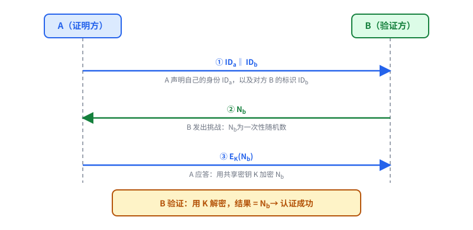
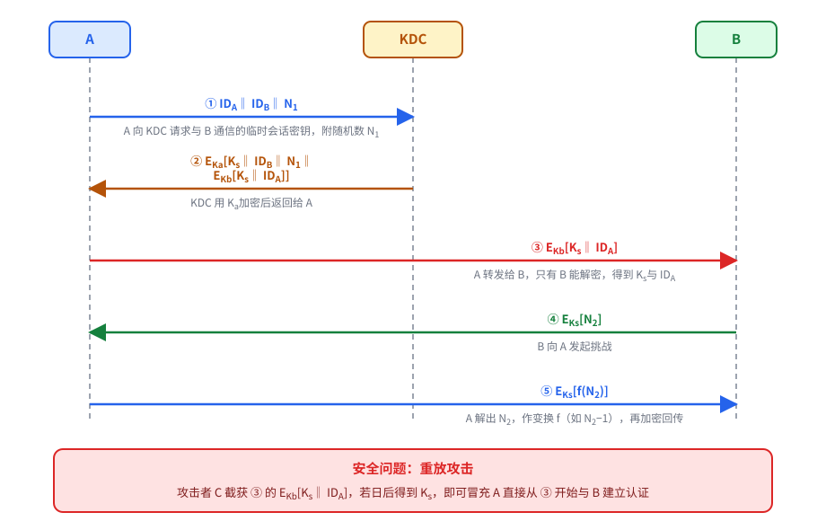
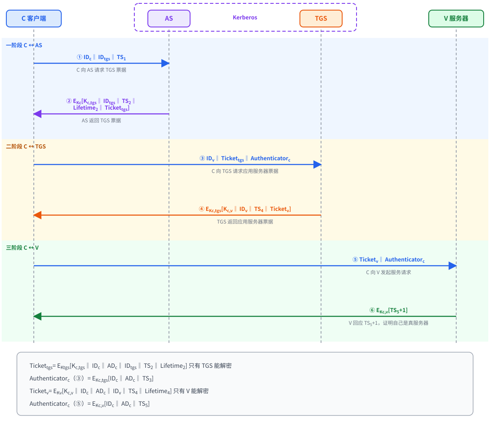

# 基于对称密钥的认证设计与 Kerberos 协议

---

## 一、基于对称密钥的认证

- 证明方与验证方**共享密钥**，并用它建立信任关系；**认证**就是建立信任关系的过程。
- 按网络规模分两种方案:
  - **小规模封闭式网络**：双方共享密钥的数量有限，直接采用**挑战-应答**方式认证
  - **大规模网络**：利用**密钥服务器**，即依靠**可信的第三方**完成认证

> 符号约定：$\Vert$ 表示拼接，$E_K[\cdot]$ 表示用密钥 $K$ 加密，$N$ 为随机数，$TS$ 为时间戳。

---

## 二、基于挑战-应答方式的认证协议

### ① 协议流程

1. ① $A \to B$：$ID_a \Vert ID_b$，声明自己的身份 $ID_a$ 与 B 的身份标识 $ID_b$
2. ② $B \to A$：$N_b$，发出**挑战**，$N_b$ 为**一次性随机数**
3. ③ $A \to B$：$E_K(N_b)$，A 用共享密钥 $K$ 加密 $N_b$ 作出**应答**

- **验证**：B 解密应答，结果 $= N_b$ 则认证成功
- **核心**：随机数一次性，旧应答不能重复使用

---

## 三、Needham-Schroeder 认证协议（对称密钥）

### ① 角色与符号

- **KDC**（Key Distribution Center，密钥分配中心）：**绝对信任的中间人**
- 每个用户与 KDC 共享密钥

| 符号 | 含义 |
|---|---|
| $K_a$ | A 与 KDC 的共享密钥 |
| $K_b$ | B 与 KDC 的共享密钥 |
| $K_s$ | KDC 生成的 **A、B 临时会话密钥** |
| $N_1,N_2$ | 随机数 |

### ② 协议流程

1. ① $A \to KDC$：$ID_A \Vert ID_B \Vert N_1$，A 试图与 B 连线，向 KDC 请求临时会话密钥，附带随机数 $N_1$
2. ② $KDC \to A$：$E_{K_a}[K_s \Vert ID_B \Vert N_1 \Vert E_{K_b}[K_s \Vert ID_A]]$，KDC 用 $K_a$ 加密后返回
3. ③ $A \to B$：$E_{K_b}[K_s \Vert ID_A]$，A 转发给 B，**只有 B 能解密**，得到 $K_s$ 与 $ID_A$
4. ④ $B \to A$：$E_{K_s}[N_2]$，B 向 A 发起挑战
5. ⑤ $A \to B$：$E_{K_s}[f(N_2)]$，A 解出 $N_2$，作函数变换 $f$（如 $N_2-1$），再用 $K_s$ 加密回传

### ③ 安全问题：重放攻击

- 攻击者 C 可截获 $E_{K_b}[K_s \Vert ID_A]$，若日后得到 $K_s$，就可以冒充 A **直接从第③步开始**与 B 建立认证
- **原因**：$E_{K_b}[K_s \Vert ID_A]$ **不包含任何时间新鲜度**认证

---

## 四、Kerberos 协议

### ① 角色与符号

| 符号 | 含义 |
|---|---|
| **AS**（Authentication Server） | 身份验证服务器 |
| **TGS**（Ticket Granting Server） | 票据授予服务器 |
| **C**（Client） | 客户机 |
| **V**（Server） | 应用服务器 |
| $K_{c,tgs}$、$K_{c,v}$ | C 与 TGS / V 间的共享密钥，**临时生成** |
| $TS$ | **时间戳**，防重放攻击 |
| $AD_c$ | C 的网络 IP 地址 |
| $Lifetime$ | 票据**有效期** |

### ② 协议流程

1. ① $C \to AS$：$ID_c \Vert ID_{tgs} \Vert TS_1$
2. ② $AS \to C$：$E_{K_c}[K_{c,tgs} \Vert ID_{tgs} \Vert TS_2 \Vert Lifetime_2 \Vert Ticket_{tgs}]$
3. ③ $C \to TGS$：$ID_v \Vert Ticket_{tgs} \Vert Authenticator_c$
4. ④ $TGS \to C$：$E_{K_{c,tgs}}[K_{c,v} \Vert ID_v \Vert TS_4 \Vert Ticket_v]$
5. ⑤ $C \to V$：$Ticket_v \Vert Authenticator_c$
6. ⑥ $V \to C$：$E_{K_{c,v}}[TS_5+1]$

### ③ 票据与认证符

$$Ticket_{tgs}=E_{K_{tgs}}[K_{c,tgs}\Vert ID_c\Vert AD_c\Vert ID_{tgs}\Vert TS_2\Vert Lifetime_2]$$

$$Ticket_v=E_{K_v}[K_{c,v}\Vert ID_c\Vert AD_c\Vert ID_v\Vert TS_4\Vert Lifetime_4]$$

$$Authenticator_c=E_{K_{c,tgs}}[ID_c\Vert AD_c\Vert TS_3] \quad(③)$$

$$Authenticator_c=E_{K_{c,v}}[ID_c\Vert AD_c\Vert TS_5] \quad(⑤)$$

- **Ticket**：包含临时会话密钥、C 的身份 ID、$AD_c$ 与有效期，**C 无法解密**
- **Authenticator**（验证子）：证明**发送者就是 Ticket 的合法拥有者**，单靠 Ticket 无法证明

### ④ 三个阶段

| 阶段 | 通信双方 | 过程 |
|---|---|---|
| **一阶段** | C ↔ AS（身份验证服务交换） | ① 请求 TGS 票据；② 返回 TGS 票据 |
| **二阶段** | C ↔ TGS（票据授予服务交换） | ③ 请求应用服务器票据；④ 返回应用服务器票据 |
| **三阶段** | C ↔ V（客户与服务器身份验证交换） | ⑤ 向应用服务器发起服务请求；⑥ 服务器对客户机的身份认证 |