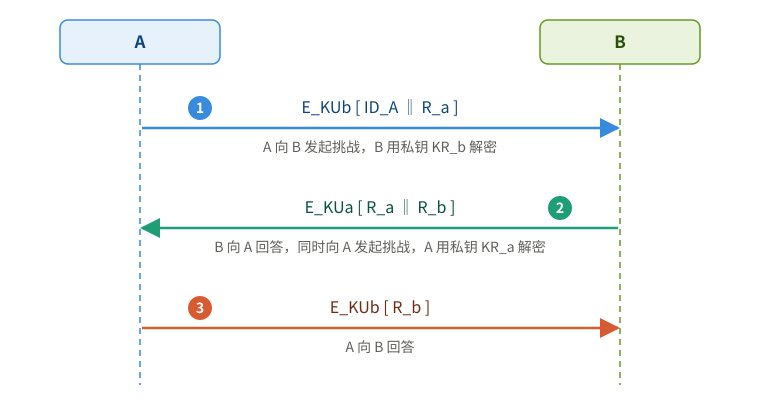
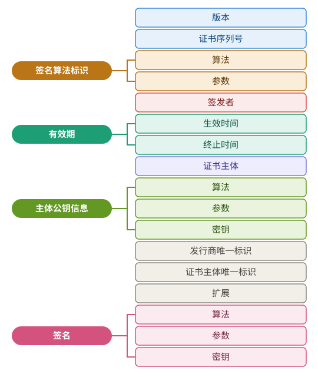
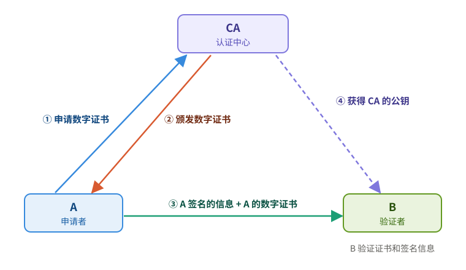

# 基于公开密钥的认证设计与 PKI 理论

## 一、基于公开密钥的认证协议

- **概念**：利用私钥只有本人持有的特点，通过对方能否用私钥完成运算来确认其身份（挑战—响应）
- **两种方式**：
  - 方式一：A 向 B 发起挑战 → B 用**私钥**加密响应发给 A → A 用 B 的**公钥**解密核对
  - 方式二：A 用 B 的**公钥**加密挑战因子发给 B → B 用私钥还原后回送 A → A 根据挑战因子确定 B 的身份
- **两类协议**：Needham-Schroeder 公钥认证（双方直接交换随机数）；基于 CA 数字证书的认证（由第三方为公钥担保）

---

## 二、Needham-Schroeder 公钥认证协议

> 又称公钥协议。

| 符号 | 含义 |
|---|---|
| $KU_a / KU_b$ | A、B 的**公钥** |
| $KR_a / KR_b$ | A、B 的**私钥** |
| $R_a / R_b$ | A、B 生成的**一次性随机数** |
| $ID_A$ | A 的身份标识 |

> $E_K[\cdot]$ 表示用密钥 $K$ 加密，$\Vert$ 表示拼接。

### 协议过程

① A → B：$E_{KU_b}[ID_A \Vert R_a]$，A 向 B 发起挑战，B 用 $KR_b$ 解密

② B → A：$E_{KU_a}[R_a \Vert R_b]$，B 向 A 回答（返回 $R_a$），同时向 A 发起挑战（$R_b$），A 用 $KR_a$ 解密

③ A → B：$E_{KU_b}[R_b]$，A 向 B 回答（返回 $R_b$）

- **意义**：能返回 $R_a$ 说明 B 持有 $KR_b$，能返回 $R_b$ 说明 A 持有 $KR_a$，双方完成相互认证

---

## 三、基于 CA 数字证书的认证协议

### 概念

- **CA**（Certificate Authority）：认证中心，权威、可信赖、公正的第三方机构
- **数字证书**：经 CA 签名的、包含拥有者信息及公开密钥的文件
- **提供的安全服务**：**身份认证**、**完整性**、**保密性**、**不可否认性**

### 证书结构

| 字段组 | 包含字段 |
|---|---|
| 版本、证书序列号 | — |
| **签名算法标识** | 算法、参数 |
| 签发者 | — |
| **有效期** | 生效时间、终止时间 |
| 证书主体 | — |
| **主体公钥信息** | 算法、参数、密钥 |
| 发行商唯一标识、证书主体唯一标识、扩展 | — |
| **签名** | 算法、参数、密钥 |

### 认证过程

① A 向 CA **申请**数字证书

② CA **颁发**数字证书给 A

③ A 将**签名的信息 + 自己的数字证书**发给 B

④ B 获得 **CA 的公钥**，验证证书（CA 的签名）

⑤ B 从证书中取出 A 的公钥，验证 A 签名的信息

---

## 四、公钥基础设施 PKI

### 概念

- **PKI**：遵循一定标准的**密钥管理基础平台**，为所有网络应用提供加密和数字签名等密码服务所必需的**密钥与证书管理**

### PKI 体系结构

- **核心**：公钥算法、数字证书
- **四个功能模块**：认证机构 CA、证书库、密钥备份及恢复、证书撤销处理
- **最外层**：PKI 应用接口，用户通过它使用 PKI 服务

### 基于 X.509 的 PKI 系统

- X.509 确定了**公钥证书结构的基准**
- X.509 v3 证书包括**预定义排序的强制字段**和**可选择的扩展字段**
- 即使是强制字段也很灵活，因为它提供**各种编码方案**

### 典型 PKI 模型

| 组成 | 作用 |
|---|---|
| 业务受理 | 接收用户申请，提交审核 |
| RA 服务器 | 审核申请 |
| CA 服务器 | 签发证书，与 RA 协同工作 |
| 安全服务器 | 居中连接 RA、CA 与两组数据库/LDAP 服务器 |
| 数据库服务器、LDAP | 存放证书，供注册用户下载及查询 |
| 注册用户 | 从数据库/LDAP 下载、查询证书 |

### PKI 系统功能

- 接收/审核证书申请
- 颁发或拒绝数字证书
- 处理证书更新、撤销、查询
- 发布证书有效期，归档管理
- 证书与密钥归档，历史数据保存