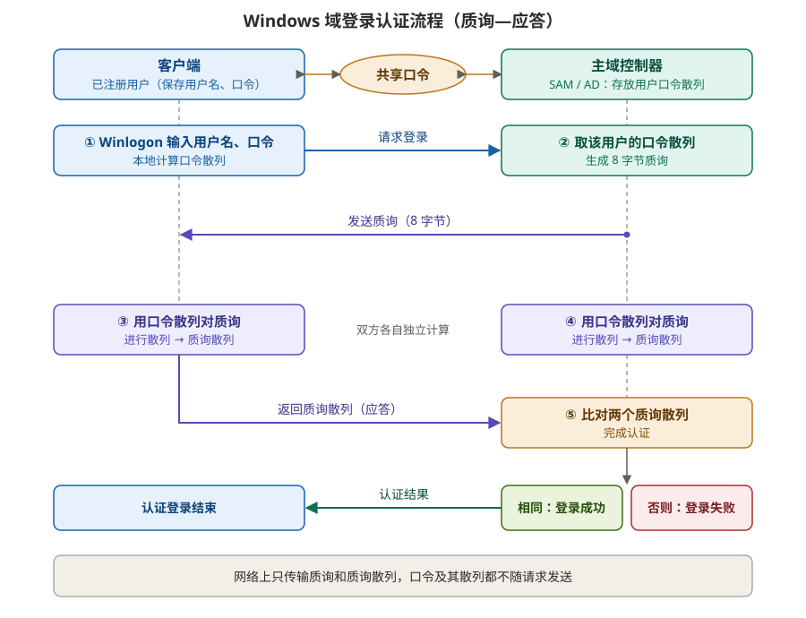
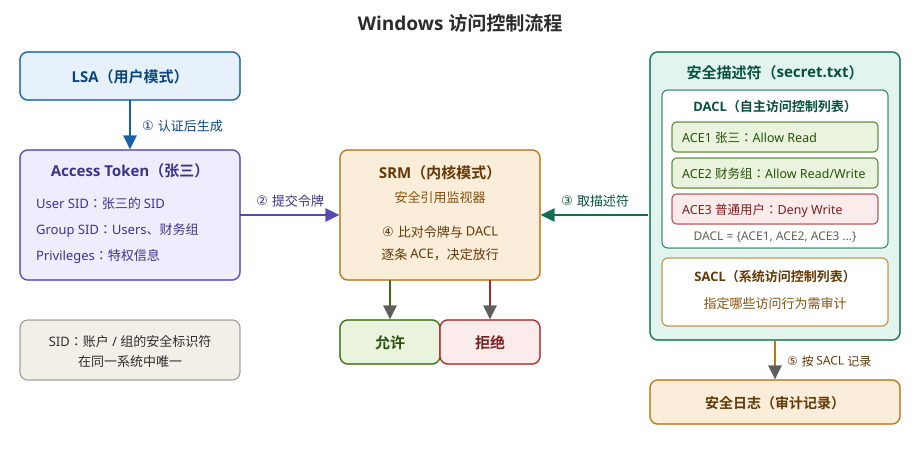

# Windows 系统网络认证与访问控制

## 一、Windows 安全体系

- **概念**：Windows 采用**层次性安全架构**，核心是**安全策略**，由它协调各安全组件
- **层次**：由外到内逐层保护

| 层次 | 作用 |
|---|---|
| 用户认证 | 最外层，是其他安全机制的基础 |
| 加密 | 保证通信与数据存储的机密性 |
| 访问控制 | 维护用户访问授权原则 |
| 管理 / 审计 | 负责安全配置与事故追查 |
| 安全策略 | 核心，决定系统安全性 |

---

## 二、Windows 系统网络认证（域登录）

- **概念**：采用**对称密钥**完成认证；登录用户必须是在**主域控制器**上注册的合法用户
- **怎么建立**：用户与主域控制器**共享口令**；域控制器的 **SAM / AD** 数据库保存用户名、口令散列等信息
- **目标**：用**质询—应答**完成认证，口令及其散列不在网络上传输

### ① 认证流程

1. **客户端**：激活 `Winlogon` 窗口，输入用户名、口令；本地计算**口令散列**，向主域控制器发送登录请求
2. **主域控制器**：从 SAM 取出该用户的口令散列；生成 **8 字节质询**发送给客户端
3. **客户端**：用口令散列对质询进行散列，得到**质询散列**，作为应答返回
4. **主域控制器**：用取出的口令散列对质询做同样的散列，得到自己的质询散列
5. **比对**：两个质询散列相同则登录成功，否则失败

### ② 组件调用关系

- 系统启动后加载 `Winlogon` 进程：`Winlogon` → `gina` → `LSA`（加载认证包）→ 认证包向 `SAM` 请求账号信息
- **域登录**时，认证包调用 `Netlogon`，经**安全通道**与域控制器建立连接，再向其 `SAM` 请求账号信息

---

## 三、Windows 访问控制

- **概念**：访问控制模块由**访问令牌**和**安全描述符**两部分组成，Windows 通过比对二者内容，判定持有令牌的账户能否访问对象
- **基本控制单元**：**账户**。账户是一种"参考上下文"，是具有特定约束条件的容器，也可理解为背景环境

### ① 安全标识符 SID

- Windows 中每个账户 / 账户组都有一个 SID
- 每个 SID 在同一系统中**唯一**

### ② 访问令牌（Access Token）

- 每个账户和组都有一个，包含该账户 / 组的 **SID** 和**特权信息**
- 账户认证完成后，由 **LSA**（用户模式）生成

### ③ 安全描述符（Security Descriptor）

- 与每个**被访问客体**（如文件）关联，描述对象属性与安全规则，包含 **SID** 和 **ACL**

| 组成 | 全称 | 作用 |
|---|---|---|
| **DACL** | 自主访问控制列表 | 由若干 **ACE**（访问控制项）组成：DACL = {ACE1, ACE2, …}；每条 ACE 指明某 SID 允许 / 拒绝何种操作 |
| **SACL** | 系统访问控制列表 | 为**审计**服务，规定哪些访问行为需被审计，记录到安全日志 |

### ④ 访问控制流程

> 例：张三访问 `secret.txt`

1. 张三认证完成后，LSA 生成他的 **access token**（含 User SID、Group SID、特权）
2. 张三发起请求，打开 `secret.txt`，向 **SRM**（Windows 安全引用监视器，内核模式）提交令牌
3. SRM 获取 `secret.txt` 的**安全描述符**（含 DACL 和 SACL）
4. SRM 将令牌与 DACL 中的各个 **ACE** 比对，决定**允许 / 拒绝**
5. 按 **SACL** 的规定，需要审计的访问记入**安全日志**

| ACE（`secret.txt` 的 DACL） | 对象 | 权限 |
|---|---|---|
| ACE1 | 张三 SID | Allow Read |
| ACE2 | 财务组 SID | Allow Read / Write |
| ACE3 | 普通用户 SID | Deny Write |

---

## 四、活动目录（AD）

- **概念**：**Active Directory**，面向网络对象管理的**综合目录服务**
- **管理对象**：用户、用户组、计算机、打印机、应用服务器、域、组织单元（OU）以及安全策略等
- **怎么工作**：把分散的网络对象有效组织起来，建立**网络对象索引目录**，存储在活动目录的数据库内；可看作数据存储的**视图**
- **管理划分**：按**域**划分，域内再划分为多个 **OU**（如域控制器 OU、服务器 OU、部门 OU、笔记本 OU 等），便于分别管理
- **作用**：是 Windows 网络中重要的**安全管理平台**，组策略是其安全性的重要体现

---

## 五、组策略（GP）

- **概念**：依据特定用户或计算机的安全需求制定的**安全配置规则**
- **怎么实施**：管理员针对每个 OU 定制不同的组策略，存储在 AD 数据库；AD 可**强制推送**到客户端，也能用组策略命令通知并改变已登录用户的策略

### ① 工作流程

- 管理员用**组策略模板**定制策略，存入**策略库**
- 策略按层级应用：**站点**组策略、**域**组策略、**OU** 策略（用户 OU / 计算机 OU）等，作用到对应的对象上

### ② 实施原理

- **注册表**是 Windows 中保存系统、应用软件配置的数据库
- 实施组策略 = **修改注册表中的相关设置**

### ③ AD 组策略与本地组策略

| | AD 组策略 | 本地组策略 |
|---|---|---|
| 存放位置 | 域控制器上 AD 的数据库 | 本地计算机内 |
| 定制实施 | 域管理员 | 本地管理员 |
| 作用对象 | 链接到的**站点、域或 OU** 范围内的用户和计算机（可向下继承） | 仅本地计算机 |

- 应用顺序：本地 → 站点 → 域 → OU，后应用的在设置冲突时覆盖先应用的，不冲突的设置叠加生效
- 客户端在开机、登录及定期刷新时从域控制器获取并应用 AD 组策略
- 部署在本地计算机时，组策略不能发挥全部功能；**与 AD 配合**才能发挥全部潜力

### ④ 组策略的主要工作

1. 部署软件
2. 设置用户权力
3. 软件限制策略：限制某用户只能运行特定程序或执行特定任务
4. 控制系统设置：统一部署网络用户的 Windows 服务
5. 设置登录、注销、关机、开机脚本
6. 通用桌面控制
7. 安全策略
8. 重定向文件夹
9. 基于注册表的策略设置