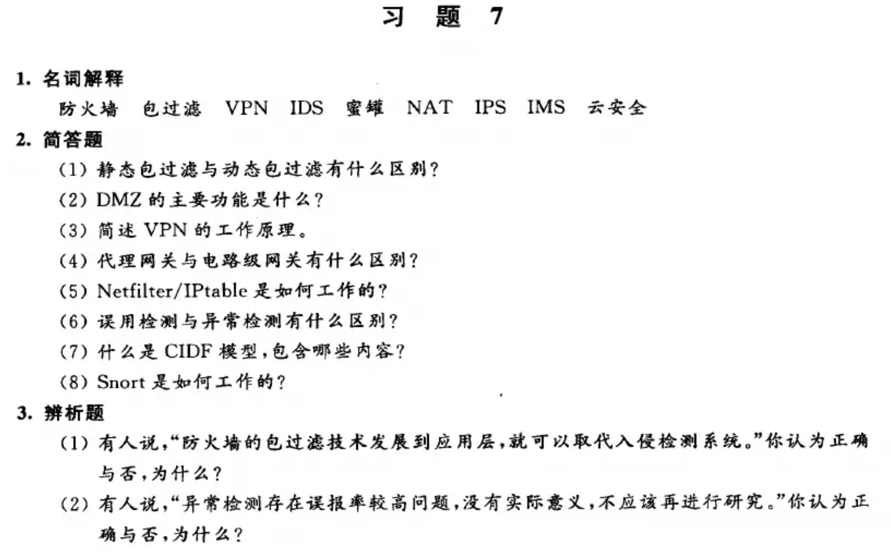
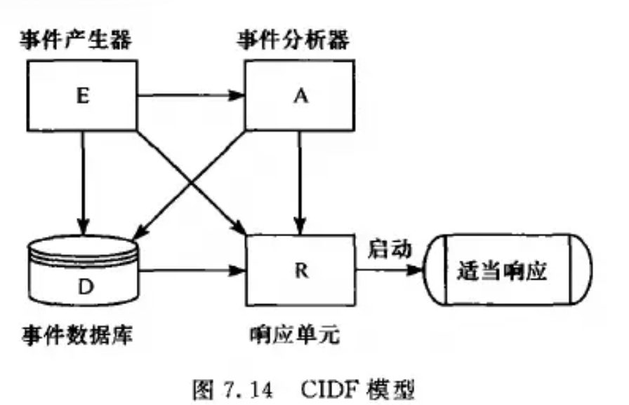

# 入侵检测理论与 snorts 结构原理

## 入侵检测系统全称？概念？
- **人侵检测系统（Intrusion Detection System, IDS）**
- 是一种对网络传输进行即时监视，在发现可疑传输时发出警报或者采取主动反应措施的网络安全系统。
- 一般认为**防火墙属于静态防范措施**，而**人侵检测系统为动态防范措施**，是对防火墙的有效补充。

## （原题）入侵检测模型的过程？
信息收集 → 信息分析  → 结果处理

## 以数据源为分类标准，入侵检测系统分为哪两类？
- **主机型入侵检测系统**（Host-based Intrusion Detection System, **HIDS**）：以**主机数据**为信息源，包括系统运行状态、记账信息、主机日志、C2级安全审计。

- **网络型入侵检测系统**（Network-based Intrusion Detection System, **NIDS**）：以**网络数据**为信息源，包括 SNMP 信息、网络数据包、路由器/交换机/防火墙日志。

## HIDS 和 NIDS 优缺点？
1. **HIDS**
- **优点**  
**性价比高：** 不需要增加专门的硬件平台，主机数量较少时性价比尤其突出。      
**准确率高：** 主要监测用户在系统中的行为活动，能准确反映系统实时状态，便于区分正常与非法行为。      
**对网络流量不敏感：** 不会因网络流量增加而丢失对网络行为的监视，适合加密环境下的入侵检测。      
- **缺点**  
**与操作系统平台相关：** 可移植性差。       
**维护复杂：** 需要在每台被检测主机上安装入侵检测系统。     
**难以检测针对网络的攻击。**        

2. **NIDS**
- **优点**  
**对用户透明：** 隐蔽性好，使用便捷，不易遭受来自网络的攻击。  
**与系统平台无关：** 可移植性好。  
**不增加业务主机负载：** 利用独立计算机完成检测工作。  
**证据不易转移：** 攻击者不易销毁或转移攻击证据。  
- **缺点**  
**无法检测内部攻击：** 无法检测来自网络内部的攻击及内部合法用户的误用行为。  
**无法分析加密报文：** 不能对加密数据进行分析。  
**主机负荷大：** 需要采集分析所有网络报文，易受 DoS 攻击。

## 以检测技术为分类标准，入侵检测系统分为哪两类？
- 基于**误用检测**（Misuse Detection）的IDS ：误用检测是**事先定义出已知的入侵行为的入侵特征，将实际环境中的数据与之匹配，根据匹配程度**来判断是否发生了误用攻击，即入侵攻击行为。
- 基于**异常检测**（Anomaly Detection）的IDS：异常检测是根据**使用者的行为或资源使用状况的程度与正常状态下的标准特征（活动轮廓）之间的偏差**来判断是否遭到入侵，如果偏差高于阈值则发生异常。

## 入侵检测的主要技术方法？
**误用检测、异常检测、诱骗和响应**

## 误用检测技术和异常检测技术常用方法？
- **误用检测技术常用方法：** 专家系统；特征分析；状态转换分析；模型推理；完整性分析
- **异常检测技术常用方法：** 统计分析；预测模型；系统调用检测；基于人工智能的异常检测技术

## （原题）误用检测技术和异常检测技术优缺点？
1. **误用检测技术**
- **优点：** **准确率高、误报率低。**
- **缺点：** **漏报率高**，无法检测未知攻击；将入侵手段抽象为知识困难；**特征库需要持续维护**。
2. **异常检测技术**
- **优点：** **通用性强、漏报率低。**
- **缺点：** **误报率高、准确率低**，无法准确报告攻击类型；阈值确定困难。

## 什么是 snort 系统？
Snort 系统是一个开放源代码的轻量级**网络入侵检测系统**，遵循CIDF 模型，使用**误用检测**的方法来识别发现违反系统和网络安全策略的网络行为。

## Snort 四大模块及其作用？

1. **数据包捕获模块：** 通过 LIBPCAP/WINPCAP 从网络适配器捕获原始数据包，提交给预处理模块。
2. **预处理模块：** 对数据包进行解码、检查和相关处理。
3. **检测引擎：** 核心部件，对处理后的数据包进行规则匹配，判断是否存在入侵。
4. **输出模块：** 根据检测结果，执行写日志或报警等操作。


## （原题）Snort 检测引擎模块的三维链表规则原理？

1. **基本思想**：Snort 将已知入侵行为以规则形式存入规则库，并用**三维链表**组织规则。检测时逐层缩小范围，避免对每个数据包与全部规则逐条比较，从而提高匹配效率。

2. **层次结构**：

```text
第一维：按规则动作分类
    RLN（Alert / Log / Pass / Activate / Dynamic）
     ↓
第二维：按协议分类
    RLH ──→ IP / TCP / UDP / ICMP 规则树
              ↓
第三维：规则头 + 规则选项
    RTN ──→ RTN ──→ ...      （规则头链表，纵向）
     ↓       ↓
    OTN     OTN              （规则选项链表）
     ↓
    OTN ...
```

3. **节点含义**：
   * **RLN（规则列表节点）**：按**规则动作**对规则分类，每种动作（Alert、Log、Pass、Activate、Dynamic）对应一个 RLN。
   * **RLH（规则列表头）**：规则列表的入口，用四个指针分别指向 IP、TCP、UDP、ICMP 四棵协议规则树。
   * **RTN（规则树节点）**：存储**规则头**（动作、协议、源/目的 IP 及端口、传输方向），用于筛选候选规则。
   * **OTN（规则选项节点）**：存储**规则选项**（具体匹配条件及匹配操作），用于检查数据包内容。规则头相同的多条规则**共享一个 RTN**，各自的选项由不同 OTN 表示。
   * **链表结构**：

4. **检测过程**：
   1. **初始化**：启动时读取规则文件，按动作、协议、规则头、规则选项建立三维链表。
   2. **遍历 RLN**：数据包到达后，依次遍历各动作类别的 RLN。
   3. **选协议树**：进入 RLH，按数据包协议选择对应的规则树。
   4. **匹配规则头**：遍历 RTN 链表，比较协议、源/目的地址和端口等。
   5. **匹配规则选项**：RTN 匹配成功后，遍历其 OTN 链表，调用匹配函数检查数据包内容。
   6. **执行动作**：规则头和选项都匹配成功，则执行相应动作（Alert：报警并记录；Log：记录；Pass：忽略）。

5. **检测流程**：数据包到达 → 遍历 RLN → 经 RLH 选协议规则树 → 遍历 RTN 匹配规则头 → 遍历 OTN 匹配规则选项 → 执行规则动作。

> 先按"动作"分，再按"协议"分，再比"规则头"，最后比"规则选项"；开销最大的内容匹配放在最后，前几层先过滤掉大部分无关规则。

## （原题）应用层防火墙能否完全取代入侵检测系统 IDS?
应用层防火墙不能完全取代 IDS，原因如下:

（1）**部署位置不同：** 防火墙通常部署在网络边界，而 IDS 可部署在内部网络或主机上，能够发现部分绕过边界防护的攻击及内部攻击。
（2）**工作机制不同：** 防火墙主要依据访问控制策略对流量进行检查和过滤，IDS 则通过特征匹配、异常检测等方式识别入侵行为。
（3）**检测范围不同：** 防火墙主要检查经过自身的流量，IDS 可以监测其部署位置可见的网络流量或主机活动，发现防火墙未能识别的攻击。
（4）**安全功能不同：** 防火墙侧重访问控制与阻断，IDS 侧重入侵检测、告警和审计，二者功能互补，不能相互完全替代。

---
# 课后习题

## 1. 名词解释
### 防火墙 包过滤 VPN IDS 蜜罐 NAT IPS IMS 云安全
1. **防火墙**：防火墙指的是一个由**软件和硬件设备**组合而成、在**内部网络和外部网络之间**构造的安全保护屏障，从而**保护内部网络免受外部非法用户**的侵人。
2. **包过滤**：
3. **VPN**：**虚拟专用网**（Virtual Private Network,VPN）是通过一个公用网络（通常是 Internet）建立一个临时的、安全的连接，VPN 的实现主要依赖**隧道**技术。
4. **IDS**：**人侵检测系统**（Intrusion Detection System, IDS）是一种对网络传输进行即时监视，在发现可疑传输时发出警报或者采取主动反应措施的网络安全系统。
5. **蜜罐**：蜜罐是一种安全资源，其价值在于被扫描、攻击和攻陷。蜜罐的核心价值就在于对这些攻击活动进行监视、检测和分析。
6. **NAT**：**网络地址翻译**（Network Address Translation, NAT）是一种将私有地址转化为合法 IP 地址的转换技术。
7. **IPS**：**人侵防御系统**（Intrusion Prevention System, IPS）采用串联的方式将部署在肉、外网络之间的关键路径上，采用基于包过滤的存储转发机制。IPS深度感知并检测流经的网络流量，对恶意数据包进行丢弃以阻断攻击，保护网络带宽资源。
8. **IMS**：**入侵管理系统**（Intrusion Man-agement System,IMS）一般认为是一个针对整个人侵过程进行统一管理的安全服务系统。实际上IMS 应该是一个融合了多种安全防御技术的管理系统。
9. **云安全**：“云安全”的概念脱胎于“云计算”，可以理解为基于云计算的安全服务，即让服务器端（即“云”端）承担与安全相关的计算，而让客户端承担扫描和防护任务。
## 2. 简答题
### （1）静态包过滤与动态包过滤有什么区别？
静态包过滤与动态包过滤的主要区别如下：

1. **过滤依据不同：** 静态包过滤主要根据预先配置的过滤规则，对**数据包的源/目的 IP 地址、端口号、协议类型等字段**进行检查；动态包过滤除检查数据包头部信息外，还可以**结合连接状态和动态生成的规则**进行过滤。

2. **状态记录不同：** 静态包过滤通常独立检查每个数据包，不跟踪连接状态；动态包过滤能够维护连接状态信息，**记录连接的建立、传输和终止等状态**。

3. **过滤决策不同：** 静态包过滤主要依据固定的过滤规则作出允许或拒绝的决定；动态包过滤可以根据**连接状态动态调整过滤决策**，只允许符合规则及连接状态的数据包通过。

4. **安全性不同：** 静态包过滤难以识别数据包是否属于一个合法连接，动态包过滤能够利用连接状态信息进行**更精细的访问控制**，但二者都不能单独保证网络安全。
### （2） DMZ的主要功能是什么？
DMZ（Demilitarized Zone，非军事区）是部署在内部网络与外部网络之间的隔离网络区域，其主要功能如下：

1. **隔离内外网络：** 将对外提供服务的服务器与内部受保护网络隔离，降低外部网络对内部网络的直接威胁。

2. **提供公共服务：** 用于部署需要被外部用户访问的服务器，如 Web、邮件和 DNS 服务器，在提供公共服务的同时保护内部网络。

3. **限制攻击影响：** 即使 DMZ 中的服务器遭到攻击或入侵，攻击者也不能因此直接访问内部网络，可通过防火墙的访问控制策略限制其向内部网络的进一步渗透。

4. **实施访问控制：** 通过防火墙等安全设备控制外部网络、DMZ 与内部网络之间的通信，限制不同区域之间的访问权限。
### （3）简述 VPN 的工作原理。
VPN（Virtual Private Network，虚拟专用网络）主要利用隧道技术，在公共网络上建立逻辑上的专用通信通道，其工作原理如下：

（1）**建立隧道：** 通信双方通过 VPN 协议建立隧道，在公共网络上形成逻辑上的专用通信通道。

（2）**数据封装：** 发送方将需要传输的原始数据包进行封装，添加隧道协议所需的报头，使其能够通过公共网络传输。

（3）**加密与认证：** VPN 可对传输数据进行加密，并通过身份认证、完整性校验等机制，保护通信的机密性与完整性，防止未经授权的访问和数据篡改。

（4）**传输与解封装：** 封装后的数据包经公共网络传输到 VPN 对端，对端接收数据后进行相应的验证、解密和解封装，恢复原始数据并转发给目标主机。
### （4）代理网关与电路级网关有什么区别？
代理网关与电路级网关的主要区别如下：

（1）**工作层次不同：** 代理网关通常工作在应用层；电路级网关主要在会话层或传输连接层提供连接代理功能。

（2）**检查内容不同：** 代理网关能够理解并检查特定应用协议的数据内容，根据应用层规则进行访问控制；电路级网关主要检查连接建立过程、连接状态及相关信息，通常不深入检查应用层数据内容。

（3）**代理方式不同：** 代理网关针对具体应用协议提供代理服务，通常需要相应的应用代理程序；电路级网关在通信双方之间建立和转发连接，使内部主机不必直接与外部主机建立端到端连接。

（4）**安全能力不同：** 代理网关能够针对应用层协议实施更细粒度的访问控制，但通常需要针对不同应用提供相应的代理支持；电路级网关开销相对较小，但对应用层攻击内容的检测能力较弱。
### （5）Netfilter/IPtable是如何工作的？
1. **Netfilter 是内核层的数据包处理框架**，嵌入在 Linux **内核层 IP 协议栈**中，负责提供数据包处理机制并实际执行处理，包括：
   * **表、链、规则的层次结构**：Netfilter 是表的容器，表是链的容器，链是规则的容器。规则存储在内核的表中。主要有三个功能表：
     * Filter：包过滤，决定放行或丢弃数据包，含 INPUT（目的地址是本机）、FORWARD（目的地址不是本机，需转发）、OUTPUT（本机产生）三条链；
     * NAT：网络地址转换；
     * Mangle：修改数据包字段值，用于流量控制和服务质量。
   * **设置钩子点（Hook）**：在协议栈关键位置设置五个钩子点：
     * IP_PRE_ROUTING：数据包从数据链路层进入网络层；
     * IP_LOCAL_IN：数据包从网络层进入传输层；
     * IP_FORWARD：数据包在网络层转发；
     * IP_POST_ROUTING：数据包从网络层进入数据链路层；
     * IP_LOCAL_OUT：数据包从传输层进入网络层。
   * **注册钩子函数**：每个钩子允许注册若干钩子函数，系统按优先级形成钩子函数指针链，数据包到达钩子点时被依次提交处理。Filter 只在 IP_LOCAL_IN、IP_FORWARD、IP_LOCAL_OUT 三点注册钩子函数，每个钩子函数对应一张包过滤表，并依据表中规则检查数据包。
   * **执行数据包处理**：钩子函数依据规则对数据包进行过滤、地址转换、字段修改等操作。

2. **IPtables 是用户空间的规则管理工具**，本身不存储规则，也不执行数据包处理，只负责通过命令对内核中 Netfilter 的表、链、规则进行增删改查（名字由此而来）。命令格式：

   > IPtables 命令 = 工作表 + 使用链 + 规则操作 + 目标动作 + 匹配条件

   * 工作表：指定操作哪张表，缺省为 filter；
   * 使用链：指定表下的某条链，即确定钩子点；
   * 规则操作：添加、插入、删除、替换、列出规则；
   * 目标动作：ACCEPT（继续传递）或 DROP（丢弃）；
   * 匹配条件：用于匹配包头信息的特征，如地址、端口等。

3. **规则匹配方式**：链上的规则按优先级形成规则队列，顺序匹配。某条规则匹配成功，就执行其目标动作并结束匹配；否则转向下一条；全部匹配失败，则执行该链的默认策略。

4. **两者关系**：Netfilter 在内核空间提供机制并执行，IPtables 在用户空间提供配置接口，二者配合构成 Linux 防火墙。流程为：管理员运行 IPtables 命令 → 规则写入内核中 Netfilter 的对应表和链 → 数据包经过钩子点时，钩子函数查表匹配并执行动作。

> **一句话记忆**：Netfilter 是内核里的“规则库和执行者”，IPtables 是用户手里的“规则编辑器”。
### （6）误用检测与异常检测有什么区别？

1. **基本原理**
   * **误用检测**（Misuse Detection）：事先定义已知入侵行为的**入侵特征**，将实际环境中的数据与特征库匹配，根据匹配程度判断是否发生入侵。核心思路是"**匹配已知攻击**"。
   * **异常检测**（Anomaly Detection）：先建立正常状态下用户行为或资源使用情况的标准特征（**活动轮廓**），再将实际行为与之比较，偏差超过阈值即判定为入侵。核心思路是"**偏离正常行为**"。

2. **优缺点对比**

| 对比项 | 误用检测 | 异常检测 |
| --- | --- | --- |
| 判断依据 | 是否匹配已知攻击特征 | 是否偏离正常行为轮廓 |
| 优点 | 准确率高、误报率低 | 通用性强、漏报率低，可发现未知攻击 |
| 缺点 | 漏报率高，无法检测未知攻击；入侵手段难以抽象为知识；特征库需持续维护 | 误报率高、准确率低；无法准确报告攻击类型；阈值难以确定 |

3. **主要区别**：误用检测"**认识坏人**"，只能识别已知攻击，所以误报低、漏报高；异常检测"**熟悉好人**"，凡是不正常的都可疑，所以漏报低、误报高。两者优缺点互补，实际系统中常结合使用。

> **一句话记忆**：误用检测靠"特征库"，异常检测靠"正常轮廓"；前者误报低、漏报高，后者漏报低、误报高。
### （7）什么是CIDF模型，包含哪些内容？
- CIDF 阐述了一个人侵检测系统的通用模型，它将一个人侵检测系统分为以下组件：事件产生器（Eventgenerators），用E盒表示；事件分析器（Eventanalyzers），用A 盒表示；响应单元（Response-units），用R 盒表示；事件数据库（Event data-bases），用D盒表示。
- CIDF 模型的工作流程为：
    * E 盒通过传感器收集事件数据，并将信息传送给A 盒和D盒；
    * A盒检测误用模式；D盒存储来自A、E盒的数据，并为额外的分析提供信息；
    * R盒从A、E盒中提取数据，D盒启动适当的响应。

### （8） Snort 是如何工作的？
见上文
## 3. 辦析题
### （1）有人说，“防火墙的包过滤技术发展到应用层，就可以取代入侵检测系统。”你认为正确与否，为什么？
见上文
### （2）有人说，“异常检测存在误报率较高问题，没有实际意义，不应该再进行研究。”你认为正确与否，为什么？

**观点不正确。** 异常检测误报率较高，但不能因此否定其研究价值，理由如下：

1. **能发现未知攻击**：异常检测通过比较用户行为、资源使用情况与正常活动轮廓的偏差来判断入侵，不依赖已知攻击特征，因此可以检测新型攻击和未知攻击。误用检测只能识别特征库中已有的攻击，无法做到这一点。
2. **漏报率低、通用性强**：异常检测的优势正好弥补了误用检测漏报率高的缺点。
3. **误报率高是技术问题，可以改进**：可以通过更准确的行为轮廓建模、引入机器学习和数据挖掘方法、合理设置或自适应调整阈值、对告警进行关联和聚合等方式降低误报。
4. **与误用检测互补**：误用检测准确率高但漏报高，异常检测漏报低但误报高，实际入侵检测系统常将两者结合使用，取长补短。

因此，异常检测有重要的实际意义，应当继续研究，重点是降低误报率，而不是放弃这项技术。