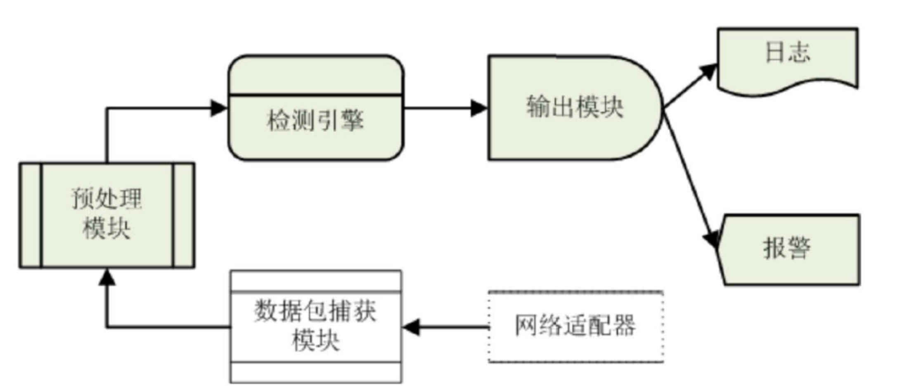
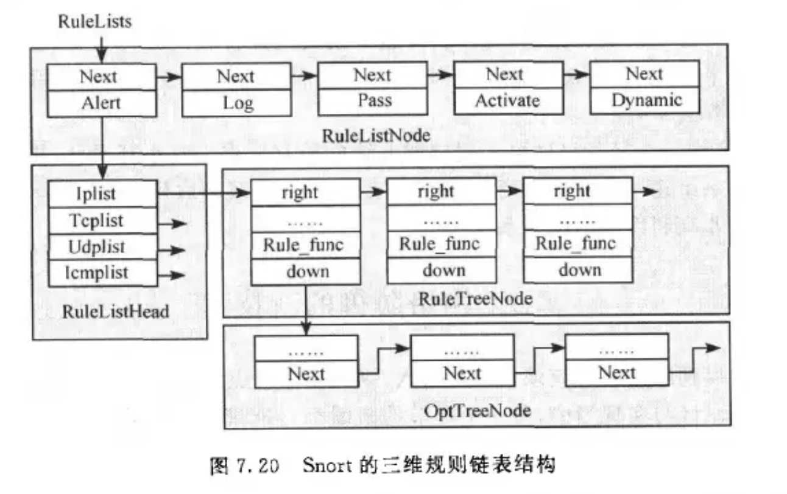

# 入侵检测理论与 snorts 结构原理

## 入侵检测系统全称？概念？
- **人侵检测系统（Intrusion Detection System, IDS）**
- 是一种对网络传输进行即时监视，在发现可疑传输时发出警报或者采取主动反应措施的网络安全系统。
- 一般认为**防火墙属于静态防范措施**，而**人侵检测系统为动态防范措施**，是对防火墙的有效补充。

## （原题）入侵检测模型的过程？
信息收集 → 信息分析  → 结果处理

## 以数据源为分类标准，入侵检测系统分为哪两类？
- **主机型入侵检测系统**（Host-based Intrusion Detection System, **HIDS**）：以**主机数据**为信息源，包括系统运行状态、记账信息、主机日志、C2级安全审计。

- **网络型入侵检测系统**（Network-based Intrusion Detection System, **NIDS**）：以**网络数据**为信息源，包括 SNMP 信息、网络数据包、路由器/交换机/防火墙日志。

## HIDS 和 NIDS 优缺点？
1. **HIDS**
- **优点**  
**性价比高：** 不需要增加专门的硬件平台，主机数量较少时性价比尤其突出。      
**准确率高：** 主要监测用户在系统中的行为活动，能准确反映系统实时状态，便于区分正常与非法行为。      
**对网络流量不敏感：** 不会因网络流量增加而丢失对网络行为的监视，适合加密环境下的入侵检测。      
- **缺点**  
**与操作系统平台相关：** 可移植性差。       
**维护复杂：** 需要在每台被检测主机上安装入侵检测系统。     
**难以检测针对网络的攻击。**        

2. **NIDS**
- **优点**  
**对用户透明：** 隐蔽性好，使用便捷，不易遭受来自网络的攻击。  
**与系统平台无关：** 可移植性好。  
**不增加业务主机负载：** 利用独立计算机完成检测工作。  
**证据不易转移：** 攻击者不易销毁或转移攻击证据。  
- **缺点**  
**无法检测内部攻击：** 无法检测来自网络内部的攻击及内部合法用户的误用行为。  
**无法分析加密报文：** 不能对加密数据进行分析。  
**主机负荷大：** 需要采集分析所有网络报文，易受 DoS 攻击。

## 以检测技术为分类标准，入侵检测系统分为哪两类？
- 基于**误用检测**（Misuse Detection）的IDS ：误用检测是**事先定义出已知的入侵行为的入侵特征，将实际环境中的数据与之匹配，根据匹配程度**来判断是否发生了误用攻击，即入侵攻击行为。
- 基于**异常检测**（Anomaly Detection）的IDS：异常检测是根据**使用者的行为或资源使用状况的程度与正常状态下的标准特征（活动轮廓）之间的偏差**来判断是否遭到入侵，如果偏差高于阈值则发生异常。

## 入侵检测的主要技术方法？
**误用检测、异常检测、诱骗和响应**

## 误用检测技术和异常检测技术常用方法？
- **误用检测技术常用方法：** 专家系统；特征分析；状态转换分析；模型推理；完整性分析
- **异常检测技术常用方法：** 统计分析；预测模型；系统调用检测；基于人工智能的异常检测技术

## （原题）误用检测技术和异常检测技术优缺点？
1. **误用检测技术**
- **优点：** **准确率高、误报率低。**
- **缺点：** **漏报率高**，无法检测未知攻击；将入侵手段抽象为知识困难；**特征库需要持续维护**。
2. **异常检测技术**
- **优点：** **通用性强、漏报率低。**
- **缺点：** **误报率高、准确率低**，无法准确报告攻击类型；阈值确定困难。

## 什么是 snort 系统？
Snort 系统是一个开放源代码的轻量级**网络入侵检测系统**，遵循CIDF 模型，使用**误用检测**的方法来识别发现违反系统和网络安全策略的网络行为。

## Snort 四大模块及其作用？

1. **数据包捕获模块：** 通过 LIBPCAP/WINPCAP 从网络适配器捕获原始数据包，提交给预处理模块。
2. **预处理模块：** 对数据包进行解码、检查和相关处理。
3. **检测引擎：** 核心部件，对处理后的数据包进行规则匹配，判断是否存在入侵。
4. **输出模块：** 根据检测结果，执行写日志或报警等操作。


## （原题）Snort 检测引擎模块的三维链表规则原理？
- Snort 将已知的入侵行为以规则的形式存储在规则库中，并采用三维链表结构对规则进行组织，以提高规则匹配的效率。
- Snort 三维链表的层次结构：

```text
第一层：规则动作分类
    RLN
     ↓
第二层：协议规则树
    RLH → IP / TCP / UDP / ICMP
              ↓
第三层：具体规则
    RTN → OTN → OTN → ...
```

#### 节点含义：
1. **RLN（Rule List Node，规则列表节点）**：用于按照规则动作对规则进行分类。Snort 定义了五种规则动作：Alert、Log、Pass、Activate 和 Dynamic，每种动作类别对应相应的 RLN。
2. **RLH（Rule List Head，规则列表头）**：作为规则列表的组织入口，通过四个指针分别指向 IP、TCP、UDP 和 ICMP 规则树。
3. **RTN（Rule Tree Node，规则树节点）**：存储规则头信息，用于筛选符合条件的候选规则。规则头包含规则动作、协议类型、源 IP 地址与端口、目的 IP 地址与端口以及数据传输方向等信息。
4. **OTN（Option Tree Node，规则选项节点）**：存储规则选项，包含具体的匹配条件及相应的匹配操作，用于进一步检查数据包是否符合规则要求。多个具有相同规则头信息的规则可以共享一个 RTN，并通过不同的 OTN 表示各自的规则选项。

#### 链表结构：


#### Snort 检测过程
1. **初始化规则链表**：Snort 启动时，建立三维规则链表，将规则按照动作类别、协议类型以及规则头和规则选项等信息进行组织。
2. **遍历规则列表**：当数据包到达检测引擎时，检测引擎根据规则链表的组织结构，逐层查找可能匹配的规则。
3. **选择协议规则树**：进入 RLH（Rule List Head，规则列表头）后，检测引擎根据数据包的协议类型，选择相应的协议规则树，如 IP、TCP、UDP 或 ICMP 规则树。
4. **匹配规则头**：检测引擎遍历 RTN（Rule Tree Node，规则树节点）链表，检查数据包的协议类型、源/目的 IP 地址及端口等信息。若找到匹配的 RTN，则进一步检查其关联的 OTN 链表。
5. **匹配规则选项**：检测引擎检查 OTN（Option Tree Node，规则选项节点）中的规则选项，并调用相应的匹配函数，判断数据包内容是否符合规则指定的条件。
6. **执行规则动作**：当规则头和规则选项均匹配成功时，检测引擎执行相应的规则动作，如 Alert（报警并记录数据包）、Log（记录数据包）或 Pass（忽略数据包）等。

**检测流程：**

数据包到达 → 遍历规则列表 → 进入 RLH 并选择协议规则树 → 遍历 RTN 匹配规则头 → 遍历 OTN 匹配规则选项 → 匹配成功后执行相应的规则动作。


## （原题）应用层防火墙能否完全取代入侵检测系统 IDS?
应用层防火墙不能完全取代 IDS，原因如下:

（1）**部署位置不同：** 防火墙通常部署在网络边界，而 IDS 可部署在内部网络或主机上，能够发现部分绕过边界防护的攻击及内部攻击。
（2）**工作机制不同：** 防火墙主要依据访问控制策略对流量进行检查和过滤，IDS 则通过特征匹配、异常检测等方式识别入侵行为。
（3）**检测范围不同：** 防火墙主要检查经过自身的流量，IDS 可以监测其部署位置可见的网络流量或主机活动，发现防火墙未能识别的攻击。
（4）**安全功能不同：** 防火墙侧重访问控制与阻断，IDS 侧重入侵检测、告警和审计，二者功能互补，不能相互完全替代。
