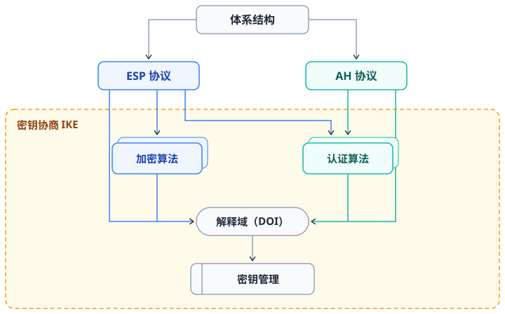
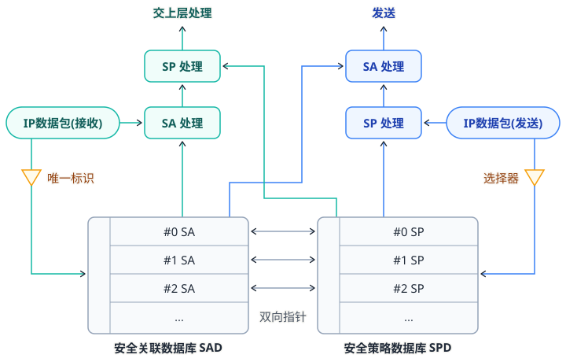
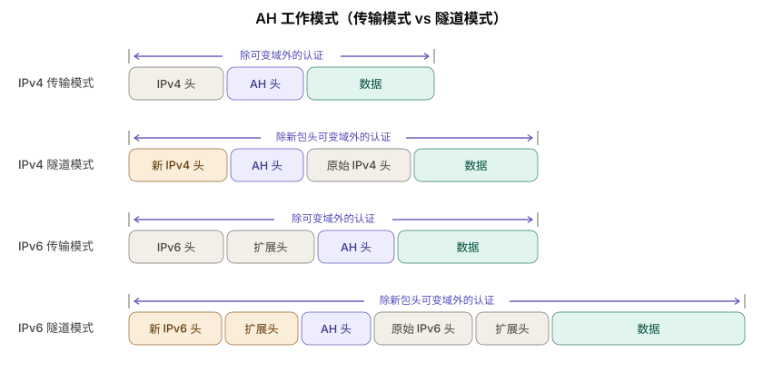
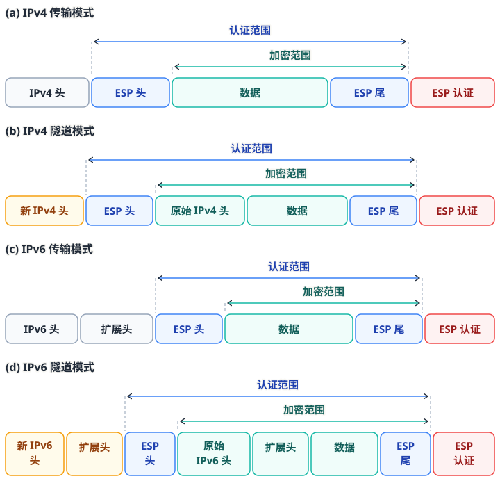
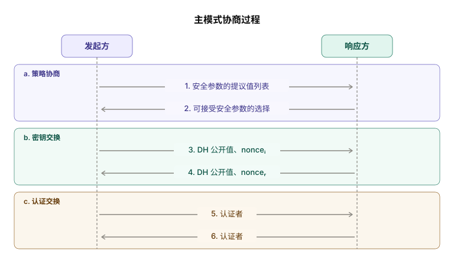
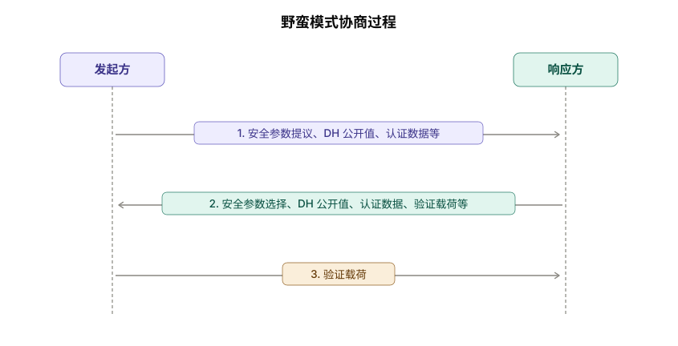
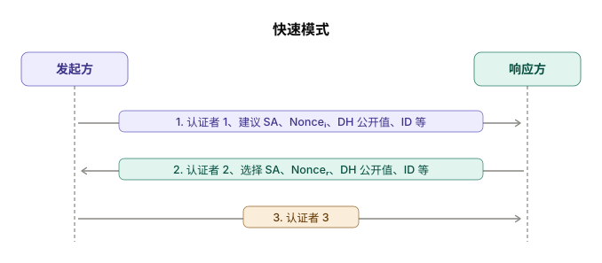

# IPSec协议的组成及工作原理

## IPSec 是什么、工作在哪一层？

IPSec 是一个标准的第三层安全协议组，工作在**传输层之下（网络/IP 层）**

## IPSec 两个核心安全协议以及提供的安全服务？

1. **安全协议**: AH（认证头协议）和 ESP（封装安全载荷协议）
2. **AH 提供的安全服务**: 提供对整个 IP 数据包包括 IP 头和内容做完整性服务、抗重放、数据源认证、不提供加密服务
3. **ESP 提供的安全服务**：只提供 IP 包内容部分的完整性认证、数据源认证、抗重放、加密服务

## IPSec 基本要件？

加密算法、认证算法、解释域（DOI）、密钥管理（IKE）

## 什么是 SA、SPD、SAD？

1. **安全关联 SA** 是 IPSec 单项连接所涉及的安全参数和策略的集合

   SA通过三元组

   $$
   \langle SPI（安全参数索引）, IP 目的地址, 安全协议标识（ESP/AH）\rangle
   $$

   来标识，其中 SPI 是与 SA 关联的位串，IKE SA 建立时生成伪随机数。

2. **SPD** 是安全策略数据库，负责保存 SP(Security Policy) 安全策略
3. **SAD** 是安全关联数据库，保存已建立的 SA

## 安全关联工作原理？

### 1. 发送方向：IP 数据包 → SP → SA

1. **查询 SPD（安全策略数据库）**：根据 IP 数据包的信息匹配 SP，确定处理方式。

   - **丢弃（DISCARD）**：直接丢弃数据包。
   - **绕过（BYPASS）**：不使用 IPSec，直接发送。
   - **应用 IPSec（PROTECT）**：按照安全策略进行 IPSec 保护。

2. **查询 SAD（安全关联数据库）**：若策略要求应用 IPSec，则获取指向相应 SA 的指针。

   - **SA 有效**：获取 SA 中的安全参数，执行 AH/ESP 处理，如加密、完整性认证等，发送处理后的报文。
   - **SA 未建立或无效**：无法满足安全策略时，丢弃数据包；必要时可通过 IKE 协商建立 SA。

### 2. 接收方向：IP 数据包 → SA → SP

1. **查询 SAD（安全关联数据库）**：根据报文的 SPI、目的 IP 地址及安全协议类型（AH/ESP），查找对应的 SA。

   - **SA 有效**：根据 SA 中的参数进行安全检查，包括防重放检查、完整性认证、解密及解封装等。
   - **SA 不存在或无效，或安全检查失败**：丢弃报文。

2. **查询 SPD（安全策略数据库）**：获取指向相应 SP 的指针，检查解封装后的数据包是否符合安全策略。

   - **符合策略**：将数据包交给上层协议处理，或在转发场景下继续转发。
   - **不符合策略**：丢弃数据包。

## IPSec工作模式？AH/ESP 分别在两种模式下的结构以及认证/加密范围

1. 工作模式分为**传输模式**和**隧道模式**
2. AH 两种模式：

   

3. ESP 两种模式：

   

## （原题）简述网络层安全协议抗重放攻击原理？

IPSec 的 AH 和 ESP 协议均可通过序列号和抗重放窗口机制防止重放攻击：

1. **序列号机制：**
   - 每个 ESP/AH 头部携带单调递增的 32 位序列号。
   - 新 SA 建立时序列号初始为 0，发送端每发一包序列号 +1。
   - 序列号达到 $ 2^{32} - 1 $ 时，原 SA 终止。

2. **抗重放窗口：**
   - 接收端为每个 SA 维护固定大小的滑动窗口（如大小 32）。
   - 序列号在窗口左侧：直接丢弃。
   - 序列号在窗口内部：MAC 验证通过后，若未标记则接收并标记位置，窗口不变。
   - 序列号在窗口右侧：MAC 验证通过后，标记位置，窗口向右滑动，以新序号为右界。

## （原题）IPSec 中 AH 与 ESP 认证数据的区别是什么？
- 传输模式中，AH 提供除了可变域（比如 TTL 字段）之外的，整个 IP 包（包含 IP 头和内容）的认证，而 ESP只提供 ESP 头、IP 包内容数据和 ESP 尾部的认证；
- 隧道模式中，AH 提供了除了新包头可变域之外的认证，而 ESP提供 ESP 头、原始 IP 包的所有数据以及 ESP 尾部的认证

总体来看，AH的认证服务安全性高于ESP的认证服务

## 什么是 IKE？IKE 负责什么？

1. IKE 是 Internet 密钥交换协议
2. IKE 负责在通信双方之间协商安全参数、进行身份认证、建立和管理 SA
   - 通信双方如果要使用 IPSec 安全通信，就需要确定使用什么加密算法、使用什么密钥，以及如何验证对方身份等。IKE 就是用来协商这些内容的。

## 建立安全关联的两个过程？

- **第一阶段**：协商建立 IKE SA，完成身份认证和密钥交换
- **第二阶段（快速模式）**：在已建立的 IKE SA 的保护下，协商建立 IPSec SA。

## 建立 IKE SA 的两个模式以及各自的过程？

### 1. 主模式：

| 步骤 | 消息 | 交换的内容 | 是否加密 | 目的 |
|---|---|---|---|---|
| a 策略协商 | 1、2 | 1：发起方提出安全参数提议列表；2：响应方选定一组可接受的 | 否 | 就加密算法、散列算法、认证方法、DH 组达成一致 |
| b 密钥交换 | 3、4 | 双方的 DH 公开值、Nonce | 否 | 双方各自算出相同的 DH 共享秘密，结合 Nonce 派生出密钥 |
| c 认证交换 | 5、6 | 双方身份信息 ID 和认证者 | **是**，用 b 步派生的密钥加密 | 验证对端身份 |

**认证者（即散列值）：** 双方用 b 步派生的密钥材料，对已交换的关键信息（双方 DH 公开值、安全参数提议、自己的身份等）计算出的散列值。对方用同样方法重算并比对：一致，说明对方掌握预共享密钥（或签名所用的私钥），且双方看到的 DH 公开值、参数没有被篡改。使用数字签名认证时，是对该散列值做签名。

**a、b 为什么不加密：** 此时双方还没有共享密钥，无从加密；DH 公开值和 Nonce 本来就是公开信息，被窃听也算不出共享秘密（离散对数难题）。预共享密钥不是用来加密 a、b，而是参与密钥派生和 c 步认证。

**Nonce 的作用：** 保证新鲜性，防重放，并参与密钥派生。

**中间人风险：** a、b 明文，攻击者可能替换 DH 公开值，由 c 步的认证者（绑定了 DH 公开值与身份）发现并堵住。

### IKE 密钥的用途

DH 共享秘密 + Nonce +（预共享密钥等认证材料）→ 派生出几把密钥：

- **加密密钥**：加密 IKE 后续消息（主模式第 5、6 条、快速模式消息）
- **认证密钥**：对 IKE 消息做完整性和来源认证（认证者）
- **派生密钥（母密钥）**：用于派生 IPSec SA 的密钥

IKE 的密钥保护的是**协商过程**，不是用户数据；IPSec SA 的密钥才用于 AH/ESP 保护数据包。

### 2. 野蛮模式：

| 消息 | 方向 | 内容 |
|---|---|---|
| 1 | 发起方→响应方 | 安全参数提议（只给一套）、DH 公开值、Nonce、自己的身份 ID |
| 2 | 响应方→发起方 | 选定的参数、DH 公开值、Nonce、自己的身份 ID、认证者 |
| 3 | 发起方→响应方 | 认证者 |

**为什么只要 3 条：** 把主模式的 a、b、c 三步合并——发起方一次性给出参数（不再逐轮协商）、DH 公开值和身份。

**代价：** 身份信息在认证之前就随消息 1、2 以明文发出，身份保护较弱。

## IKE 第二阶段：建立 IPSec SA（快速模式）

快速模式属于 IKE 协议，但它建立的是 IPSec SA，其消息受 IKE SA 保护。

- 认证者 1、2、3：用 IKE SA 的认证密钥计算，认证快速模式的协商消息（即“协商消息认证”）。
- IPSec SA 的密钥由 IKE 派生密钥，结合 SPI、协议号、双方 Nonce 产生；启用 PFS 时再混入新的 DH 共享秘密。

## IKE 的其他交换（不是建立 SA 的必经步骤）

1. **新组模式**：用于实现通信双方交换协商新的 Diffie-Hellman 组，如果响应方能够接受提议，就用完全一样的消息应答。
2. **ISAKMP 信息交换**：主要功能是实现通信一方向对方发送错误及状态提示消息，不需要确认。

## IPsec 是否涉及身份认证，位于哪些流程

**结论：涉及。** IPsec 中有三类认证，位于不同流程：

| 认证类型 | 验证什么 | 位于哪个流程 | 依靠 |
|---|---|---|---|
| ① 身份认证 | 通信对端是谁 | IKE 第一阶段，建立 IKE SA 时（主模式第 5、6 条；野蛮模式第 2、3 条） | 预共享密钥、数字签名等 |
| ② 数据源认证与完整性认证 | IP 包是否来自声称的源、有无被篡改 | 数据传输阶段，AH、启用完整性认证的 ESP | 基于密钥的认证机制 |
| ③ 协商消息认证 | 协商消息的来源与完整性 | IKE 第二阶段，快速模式 | 已建立的 IKE SA 的保护 |

- **① 身份认证的两种模式**：主模式先协商安全参数，再交换 DH 公开值和随机数，最后在加密保护下交换身份认证信息；野蛮模式将安全参数协商、DH 交换和身份认证压缩到 3 条消息中，交互更快，但身份信息保护较弱。

**严格意义的“身份认证”仅指①。** ②③是消息级认证，不是身份认证，但它们依赖①建立的可信密钥。

**核心区别：** 身份认证确认通信对端是谁，数据源认证保护传输的数据包，消息认证保护协议交互及协商内容。