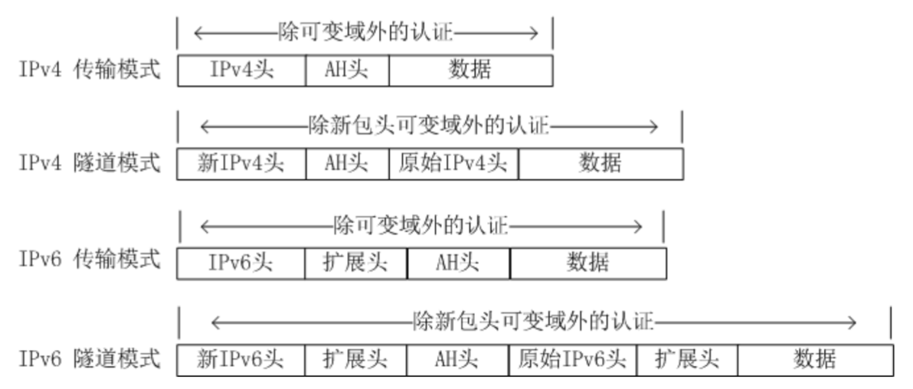
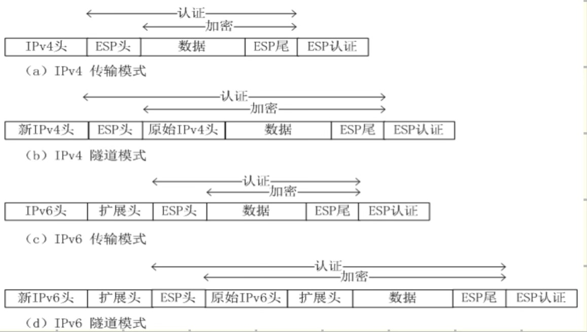
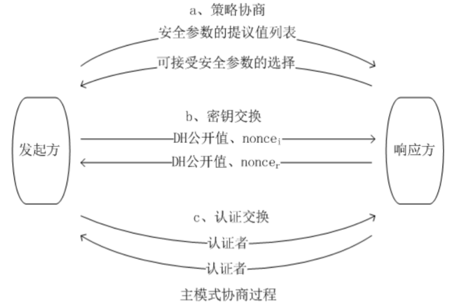
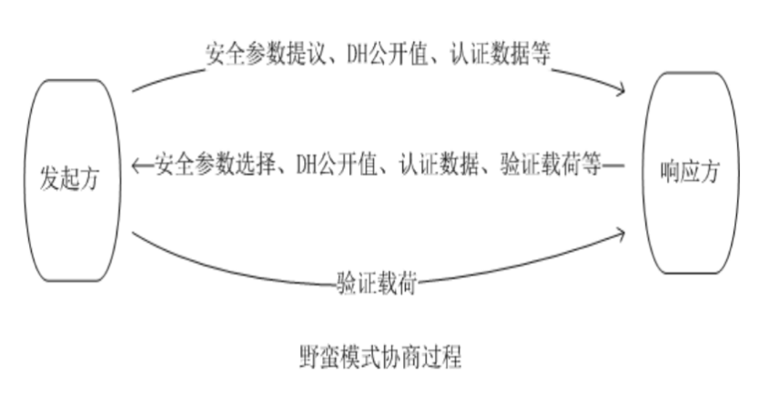
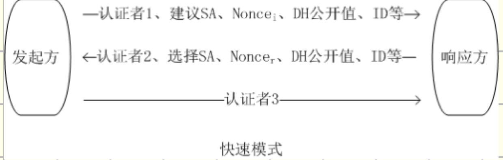

# IPSec协议的组成及工作原理

## IPSec 是什么、工作在哪一层？

IPSec 是一个标准的第三层安全协议组，工作在**传输层之下（网络/IP 层）**

## IPSec 两个核心安全协议以及提供的安全服务？

1. **安全协议**: AH（认证头协议）和 ESP（封装安全载荷协议）
2. **AH 提供的安全服务**: 提供对整个 IP 数据包包括 IP 头和内容做完整性服务、抗重放、数据源认证、不提供加密服务
3. **ESP 提供的安全服务**：只提供 IP 包内容部分的完整性认证、数据源认证、抗重放、加密服务

## IPSec 基本要件？

加密算法、认证算法、解释域（DOI）、密钥管理（IKE）

## 什么是 SA、SPD、SAD？

1. **安全关联 SA** 是 IPSec 单项连接所涉及的安全参数和策略的集合

   SA通过三元组

   $$
   \langle SPI（安全参数索引）, IP 目的地址, 安全协议标识（ESP/AH）\rangle
   $$

   来标识，其中 SPI 是与 SA 关联的位串，IKE SA 建立时生成伪随机数。

2. **SPD** 是安全策略数据库，负责保存 SP(Security Policy) 安全策略
3. **SAD** 是安全关联数据库，保存已建立的 SA

## 安全关联工作原理？

### 1. 发送方向：IP 数据包 → SP → SA

1. **查询 SPD（安全策略数据库）**：根据 IP 数据包的信息匹配 SP，确定处理方式。

   - **丢弃（DISCARD）**：直接丢弃数据包。
   - **绕过（BYPASS）**：不使用 IPSec，直接发送。
   - **应用 IPSec（PROTECT）**：按照安全策略进行 IPSec 保护。

2. **查询 SAD（安全关联数据库）**：若策略要求应用 IPSec，则获取指向相应 SA 的指针。

   - **SA 有效**：获取 SA 中的安全参数，执行 AH/ESP 处理，如加密、完整性认证等，发送处理后的报文。
   - **SA 未建立或无效**：无法满足安全策略时，丢弃数据包；必要时可通过 IKE 协商建立 SA。

### 2. 接收方向：IP 数据包 → SA → SP

1. **查询 SAD（安全关联数据库）**：根据报文的 SPI、目的 IP 地址及安全协议类型（AH/ESP），查找对应的 SA。

   - **SA 有效**：根据 SA 中的参数进行安全检查，包括防重放检查、完整性认证、解密及解封装等。
   - **SA 不存在或无效，或安全检查失败**：丢弃报文。

2. **查询 SPD（安全策略数据库）**：获取指向相应 SP 的指针，检查解封装后的数据包是否符合安全策略。

   - **符合策略**：将数据包交给上层协议处理，或在转发场景下继续转发。
   - **不符合策略**：丢弃数据包。

## IPSec工作模式？AH/ESP 分别在两种模式下的结构以及认证/加密范围

1. 工作模式分为**传输模式**和**隧道模式**
2. AH 两种模式：

   

3. ESP 两种模式：

   

## （原题）简述网络层安全协议抗重放攻击原理？

IPSec 的 AH 和 ESP 协议均可通过序列号和抗重放窗口机制防止重放攻击：

1. **序列号机制：**
   - 每个 ESP/AH 头部携带单调递增的 32 位序列号。
   - 新 SA 建立时序列号初始为 0，发送端每发一包序列号 +1。
   - 序列号达到 $ 2^{32} - 1 $ 时，原 SA 终止。

2. **抗重放窗口：**
   - 接收端为每个 SA 维护固定大小的滑动窗口（如大小 32）。
   - 序列号在窗口左侧：直接丢弃。
   - 序列号在窗口内部：MAC 验证通过后，若未标记则接收并标记位置，窗口不变。
   - 序列号在窗口右侧：MAC 验证通过后，标记位置，窗口向右滑动，以新序号为右界。

## （原题）IPSec 中 AH 与 ESP 认证数据的区别是什么？
- 传输模式中，AH 提供除了可变域（比如 TTL 字段）之外的，整个 IP 包（包含 IP 头和内容）的认证，而 ESP只提供 ESP 头、IP 包内容数据和 ESP 尾部的认证；
- 隧道模式中，AH 提供了除了新包头可变域之外的认证，而 ESP提供 ESP 头、原始 IP 包的所有数据以及 ESP 尾部的认证

总体来看，AH的认证服务安全性高于ESP的认证服务

## 什么是 IKE？IKE 负责什么？

1. IKE 是 Internet 密钥交换协议
2. IKE 负责在通信双方之间协商安全参数、进行身份认证、建立和管理 SA
   - 通信双方如果要使用 IPSec 安全通信，就需要确定使用什么加密算法、使用什么密钥，以及如何验证对方身份等。IKE 就是用来协商这些内容的。

## 建立安全关联的两个过程？

- **第一阶段**：协商建立 IKE SA，完成身份认证和密钥交换
- **第二阶段**：协商建立 IPSEC SA

## 建立 IKE SA 的两个模式以及各自的过程？

### 1. 主模式：

- a. 策略协商（加密算法、散列算法、认证方法、DH 组）
- b. 密钥交换（DH 公开值、防重放随机数 Nonce）
- c. 认证交换（交换认证者，即散列值）

### 2. 野蛮模式：

- 发送方：参数提议、DH 公开值、身份信息
- 接收方：参数选择、DH 公开值、身份信息、验证载荷
- 发送方：验证载荷（散列）

## 建立 IPSec 的过程
1. 快速模式

2. 新组模式：     
用于实现通信双方交换协商新的 Diffie-Hellman 组，如果响应方能够接受提议，就用完全一样的消息应答
3. ISAKMP 信息交换：    
主要功能是实现通信一方向对方发送错误及状态提示消息，不需要确认

## （原题）IPsec 协议中是否涉及身份认证，位于哪些流程。
- IPsec 涉及身份认证，主要通过 **IKE 协议第一阶段** 完成。
- IKE 第一阶段分为主模式和野蛮模式，双方先协商安全参数并交换 DH 公共值、随机数，再采用预共享密钥、数字签名等认证方法验证通信对端的身份，并建立 IKE SA。
- 主模式：先协商安全参数，再交换 DH 公共值和随机数，最后在加密保护下交换身份认证信息。
- 野蛮模式：将安全参数协商、DH 交换和身份认证所需的信息压缩到 3 条消息中，交互更快，但身份信息保护较弱。

（注）区分三种认证：
1. 身份认证：IKE 第一阶段（主模式、野蛮模式）通过预共享密钥、数字签名等方式认证通信对端的身份。
2. 数据源认证与完整性认证：AH 和启用了完整性认证功能的 ESP 利用基于密钥的认证机制，验证 IP 数据包的来源真实性和完整性。
3. 协商消息认证：IKE 快速模式利用已有 IKE SA 提供的保护机制，验证协商消息的完整性及其来源的真实性，确保 IPsec SA 协商过程的安全。

**核心区别**：身份认证确认通信对端是谁，数据源认证保护传输的数据包，消息认证保护协议交互及协商内容。