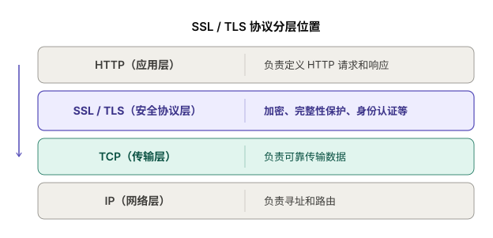
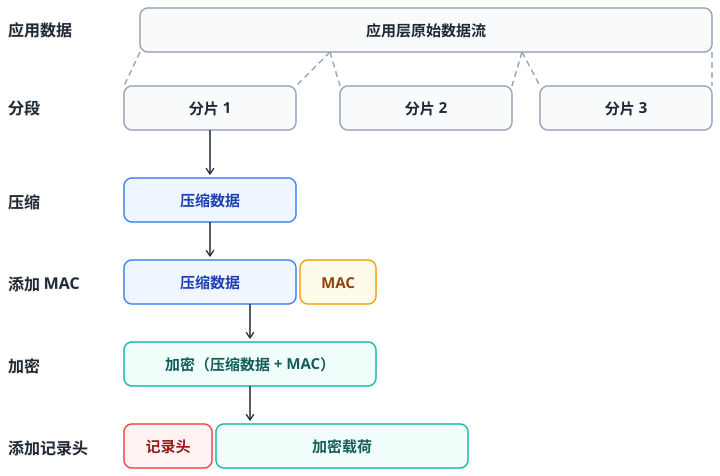
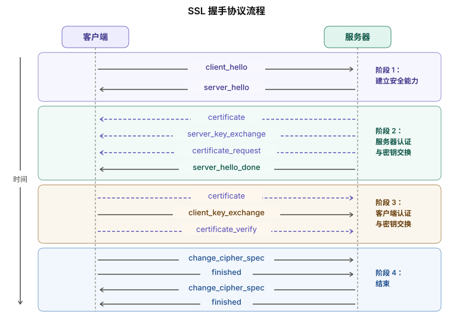

# SSL协议的组成及工作原理

## 什么是 SSL 和 TLS？
- SSL 是**安全套接层 Secure Socket Layer 协议**，TLS 是**传输层安全规范协议**
- 位于 TCP 与应用层之间。

SSL/TLS 接收应用层数据，对其进行安全处理后，再通过 TCP 传输。

## （原题）SSL 协议位于哪一层？
位于传输层和应用层之间
## （原题）SSL 的四个核心协议名称，分别位于哪一层及其作用？
1. **记录协议**（应用层与传输层间）：对上层数据进行封装、完整性保护和加密，提供**完整性、通信加密**服务
2. **握手协议**（应用层）：协商安全参数、认证身份、建立共享密钥，提供**点对点身份认证**
3. **转换密码规范协议**（应用层）：协商密码套件与密钥规范，通知对方切换到协商好的密码保护状态
4. **报警协议**（应用层）：传输异常警报信息

## SSL 记录协议提供的安全服务有哪些？
1. **保密性**：利用握手协议定义的共享密钥，对有效载荷进行常规加密。
2. **消息完整性**：利用握手协议定义的共享 MAC 密钥，生成报文摘要，确保数据未被篡改。

## SSL 记录协议数据处理流程？
分段 -> 压缩 -> 添加 MAC -> 加密 -> 加记录头

## SSL 握手协议核心功能？
用于建立会话、协商压缩方法、鉴别方法、加密算法、加密密钥、初始化操作。 最终目标：使服务器和客户端能相互鉴别对方身份，并协商共享的 MAC 密钥和载荷加密密钥。

## SSL 握手协议过程？
建立安全能力-> 服务器认证密钥交换 -> 客户端认证与密钥交换 -> 结束

## SSL 握手过程（四个阶段）

> 带 * 为可选/视情况而定

| 阶段 | 消息 | 内容 |
|---|---|---|
| **1 建立安全能力** | ClientHello、ServerHello | 协商版本、加密套件、压缩方法，交换随机数 |
| **2 服务器认证与密钥交换** | Certificate* | 服务器证书（内含服务器公钥），客户端据此认证服务器；匿名 DH 无 |
| | ServerKeyExchange* | 证书公钥不足以交换密钥时才发（DH：参数 + 公开值，带签名）；RSA 不发 |
| | CertificateRequest* | 要求客户端提供证书 |
| | ServerHelloDone | 服务器消息结束 |
| **3 客户端认证与密钥交换** | Certificate* | 仅在服务器要求时发送客户端证书 |
| | ClientKeyExchange | 预主密钥（RSA：用服务器公钥加密）或 DH 公开值 |
| | CertificateVerify* | 有客户端证书时，用私钥签名证明持有 |
| **4 结束** | ChangeCipherSpec、Finished（双方各一次） | 切换到新密码规范；Finished 含全部握手消息的散列，验证握手完整 |

**密钥生成：** 预主密钥 + 双方随机数 → 主密钥 → 加密密钥、MAC 密钥。
**证书验证：** 客户端用 CA 公钥验证证书签名，确认服务器身份。