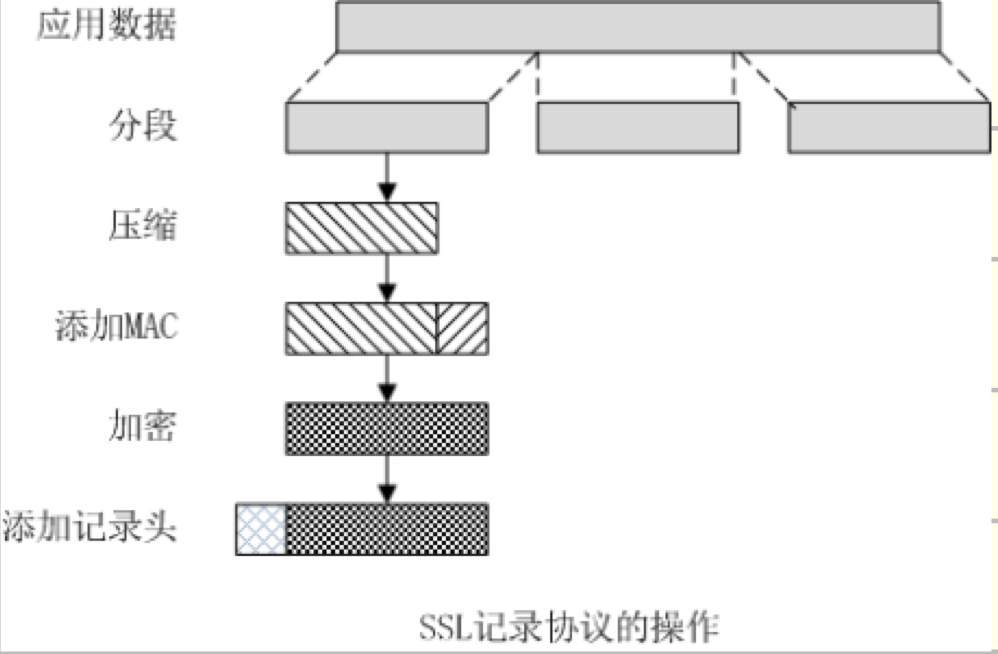
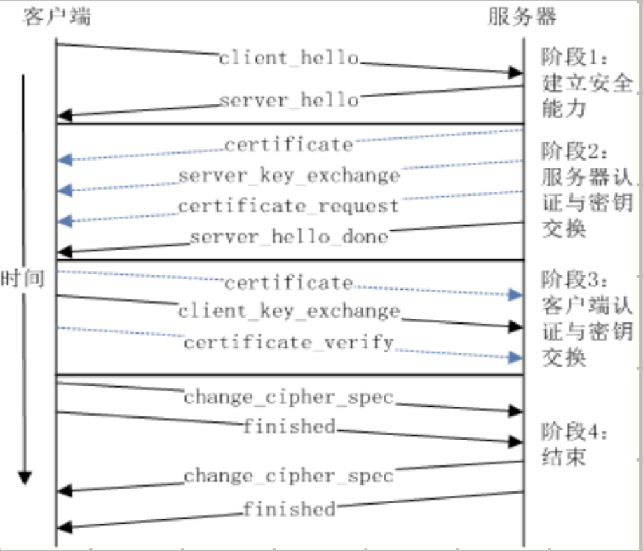

# SSL协议的组成及工作原理

## 什么是 SSL 和 TLS？
- SSL 是**安全套接层 Secure Socket Layer 协议**，TLS 是**传输层安全规范协议**
- 位于 TCP 与应用层之间。

```text
┌─────────────────────────┐
│ HTTP（应用层）           │ 负责定义 HTTP 请求和响应
├─────────────────────────┤
│ SSL/TLS（安全协议层）    │  ← 加密、完整性保护等
├─────────────────────────┤
│ TCP（传输层）            │ 负责可靠传输数据
├─────────────────────────┤
│ IP（网络层）             │ 负责寻址和路由
└─────────────────────────┘
```
SSL/TLS 接收应用层数据，对其进行安全处理后，再通过 TCP 传输。

## （原题）SSL 协议位于哪一层？
位于传输层和应用层之间
## （原题）SSL 的四个核心协议名称，分别位于哪一层及其作用？
1. **记录协议**（应用层与传输层间）：对上层数据进行封装、完整性保护和加密，提供**完整性、通信加密**服务
2. **握手协议**（应用层）：协商安全参数、认证身份、建立共享密钥，提供**点对点身份认证**
3. **转换密码规范协议**（应用层）：协商密码套件与密钥规范，通知对方切换到协商好的密码保护状态
4. **报警协议**（应用层）：传输异常警报信息

## SSL 记录协议提供的安全服务有哪些？
1. **保密性**：利用握手协议定义的共享密钥，对有效载荷进行常规加密。
2. **消息完整性**：利用握手协议定义的共享 MAC 密钥，生成报文摘要，确保数据未被篡改。

## SSL 记录协议数据处理流程？
分段 -> 压缩 -> 添加 MAC -> 加密 -> 加记录头


## SSL 握手协议核心功能？
用于建立会话、协商压缩方法、鉴别方法、加密算法、加密密钥、初始化操作。 最终目标：使服务器和客户端能相互鉴别对方身份，并协商共享的 MAC 密钥和载荷加密密钥。

## SSL 握手协议过程？
建立安全能力-> 服务器认证密钥交换 -> 客户端认证与密钥交换 -> 结束

1. 建立安全能力（Hello & 算法协商）：交换 ClientHello / ServerHello，协商版本、加密套件、随机数等。
2. 服务器认证与密钥交换：服务器发送证书、公钥，完成服务器身份验证。
3. 客户端认证与密钥交换：客户端验证服务器证书后，发送客户端证书及预主密钥（可选）。
4. 结束：双方验证协商参数，生成会话密钥，握手完成。