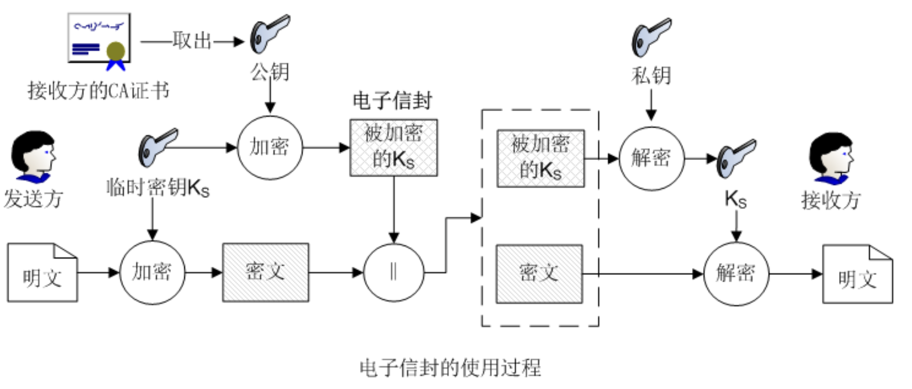
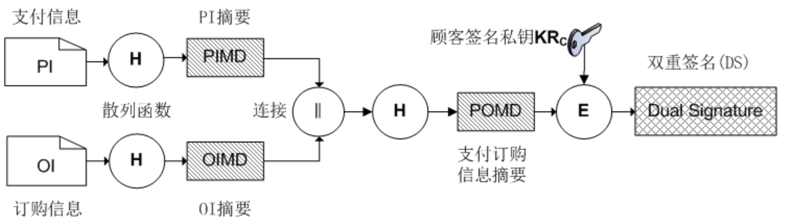

# SET 协议体系与关键技术

## SET 全称？运行在哪一层？
- SET 全称 (Secure Electronic Transaction）**安全电子交易协议**       
- 运行在**应用层**

## SET 提供哪些安全服务？
机密性、完整性、身份认证、不可否认性

## SET 关键技术？
数字证书、数字签名、双重签名、电子信封、加密技术和散列函数。
- 数字签名用于验证签名的有效性及信息完整性
- 双重签名用于建立订购信息与支付信息的关联并实现信息隔离
- 电子信封结合对称加密和公钥加密保护信息机密性
- 散列函数用于生成消息摘要，支持完整性验证和数字签名

## 解释电子信封技术（Electronic Envelope）
电子信封技术结合了对称加密和非对称加密的优点，利用对称加密提高数据加密效率，利用非对称加密安全地传递对称密钥，从而实现数据的机密性保护。

**发送方的处理过程：**

1. **获取接收方公钥**：发送方从接收方的数字证书中获取其公钥，并验证证书的有效性。
2. **加密明文**：发送方生成对称密钥 $K_s$，使用该密钥加密明文 $M$，得到密文 $C = E_{K_s}(M)$。
3. **加密对称密钥**：发送方使用接收方的公钥 $PK_B$ 加密对称密钥 $K_s$，得到加密后的对称密钥 $C_K = E_{PK_B}(K_s)$。
4. **发送数据**：发送方将加密后的对称密钥 $C_K$ 与密文 $C$ 组合后发送给接收方。

**接收方的处理过程：**

1. **恢复对称密钥**：接收方使用自己的私钥 $SK_B$ 解密 $C_K$，恢复对称密钥 $K_s$。
1. **恢复对称密钥**：接收方使用自己的私钥 $SK_B$ 解密 $C_K$，恢复对称密钥 $K_s$。
2. **解密明文**：接收方使用恢复的对称密钥 $K_s$ 解密密文 $C$，得到原始明文 $M$。

**电子信封的核心思想：** 使用对称加密保护实际数据，使用接收方的公钥加密对称密钥，兼顾加密效率与密钥传递的安全性。

**注意：** 电子信封主要提供机密性保护，本身不自动提供发送方身份认证和消息完整性保护。

## （原题）解释双重签名（DS，Dual Signature）技术

**双重签名的生成：**

1. 顾客分别对支付信息 $PI$ 和订购信息 $OI$ 进行散列：
   $$
   PIMD = H(PI), \qquad OIMD = H(OI)
   $$
2. 将两个摘要连接后再次散列：
   $$
   POMD = H(PIMD \parallel OIMD)
   $$
3. 顾客使用自己的私钥对 $POMD$ 签名，得到双重签名：
   $$
   DS = Sign_{SK_C}(POMD)
   $$
   其中，$SK_C$ 表示顾客的私钥。

**交互流程与验证：**

1. **顾客向商家发送信息**
   - 顾客发送 $DS$、$OI$ 和 $PIMD$。
   - 商家使用顾客证书中的公钥验证 $DS$，得到签名对应的摘要。
   - 商家计算：
     $$
     POMD_M = H(PIMD \parallel H(OI))
     $$
   - 商家比较计算结果与签名验证得到的摘要；若一致，则验证通过。商家可验证订单信息与支付信息摘要之间的关联，但无法获得 $PI$。

2. **顾客向银行发送支付信息**
   - 顾客通过电子信封保护支付信息，并经商家转发给银行；发送内容包括 $DS$、$PI$ 和 $OIMD$。
   - 银行使用顾客证书中的公钥验证 $DS$。
   - 银行计算：
     $$
     POMD_B = H(H(PI) \parallel OIMD)
     $$
   - 银行比较计算结果与签名验证得到的摘要；若一致，则验证通过。银行可验证支付信息与订单信息摘要之间的关联，但无法获得 $OI$。
