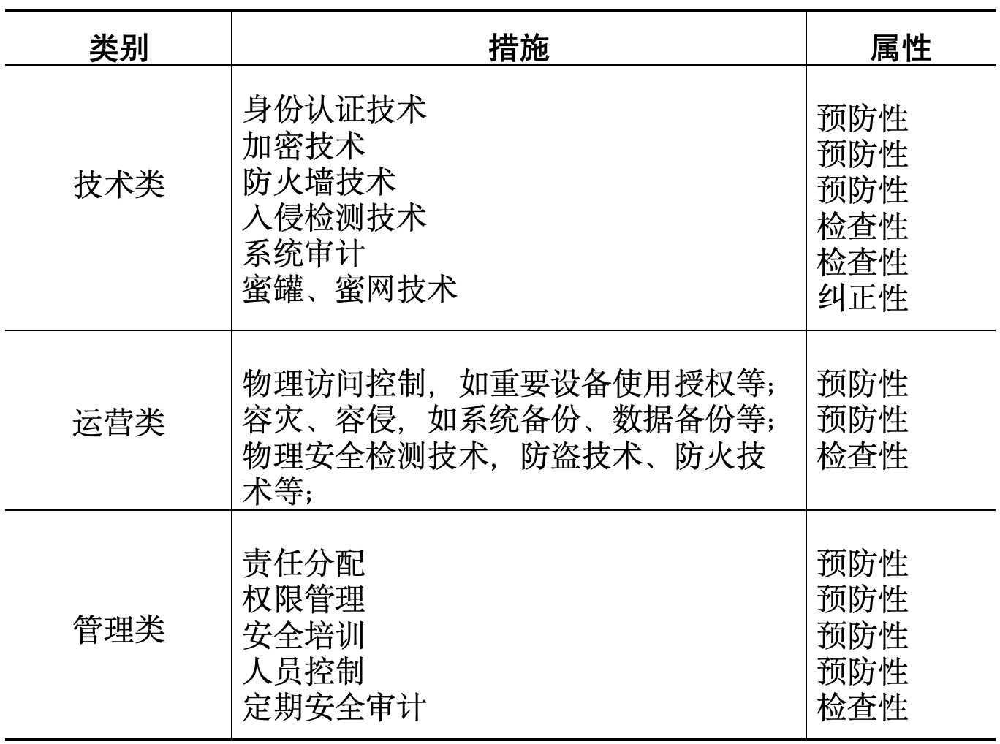

# 信息系统风险评估与控制

此部分做笔记时没有详细记述，故重新系统学习      
信息安全标准：为了能够更好地解决信息安全产品的互操作性，许多标准化组织制定了有关信息安全的国际标准

## 关于信息安全的国际标准
### 技术与工程标准：
CC、SSE-CCM 等
### 互操作标准：
互操作标准多数为所谓的“事实标准”，如 RSA、DES、CVE 等
### 信息安全管理与控制标准：
BS 7799等
## 什么是CC？

- CC（信息技术安全性评估通用准则，简称**通用准则**、Common Criteria）
- CC 是一套信息技术安全性评价准则，侧重点放在系统和产品的技术指标评价上。
- 其重要突出概念是**保护轮廓**（PP，Protection Profile），用于描述特定产品类型或使用场景的安全需求(针对某一类产品，提前规定需要满足哪些安全要求)

## 什么是 BS 7799？
- BS 7799 是**信息安全管理标准**
- BS 7799 标准采用层次结构化形式定义描述了安全策略、信息安全的组织结构、资产管理、人力资源安全等 11 个**安全管理要素**，另外还给出了 39 个**主要执行目标**和 133 个**具体控制措施**。
- BS 7799 明确了组织机构**信息安全管理建设**的内容，为负责信息安全系统应用和开发的人员提供了较全面的参考规范

## 信息犯罪与道德规范？
- 信息【三】犯罪：窃取、破坏、滥用。
- 道德【三】原则：整体原则、兼容原则、互惠原则。

## 具体风险控制措施？

## （原题）cc 和 bs7799 分别属于什么措施。
* CC 标准属于技术性措施。
* BS 7799 属于管理性措施。

## GB17895-1999《计算机信息系统安全保护等级划分准则》

包含 5 个等级（从低到高）：

- 自主保护
- 系统审计保护
- 安全标注保护
- 结构化保护
- 访问验证保护（最高级）
## 国家信息安全标准体系

包含 6 个部分：

- 技术与机制
- 基础标准
- 管理标准
- 测评标准
- 密码技术
- 保密技术

不懂考这些干什么，26 年居然考 GB/T 22239-2019，这谁能记得住     
蒜鸟，考场上看命吧