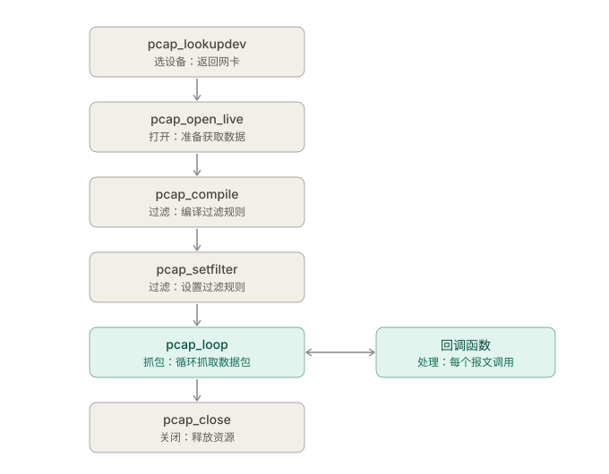

# 数据链路层编程接口

## Libpcap / WinPcap 数据采集

### 一、基本概念

- `libpcap`（Linux）和 `winpcap`（Windows）都是**数据链路层编程接口**。
- 使用时需先设置**混杂模式**，并可通过 **BPF 语法**编译、设置过滤器，对数据包进行过滤。

### 二、应用编程流程 🟨

| 步骤 | 函数 | 作用 |
|---|---|---|
| 选设备 | `pcap_lookupdev()` | 查找并返回可用网卡 |
| 打开 | `pcap_open_live()` | 打开网卡，准备获取数据 |
| 过滤 | `pcap_compile()` | 把字符串形式的过滤规则编译成内核可执行的过滤程序 |
| 过滤 | `pcap_setfilter()` | 把编译好的过滤程序应用到网卡 |
| 抓包 + 处理 | `pcap_loop()` | 循环抓取数据包，**对每个报文调用回调函数** |
| 关闭 | `pcap_close()` | 关闭，释放资源 |

### 三、重点函数参数

- `pcap_open_live()`
  - `snaplen`：捕获的**最大字节数**
  - `promisc`：是否进入**混杂模式**（`true` / `false`）
- `pcap_loop()`：连续捕获 `cnt` 个数据包；**超时不返回**；`cnt < 0` 则持续抓包，直到出错。

### 四、其他 API

| 函数 | 作用 |
|---|---|
| `pcap_lookupnet()` | 获取网卡的 **IP 地址和子网掩码** |
| `pcap_datalink()` | 返回**链路层类型**（以太网、IEEE 802.11 等） |
| `pcap_open_offline()` | 打开存盘文件，**读取**离线数据包 |
| `pcap_dump_open()` | 打开存盘文件，准备**写入**捕获的数据包 |
| `pcap_dump()` | 将分组输出到已打开的存盘文件 |
| `pcap_dispatch()` | 处理最多 `cnt` 个包；`cnt=0` 处理所有，`cnt=-1` 一次读一个缓冲区 |
| `pcap_next()` | 获取 **1 个**数据包后立即返回 |

### 五、抓包函数对比

| 函数 | 抓多少 | 特点 |
|---|---|---|
| `pcap_loop()` | `cnt` 个，`cnt<0` 则一直抓 | 超时**不返回**，用回调处理 |
| `pcap_dispatch()` | 最多 `cnt` 个 | 按缓冲区读取，超时可返回 |
| `pcap_next()` | 1 个 | 立即返回，数据存在返回值指向的内存 |