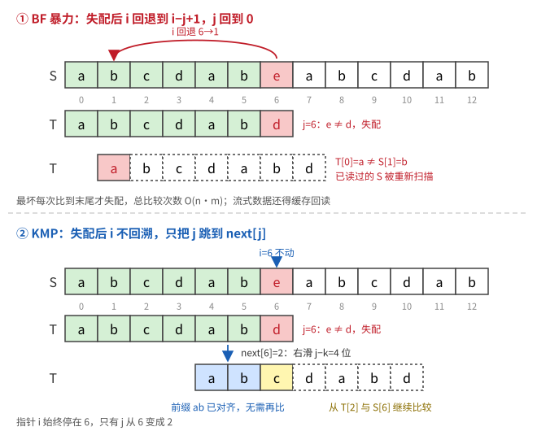
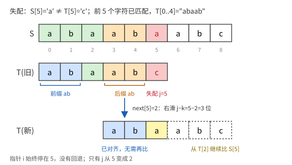

# KMP 算法

## 1. 要解决的问题

**单模式串匹配**：在文本串 `S`（长度 n）中找模式串 `T`（长度 m）第一次出现的位置。

| 方法 | 做法 | 最坏复杂度 |
|---|---|---|
| **BF（暴力）** | 失配后 `i` 回退到 `i-j+1`，`j` 回到 0 | O(n·m) |
| **KMP** | 失配后 **`i` 不回溯**，只移动 `j` | **O(n+m)** |


## 2. 核心思想：文本指针不回溯

设文本串第 `i` 个字符与模式串第 `j` 个字符失配，则前 `j` 个字符一定匹配成功：

```
S[i-j .. i-1] = T[0 .. j-1]
```

也就是说，**文本串这一段的信息已经"映射"到了模式串上**，我们已经知道它长什么样，不需要再回头读文本串。

**在网络与信息安全中的意义**

- 防火墙、IDS 等设备大多做**基于流的匹配**，有些特征甚至**跨数据包**。
- 文本指针回退意味着要缓存、回读已处理的数据，严重影响性能。
- 因此"不回溯"是单模式和多模式匹配算法（如 AC 自动机）的共同核心。

## 3. 失配后该从模式串哪个位置继续比较？

已知 `S[i-j..i-1] = T[0..j-1]`。若存在最大的 `k (k<j)`，使得

```
T[0..k-1] = T[j-k..j-1]      （T[0..j-1] 的最长相同前缀 = 后缀）
```

由于 `T[j-k..j-1] = S[i-k..i-1]`，所以

```
S[i-k..i-1] = T[0..k-1]
```

即模式串的前 `k` 个字符已经与文本串当前位置前面的 `k` 个字符对齐。于是只需把模式串**右滑 `j-k` 位**，直接从 `T[k]` 与 `S[i]` 继续比较。

> **关键结论**：`k` 只由模式串自身和失配位置 `j` 决定，**与文本串无关**，所以可以对 `T` 预处理出 **next 数组**。

#### S = `abaabaabc`，T = `abaabc`，j=5 处失配


## 4. 前缀、后缀与最长公共前后缀

- **前缀**：除最后一个字符外，字符串所有的头部组合。
- **后缀**：除第一个字符外，字符串所有的尾部组合。
- **最大公共元素长度**：相等的前缀和后缀中最长的那个的长度。

以模式串 `ABCDABD` 为例：

| 子串 | 前缀 | 后缀 | 最大公共长度 |
|---|---|---|---|
| `A` | 空 | 空 | **0** |
| `AB` | A | B | **0** |
| `ABC` | A, AB | C, BC | **0** |
| `ABCD` | A, AB, ABC | D, CD, BCD | **0** |
| `ABCDA` | **A**, AB, ABC, ABCD | **A**, DA, CDA, BCDA | **1**（`A`） |
| `ABCDAB` | A, **AB**, ABC, ABCD, ABCDA | B, **AB**, DAB, CDAB, BCDAB | **2**（`AB`） |
| `ABCDABD` | A, AB, ABC, ABCD, ABCDA, ABCDAB | D, BD, ABD, DABD, CDABD, BCDABD | **0** |

## 5. next 函数的定义

下标从 0 开始：

```
         ┌ -1   当 j = 0
next[j] =┤  k   T[0..j-1] 的最长相同前后缀长度（j > 0，0 ≤ k < j）
         └  0   没有相同前后缀
```

| next[j] 的值 | 含义 |
|---|---|
| **-1** | 根本不比较：模式串窗口滑出当前文本位置，**`i++`，`j` 重置为 0** |
| **0** | 从模式串**头部** `T[0]` 开始重新比较 |
| **k** | 从模式串 `T[k]` 继续比较 |

### 例：T = `abaabc`

| j | 0 | 1 | 2 | 3 | 4 | 5 |
|---|---|---|---|---|---|---|
| T[j] | a | b | a | a | b | c |
| **next[j]** | **-1** | **0** | **0** | **0** | **1** | **2** |

验证 `next[5]=2`：`T[0..4]="abaab"`，前缀 `ab` = 后缀 `ab`，最长为 2。

### 例：T = `ABCDABD`

| j | 0 | 1 | 2 | 3 | 4 | 5 | 6 |
|---|---|---|---|---|---|---|---|
| T[j] | A | B | C | D | A | B | D |
| **next[j]** | **-1** | **0** | **0** | **0** | **0** | **1** | **2** |

## 6. KMP 匹配主过程


## 8. 复杂度

| 阶段 | 时间 | 说明 |
|---|---|---|
| 求 next | **O(m)** | k 增加总次数 ≤ m，减少次数不超过增加次数 |
| 匹配 | **O(n)** | `i` 只增不减；`j` 每次回退都以前面的增加为上限 |
| 总计 | **O(n+m)** | 额外空间 O(m) |
