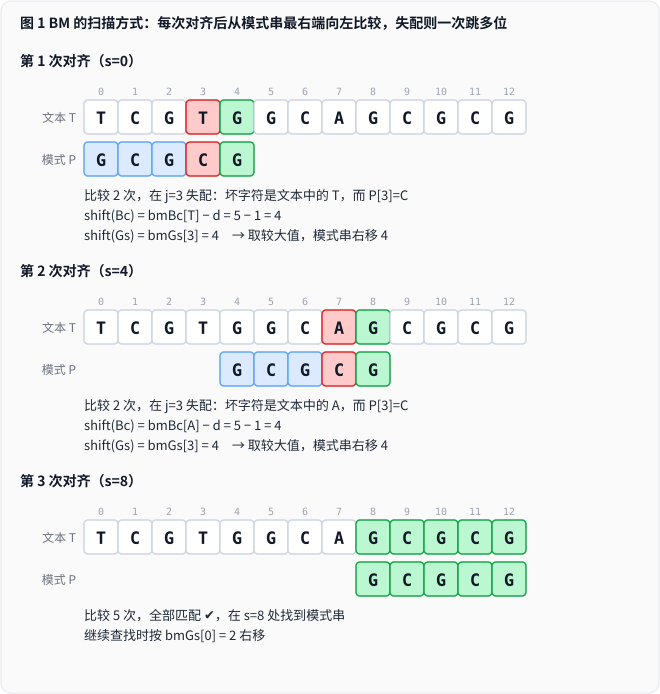
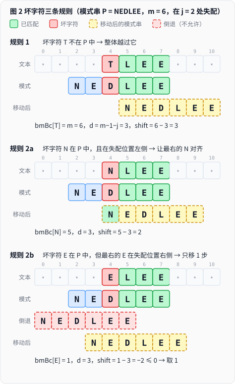
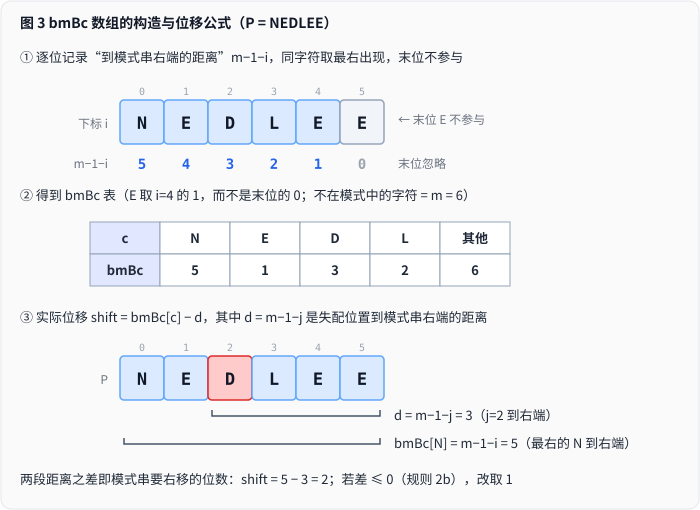
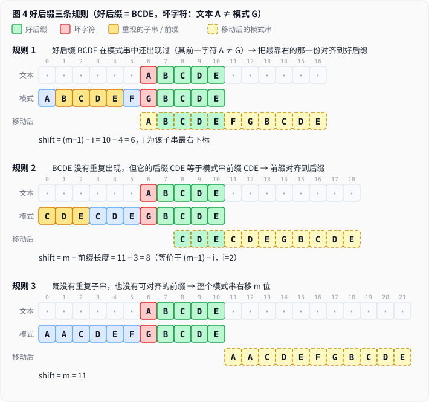
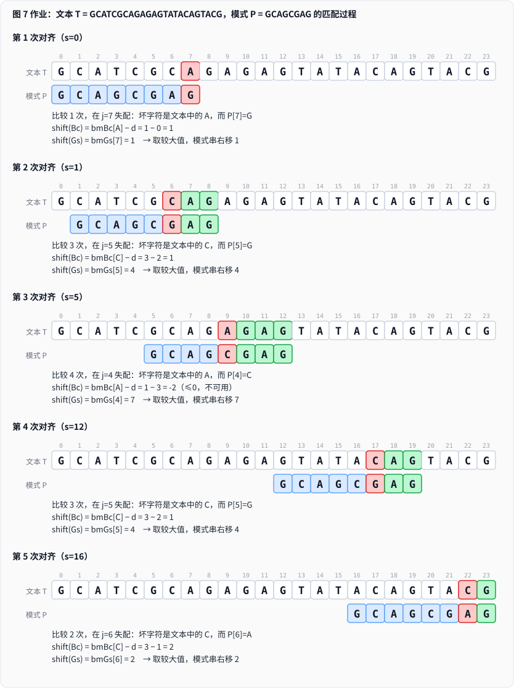
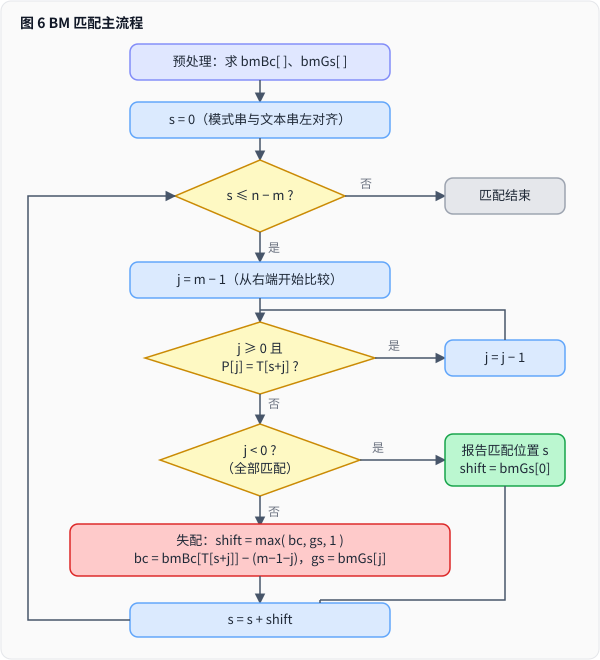

# BM 算法

自右向左比较、坏字符与好后缀、bmBc / bmGs 数组与亚线性跳跃。

## 1. 要解决的问题

**单模式串匹配**：在文本串 `T`（长度 n）中找模式串 `P`（长度 m）。

| 方法 | 做法 | 复杂度 |
|---|---|---|
| **BF（暴力）** | 失配后文本指针回退，逐位重来 | O(n·m) |
| **KMP** | 文本指针不回溯，靠 next 数组调整模式指针 | O(n+m) |
| **BM** | 模式串**自右向左**比较，失配时按两个预处理函数**大步右移** | 预处理 O(m+σ)，匹配最好 **O(n/m)**（亚线性） |

> σ 为字符集大小（如 ASCII 取 256）。

## 2. 核心思想：从右往左比，失配就大步跳

- 文本串与模式串左端对齐后，**比较从模式串最右端开始，自右向左**；文本串整体仍是从左向右推进。
- 相等：两个指针同时左移 1 位，继续比较。
- 失配（或整串匹配）：**模式串右移若干位**，重新对齐后再次从最右端开始比。
- 右移的距离由两个预先算好的函数决定：**坏字符**（`bmBc`）与**好后缀**（`bmGs`），实际取二者的**较大值**。

目标：每次右移尽可能远，同时**绝不漏掉任何可能的匹配**。



## 3. 坏字符规则

**坏字符**：本轮从右往左比较时，**第一次失配位置上的文本字符**（是文本里的字符，不是模式串里的）。每轮最多一个。

设失配位置为 `j`（模式串下标），坏字符为 `c`：

| 情形 | 条件 | 动作 |
|---|---|---|
| **规则 1** | `c` 不在模式串中 | 模式串整体右移到坏字符的右侧 |
| **规则 2a** | `c` 在模式串中，最右的 `c` 位于失配位置**左侧** | 右移，使最右的 `c` 与坏字符对齐 |
| **规则 2b** | `c` 在模式串中，最右的 `c` 位于失配位置**右侧** | 右移 **1 步**（对齐会让模式串倒退，不允许） |

原则：**模式串不能相对文本串走回头路**。



**为什么 2b 只走 1 步？** 对齐最右的 `c` 会得到负位移（倒退）；而 `bmBc` 只记录全串最右的 `c`，没有记录“失配位置左边最近的 `c`”，因此坏字符规则此时给不出正位移，保守取 1 步一定不会漏解。更大的位移要靠**好后缀规则**，这也是 BM 需要两条规则的原因。


## 4. bmBc 数组（坏字符表）

**定义**：下标是字符 `c`，值是 `c` 在模式串中**最右出现位置到模式串右端的距离**；不在模式串中的字符记为 `m`。

- 距离 = `m-1-i`（`i` 为该字符的下标）。
- 查找最右出现位置时要**忽略模式串末位**：末位若与文本匹配就不是坏字符，若不匹配则它本身不是 `c`，所以末位永远不是“坏字符的出现位置”。

**实际位移**：`bmBc` 存的是“最右 `c` 到右端的距离”，而失配位置 `j` 是动态的，所以

```
       d = m - 1 - j                 // 失配位置到模式串右端的距离
shift_Bc = bmBc[c] - d               // 若 ≤ 0（规则 2b），说明会倒退，取 1
```



示例（`P = NEDLEE`，m = 6）：

| c | N | E | D | L | 其他 |
|---|---|---|---|---|---|
| **bmBc** | 5 | 1 | 3 | 2 | 6 |


## 5. 好后缀规则

**好后缀**：失配之前已经匹配成功的那一段后缀 `P[j+1..m-1]`。若第一次比较就失配，则没有好后缀，只能用坏字符规则。

设好后缀为 `u`，失配位置为 `j`：

| 情形 | 条件 | 动作 |
|---|---|---|
| **规则 1** | 模式串中**另有一处**子串等于 `u`，且其**前一个字符不同于 `P[j]`** | 把**最靠右**的那一处对齐到好后缀位置 |
| **规则 2** | 没有这样的子串，但 `u` 的某个**后缀**等于模式串的**前缀** | 取**最长**的这样的前缀，与该后缀对齐（思路同 KMP） |
| **规则 3** | 以上都不满足 | 整个模式串右移 `m` 位 |

> “前一个字符不同”是**强好后缀**条件：若前一个字符相同，对齐后同一位置必然再次失配，白白浪费一次比较。


## 6. bmGs 数组（好后缀表）

**定义**：长度为 `m` 的数组，`bmGs[j]` = 在 `j` 处失配时，按好后缀规则应右移的距离（好后缀 = `P[j+1..m-1]`）。

按第 5 节的三条规则，直接写出每个 `j` 的取值：

- 规则 1：`bmGs[j] = (m-1) - i`（`i` 为重现子串的**最右下标**）
- 规则 2：`bmGs[j] = m - L`（`L` 为好后缀的某个后缀与模式串前缀相同的最大长度）
- 规则 3：`bmGs[j] = m`
- `j = m-1`（好后缀为空）：没有额外信息，取 1

### 6.1 手动计算 bmGs

> 程序里借助 `suffix[]` 数组是为了把 O(m²) 降到 O(m)；**手算不需要它**，对每个 `j` 按定义求值即可，结果与程序完全一致。

**步骤一：空好后缀**

当 $j = m-1$ 时好后缀为空：

$$bmGs[m-1] = 1$$

**步骤二：对 $j = m-2, \dots, 0$，写出好后缀 $GS = P[j+1..m-1]$，依次尝试**

1. **找重现子串**：在 `P[0..m-2]` 中找与 $GS$ 相同的子串（不含 $GS$ 自己），要求其**左邻字符 $\ne P[j]$**。
   - 子串从 `P[0]` 开始时没有左邻字符，视为合法。
   - 有多个合法候选时取**最靠右**的，设其结束下标为 $i$：

   $$bmGs[j] = m-1-i$$

2. **没有合法重现**：找 $GS$ 的**最长后缀**，使其等于 $P$ 的前缀，设长度为 $L$：

   $$bmGs[j] = m-L$$

3. **都没有**：

   $$bmGs[j] = m$$

**易错点**

- 步骤 1 优先于步骤 2（规则 1 的位移更小，更保守）。
- **别忘了“左邻字符不同”这一条，它是强好后缀的关键。**
- 重现子串不能是好后缀本身。
- 步骤 2 取的是 **$GS$ 的后缀**，不是 $P$ 的任意后缀。

**手算模板**（逐行填写）：

| j | P[j] | 好后缀 GS | 重现 / 前缀 | bmGs[j] |
|---|---|---|---|---|
| m-1 | | 空 | | 1 |
| ... | | | | |

### 6.2 作业题解

**题目**：文本串 `T = GCATCGCAGAGAGTATACAGTACG`（n = 24），模式串 `P = GCAGCGAG`（m = 8）。给出 bmBc 和 bmGs，推导匹配过程，计算对齐次数和字符比较次数。

> 课件中 `S` 是文本串、`T` 是模式串，这里统一为文本串 `T`、模式串 `P`。

**bmBc**（末位 `G` 不参与，取 `i < 7` 中最右出现位置，距离为 `m-1-i`）：

| c | G | C | A | 其他 |
|---|---|---|---|---|
| **bmBc** | 2 | 3 | 1 | 8 |

**bmGs**：

| j | P[j] | 好后缀 GS | 求法 | bmGs[j] |
|---|---|---|---|---|
| 7 | G | 空 | 空好后缀 | **1** |
| 6 | A | `G` | `G` 重现于 `P[5]`，左邻 `P[4]=C ≠ A` ✓，i=5 | 7−5 = **2** |
| 5 | G | `AG` | `AG` 重现于 `P[2..3]`，左邻 `P[1]=C ≠ G` ✓，i=3 | 7−3 = **4** |
| 4 | C | `GAG` | 无重现；后缀 `G` = 前缀 `G`，L=1 | 8−1 = **7** |
| 3 | G | `CGAG` | 无重现；后缀 `G` = 前缀 `G`，L=1 | **7** |
| 2 | A | `GCGAG` | 同上 | **7** |
| 1 | C | `AGCGAG` | 同上 | **7** |
| 0 | G | `CAGCGAG` | 同上 | **7** |

即 `bmGs = [7, 7, 7, 7, 7, 4, 2, 1]`。

**匹配过程**（`d = m-1-j`，`shift(Bc) = bmBc[c] - d`，每次取 `max(Bc, Gs, 1)`）：

| 对齐 | s | 比较次数 | 失配位置 j | 坏字符 | shift(Bc) | shift(Gs) | 右移 |
|---|---|---|---|---|---|---|---|
| 1 | 0 | 1 | 7 | A | 1−0 = 1 | 1 | **1** |
| 2 | 1 | 3 | 5 | C | 3−2 = 1 | 4 | **4** |
| 3 | 5 | 4 | 4 | A | 1−3 = −2（≤0，不可用） | 7 | **7** |
| 4 | 12 | 3 | 5 | C | 3−2 = 1 | 4 | **4** |
| 5 | 16 | 2 | 6 | C | 3−1 = 2 | 2 | **2** |

下一次起点 s = 18 > n−m = 16，匹配结束。

- **对齐次数：5 次**
- **字符比较次数：1 + 3 + 4 + 3 + 2 = 13 次**
- **结果：文本串中不存在模式串**（暴力法需要 17 次对齐）

第 3 次对齐里，坏字符规则给出 −2（属于规则 2b），完全靠好后缀规则（好后缀 `GAG` 没有重现，只有前缀 `G` 可对齐）跳了 7 位，说明两条规则要取较大值。



## 7. 完整算法

每次失配取两条规则的**较大值**（且至少为 1）；整串匹配后按 `bmGs[0]` 右移继续找下一个出现位置。

<!--  -->

> 逐步观察每一次比较、坏字符/好后缀位移的计算与取最大值，请打开 [bm-demo.html](./bm-demo.html)。

## 8. 复杂度与变种

| 项目 | 说明 |
|---|---|
| 预处理 | O(m + σ) |
| 最好情况 | O(n/m)：每次比较失配都能跳满 m 位，**亚线性** |
| 最坏情况 | 模式串在文本中大量出现时可达 O(n·m)；加入 **Galil 规则**后为 O(n+m) |
| 实际表现 | 字符集越大、模式串越长，跳得越远；内容安全场景中模式串通常较长，速度很快 |
