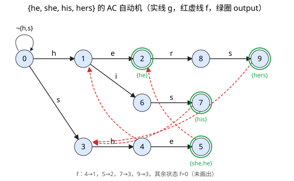

# AC 算法（Aho-Corasick 多模式匹配）

## 1. 基本概念

**AC 自动机** = **Trie 树 + KMP 思想**：把多个模式串合并成一棵树型有限自动机，文本只扫一遍，**不回溯**，时间复杂度 **O(n)**，与模式个数、长度无关。

三个函数：

| 函数 | 含义 |
|---|---|
| **转向函数 g(s,a)** | 状态 s 读入字符 a 后到哪个状态，没有边则为 `fail` |
| **失效函数 f(s)** | g 失败时回退到的状态 |
| **输出函数 output(s)** | 到达状态 s 时，报告命中的模式串集合 |


## 2. 数据初始化（预处理）

### ① 建 Trie：得到 g 和 output
- 初始只有状态 0；依次插入每个模式串，**已有的边复用**，没有的边新建状态。
- 模式串的**终点状态**记入 output。
- 最后给 0 加自环 **¬{h,s}**，保证对任意字符 `g(0,a) ≠ fail`（每个字符都能处理）。

| i | 2 | 5 | 7 | 9 |
|---|---|---|---|---|
| output(i) | {he} | {she} | {his} | {hers} |


### ② 求失效函数 f（按深度 BFS）

**f(s) = s 的最长真后缀所在状态，该后缀同时是某模式串的前缀。**

**前置准备**

- 模式串的所有前缀对应状态：h=1，he=2，s=3，sh=4，she=5，hi=6，his=7，her=8，hers=9（空串=0）
- 状态深度：d=1 → {1, 3}；d=2 → {2, 6, 4}；d=3 → {8, 7, 5}；d=4 → {9}

**公式**（r 是 r' 的父状态，边为 `g(r,a)=r'`）

1. `state = f(r)`
2. `f(r') = g(state, a)`
3. 若 `g(state,a)=fail`，则 `state = f(state)` 再试，直到有转移（0 号自环 ¬{h,s} 保证 `g(0,a)` 恒有定义，必定终止）

**为什么这样算**：r' 的串 = r 的串 + a，所以 r' 的后缀 = r 的某个后缀 + a。r 的后缀由 f(r)、f(f(r))…依次给出（越来越短），第一个能接上 a 的就是最长的。必须由浅到深算，因为 f(r') 要用到更浅的 f(r)。

**完整推导（模式集 {he, she, his, hers}）**

| 深度 | 状态 r' | 串 | 父 r，字符 a | state = f(r) | g(state, a) | **f(r')** | 用后缀验证 |
|---|---|---|---|---|---|---|---|
| 1 | 1 | h | 0，h | 规定 | 规定 | **0** | 单字符无非空真后缀 |
| 1 | 3 | s | 0，s | 规定 | 规定 | **0** | 同上 |
| 2 | 2 | he | 1，e | f(1)=0 | g(0,e)=0（自环） | **0** | 后缀 e 不是任何模式的前缀 |
| 2 | 6 | hi | 1，i | f(1)=0 | g(0,i)=0（自环） | **0** | 后缀 i 不是前缀 |
| 2 | 4 | sh | 3，h | f(3)=0 | g(0,h)=1 | **1** | 后缀 h 是 he 的前缀，即状态 1 |
| 3 | 8 | her | 2，r | f(2)=0 | g(0,r)=0（自环） | **0** | 后缀 er、r 都不是前缀 |
| 3 | 7 | his | 6，s | f(6)=0 | g(0,s)=3 | **3** | 后缀 is 不是前缀；s 是 she 的前缀，即状态 3 |
| 3 | 5 | she | 4，e | f(4)=1 | g(1,e)=2 | **2** | 后缀 he 是前缀（状态 2，最长）；e 更短，不取 |
| 4 | 9 | hers | 8，s | f(8)=0 | g(0,s)=3 | **3** | 后缀 ers、rs 不是前缀；s 是前缀，即状态 3 |

**结果**

| 状态 | 1 | 2 | 3 | 4 | 5 | 6 | 7 | 8 | 9 |
|---|---|---|---|---|---|---|---|---|---|
| 串 | h | he | s | sh | she | hi | his | her | hers |
| **f** | 0 | 0 | 0 | **1** | **2** | 0 | **3** | 0 | **3** |

**说明**

- 本例中 state 只取到 0 或 1，且 g(0,·)、g(1,e) 都有定义，所以没有触发"沿 f 链继续回退"。若 `g(state,a)=fail` 且 state≠0，就令 `state = f(state)` 再查。
- 算 5 时 state=f(4)=1，是"sh 的后缀 h"后面再接 e，得到后缀 he，这是最容易写错的一格。

**同步合并 output**：每求出 `f(r')=s'`，令 `output(r') ∪= output(s')`

| 状态 | f 值 | output(f) | 合并后 output |
|---|---|---|---|
| 2 | 0 | 空 | {he} |
| 4 | 1 | 空 | 空 |
| 5 | 2 | {he} | **{she, he}** |
| 7 | 3 | 空 | {his} |
| 9 | 3 | 空 | {hers} |

## 3. 匹配过程

s 为当前状态，a 为当前字符，一次操作循环：

1. `g(s,a)=t` 存在 → 进入 t，**文本指针前进**；若 output(t) 非空则输出
2. `g(s,a)=fail` → `s = f(s)`，**指针不动**，对同一个 a 重复

```
s = 0
for a in 文本:
    while g(s,a) == fail: s = f(s)
    s = g(s,a)
    if output(s) 非空: 报告 output(s) 与当前位置
```

**例：文本 "ushers"**

| 读入 | u | s | h | e | r | s |
|---|---|---|---|---|---|---|
| 状态 | 0 | 3 | 4 | 5 | 2→8 | 9 |
| 输出 | | | | she, he | | hers |

- 读 e 到状态 5：输出 **she、he**（结束于第 4 位）
- 读 r：`g(5,r)=fail` → `f(5)=2` → `g(2,r)=8`，一次循环两次转移
- 读 s 到状态 9：输出 **hers**

>完整过程展示       


## 4. 特点

- 构建与模式集内容无关，模式集可动态变化
- 扫描时间只与文本长度有关，无回溯
- 缺点：每个状态的 goto 表按字符集存储，**内存浪费**（ASCII 下每状态至少 1KB）

## 5. 优化方法

- 行压缩方法
- 位图方法