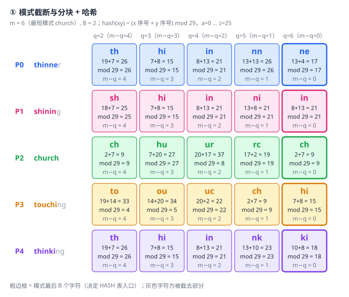
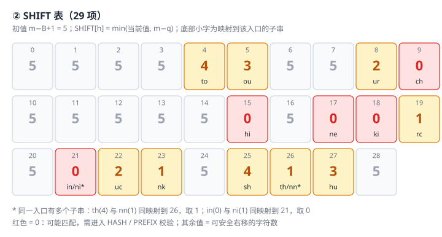
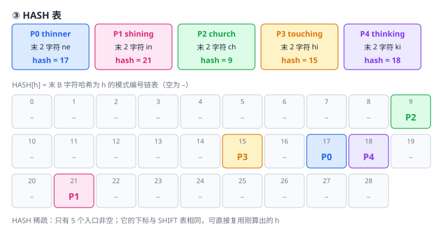
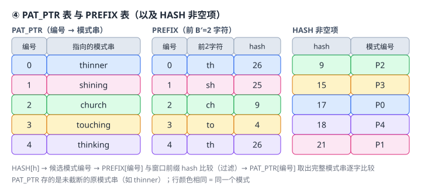
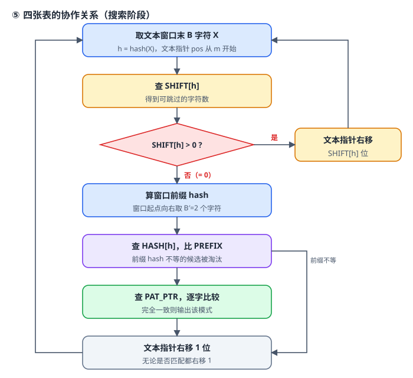

# WM算法

## 1 问题与例题

**要解决的问题**：同时在文本中查找多个模式。像 Boyer-Moore 那样只看 1 个字符决定跳多远，在模式很多时几乎每个字母都出现在某个模式里，能跳的距离趋近于 0。WM 的办法是改看**末尾 B 个字符组成的块**：长度为 B 的子串组合数是 $ c^B $，出现在模式里的概率比单个字符小得多，更容易遇到“没出现过”的情况，一次就能跳很远。

**整体思路**：预处理阶段建好四张表；搜索阶段先靠 SHIFT 表大步跳过，只有 SHIFT 值为 0（可能匹配）时，才依次动用 HASH、PREFIX、PAT_PTR 把候选一层层缩小并验证。下面每讲一张表，都会先说明“为什么需要它”，再用同一个例题把它建出来，最后在第 3 节的搜索中看到它真正起作用。

**例题与约定**

- 模式集：`{thinner, shining, church, touching, thinking}`
- 正文：`Tomisthinkinghowtobethinner`（统一转小写处理，共 27 个字符）
- 最短模式 `church`，所以 **m = 6**；块长 **B = 2**；前缀长度 **B′ = 2**
- 哈希函数：`hash(xy) = (x 的序号 + y 的序号) mod 29`，`a=0 … z=25`
    - 例：`th = 19+7 = 26`，`ur = 20+17 = 37 mod 29 = 8`

## 2 预处理

### 2.1 截断与分块

**为什么要截断**：把所有模式截成同样长度 m，并让它们**右端对齐**，这样“窗口末 B 个字符”对每个模式都有同一个含义——它是不是该模式（截断后）的某一段。位移上限也由此确定：如果不截断，长模式里更靠后的块会让位移变大，可能直接跳过最短模式的匹配位置，所以必须以**最短模式**为基准。代价是：只要混入一个很短的模式，m 变小，所有跳跃的上限都会变小。

**怎么做**：把所有模式截断为前 m 个字符，再取每个长度为 B 的子串（结束位置 q = 2…m），计算其哈希值。

- `thinner → thinne`：th(26) hi(15) in(21) nn(26) ne(17)
- `shining → shinin`：sh(25) hi(15) in(21) ni(21) in(21)
- `church → church`：ch(9) hu(27) ur(8) rc(19) ch(9)
- `touching → touchi`：to(4) ou(5) uc(22) ch(9) hi(15)
- `thinking → thinki`：th(26) hi(15) in(21) nk(23) ki(18)

这些块的哈希值与结束位置 q，就是下一步建 SHIFT 表的原料；每个模式**最后一个块**（q = m）还要用于建 HASH 表。

### 2.2 SHIFT 表

**作用**：搜索时决定文本指针右移多少。

**原理**：设窗口末 B 字符为 X，分三种情况：

- X 没在任何模式中出现 → 窗口内任何位置都不可能与模式对齐，可以直接跳 `m−B+1`（这是最大跳跃值，本例为 5）。
- X 在某个截断模式中结束于位置 q → 把窗口右移 `m−q` 位，X 恰好与该模式中的这一块对齐，这是该模式**最早可能**匹配的位置，比这更小的位移不可能匹配，所以跳 `m−q` 是安全的。
- X 出现在多处（同一模式多次，或多个模式）→ 要取**最右出现（q 最大，即 m−q 最小）**，否则可能跳过某个模式的匹配位置。

由此得到：值 **> 0 可安全移动**；值 **= 0**（X 恰好是某个模式截断后的结尾，窗口右端与该模式右端对齐）**才可能匹配**，需要进入 HASH 表继续判断。注意 0 只是必要条件，不是充分条件。

**构建**：全部初始化为 `m−B+1 = 5`；对每个模式的每个 B 子串（结束位置 q），令 `SHIFT[h] = min(SHIFT[h], m−q)`。

- 例：`ne`（q=6）→ 0；`ki`、`hi`、`in`、`ch` 也都在某个模式的末尾出现 → 0
- `th`(26)：q=2 → 4，`nn`(26)：q=5 → 1，二者哈希相同，取 min 得 **SHIFT[26] = 1**
- `in`(21)：q=4 → 2 / q=6 → 0，`ni`(21)：q=5 → 1，取 min 得 **SHIFT[21] = 0**

**哈希冲突为什么不会漏匹配**：冲突时取 min，只会让位移变得更保守（跳得更少），不会跳过匹配。这在后面的搜索里会反复看到：文本里的 `st`、`ng`、`be` 都不在任何模式中，本可以跳 5，但它们分别与模式里的 `ur`(8)、`rc`(19)、`ou`(5) 哈希相同，所以只能跳 2、1、3（见第 3 节的步 1、7、10）。

SHIFT 表只能回答“能不能安全地跳”。当它给出 0 时，我们需要知道是**哪个**模式可能匹配，这就是 HASH 表的任务。

### 2.3 HASH 表

**作用**：SHIFT 为 0 时，如果把文本与全部模式逐个比较，就失去了多模式算法的意义。HASH 表只取出“末 B 字符哈希相同”的候选模式列表。

- 下标与 SHIFT 表相同（同一个 h），所以刚才为查 SHIFT 算出的哈希不用重算——这是它“稀疏但省时间”的原因。
- `HASH[h]` 指向末 B 字符哈希为 h 的模式链表。表很稀疏（只含各模式的结尾子串），内存利用率低，但省去了重复计算。

**构建**：每个模式取截断后的最后 B 个字符（2.1 中每行的最后一个块），按其哈希放入对应入口。

本例：`HASH[9]=P2`，`HASH[15]=P3`，`HASH[17]=P0`，`HASH[18]=P4`，`HASH[21]=P1`。本例每个入口只有 1 个候选，所以搜索时每次只需看 1 个模式。

但如果多个模式以同样的后缀结尾，它们会挤进同一个入口，候选又变多了——这正是 PREFIX 表要解决的问题。

### 2.4 PREFIX 表与 PAT_PTR 表

**PREFIX 表的作用**：自然语言里 `ing`、`ion` 等后缀很常见，会让很多模式落到 HASH 表的同一入口，候选仍然很多。窗口的**前缀**是另一个独立条件：窗口起点向右取 B′ 个字符，必须与候选模式的前 B′ 个字符一致。后缀相同、前缀不同的情形很常见，而前缀、后缀同时相同的不同模式很少，所以这种过滤很有效。PREFIX 只是工程上的选择（PPT 原文：engineering decision），B′ 取 2 是经验值。因此，PREFIX 表保存每个模式**开头 B′ 个字符**的哈希，搜索时先比窗口前缀，**后缀相同而前缀不同的模式直接淘汰**。

**PAT_PTR 表的作用**：前面全是哈希和截断后的比较——哈希可能冲突，截断又丢了模式的尾部。所以最后必须取出**完整模式串**与文本逐字符比较才能确认匹配。PAT_PTR 保存模式编号到完整模式串（未截断）的指针。

| 编号 | PAT_PTR | PREFIX（前缀→hash） |
| --- | --- | --- |
| 0 | thinner | th → 26 |
| 1 | shining | sh → 25 |
| 2 | church | ch → 9 |
| 3 | touching | to → 4 |
| 4 | thinking | th → 26 |

### 2.5 四表关系

至此四张表各司其职：**SHIFT 决定跳多远 → HASH 找出候选 → PREFIX 过滤候选 → PAT_PTR 完整验证**。下图是它们在搜索阶段的协作关系。

## 3 搜索过程

- 交互模拟：[wm_simulator.html](wm_simulator.html)（可单步观察每一步用到了哪些表项）

### 3.1 流程

从文本第 m 个字符开始自左向右扫描，每次读入 `t[pos−B+1..pos]`：

1. 计算这 B 个字符的 hash 值 h；
2. 查 `SHIFT[h]`：> 0 则文本指针右移该值，回到 1；= 0 继续；
3. 计算窗口前缀（窗口起点向右 B′ 个字符）的 hash；
4. 查 `HASH[h]` 中各候选的 PREFIX，不等则淘汰；
5. 对前缀相等的候选，从 PAT_PTR 取出模式串与文本逐字比较，匹配则输出；
6. 无论是否匹配，文本指针右移 1 位，回到 1，直到文本结束。

**第 6 步为什么只右移 1 位**：SHIFT 为 0 说明此处无法保证更大的安全跳跃，且模式之间、匹配之间可能重叠。保守地右移 1 位，再重新查 SHIFT，既不漏匹配，也能找出重叠的匹配。

### 3.2 例子逐段走一遍

下面把 15 个窗口按“发生了什么”分成几段。表中“窗口”是长度 m=6 的文本片段，末 2 个字符就是用来查 SHIFT 的块。

**① 步 1：SHIFT > 0，安全跳过**

窗口 `tomist`，末 2 字符 `st`，h = 18+19 = 37 mod 29 = 8，`SHIFT[8] = 2`（右移 2，pos 6 → 8）。`st` 其实没在任何模式里出现，但它与 `ur` 同哈希为 8，只能按 `ur` 的值跳 2——这就是 2.2 说的“冲突只会更保守”。

**② 步 2、3：SHIFT = 0，但被 PREFIX 淘汰**

- 步 2：pos=8，窗口 `misthi`，末 2 字符 `hi`，h=15，SHIFT=0。`HASH[15]={P3}`，候选 `touching`（截断为 `touchi`，末尾正是 `hi`）。窗口前缀 `mi` 的 hash=20，而 PREFIX[3]=4（`to`），不等，淘汰，右移 1。
- 步 3：pos=9，窗口 `isthin`，末 2 字符 `in`，h=21，SHIFT=0。`HASH[21]={P1}`，候选 `shining`。窗口前缀 `is`=26 ≠ PREFIX[1]=25，淘汰，右移 1。

这两步说明：**SHIFT=0 只是“可能”**，真正的筛选是由 HASH → PREFIX 完成的，没有发生任何逐字符比较。

**③ 步 4、5：先对齐，再命中**

- 步 4：pos=10，窗口 `sthink`，末 2 字符 `nk`，h=23，`SHIFT[23]=1`。`nk` 是 `thinki` 中 q=5 的块，`m−q=1`，所以右移 1 位，正好让窗口对齐到 `thinki`。
- 步 5：pos=11，窗口 `thinki`，末 2 字符 `ki`，h=18，SHIFT=0。`HASH[18]={P4}`，候选 `thinking`；前缀 `th`=26 = PREFIX[4]=26，相等；于是通过 PAT_PTR 取出完整的 `thinking`，与文本第 6–13 位逐字比较，**匹配 ✓**。

注意：截断后的 `thinki` 只有 6 个字符，窗口只确认了前 6 位，**要比到最后的 `ng` 才算真正匹配**——这就是需要 PAT_PTR 保存完整模式的原因。匹配后仍右移 1 位（步 6 重新开始检查）。

**④ 步 6～8：再次淘汰与大跳**

- 步 6：pos=12，窗口 `hinkin`，末 2 字符 `in`，SHIFT=0，候选 P1，前缀 `hi`=15 ≠ 25，淘汰。
- 步 7：pos=13，窗口 `inking`，末 2 字符 `ng`，h=19，`SHIFT[19]=1`（与 `rc` 同哈希，又是冲突导致的保守位移）。
- 步 8：pos=14，窗口 `nkingh`，末 2 字符 `gh`，h=13，`SHIFT[13]=5`——没有任何模式的块哈希为 13，直接跳到最大值 5（pos 14 → 19）。这是 SHIFT 表发挥最大价值的地方。

**⑤ 步 9～13：哈希冲突被 PREFIX 拦下**

- 步 9：pos=19，窗口 `howtob`，末 2 字符 `ob`，h=15。`ob` 并不是任何模式的块，但它与 `hi` 哈希相同，所以 SHIFT=0、候选 P3。前缀 `ho`=21 ≠ 4，淘汰。**这是一个典型的“哈希冲突造成的假候选”，被 PREFIX 过滤掉了。**
- 步 10：pos=20，窗口 `owtobe`，末 2 字符 `be`，h=5，`SHIFT[5]=3`（与 `ou` 同哈希，保守位移，pos 20 → 23）。
- 步 11：pos=23，窗口 `obethi`，末 2 字符 `hi`，候选 P3，前缀 `ob`=15 ≠ 4，淘汰。
- 步 12：pos=24，窗口 `bethin`，末 2 字符 `in`，候选 P1，前缀 `be`=5 ≠ 25，淘汰。
- 步 13：pos=25，窗口 `ethinn`，末 2 字符 `nn`，h=26，`SHIFT[26]=1`（`nn` 是 `thinne` 中 q=5 的块，m−q=1），右移 1 位，对齐到 `thinne`。

**⑥ 步 14、15：第二次命中与结束**

- 步 14：pos=26，窗口 `thinne`，末 2 字符 `ne`，h=17，SHIFT=0。`HASH[17]={P0}`，候选 `thinner`；前缀 `th`=26 = PREFIX[0]，相等；PAT_PTR 取出完整的 `thinner`，与文本第 21–27 位比较，要比到最后的 `r` 才确认，**匹配 ✓**。
- 步 15：pos=27，窗口 `hinner`，末 2 字符 `er`，h=21，SHIFT=0，候选 P1，前缀 `hi`=15 ≠ 25，淘汰；右移 1 位后 pos=28 超出文本，结束。

### 3.3 完整过程一览

| 步 | pos | 窗口 | 末2字符 | h | SHIFT | 动作 |
| --- | --- | --- | --- | --- | --- | --- |
| 1 | 6 | tomist | st | 8 | 2 | 右移 2 |
| 2 | 8 | misthi | hi | 15 | 0 | HASH[15]={P3}；窗口前缀 `mi`=20 ≠ PREFIX[3]=4 → 右移 1 |
| 3 | 9 | isthin | in | 21 | 0 | HASH[21]={P1}；前缀 `is`=26 ≠ 25 → 右移 1 |
| 4 | 10 | sthink | nk | 23 | 1 | 右移 1 |
| 5 | 11 | thinki | ki | 18 | 0 | HASH[18]={P4}；前缀 `th`=26 = 26，比较 `thinking` ✓ **匹配（第 6–13 位）** → 右移 1 |
| 6 | 12 | hinkin | in | 21 | 0 | P1；前缀 `hi`=15 ≠ 25 → 右移 1 |
| 7 | 13 | inking | ng | 19 | 1 | 右移 1 |
| 8 | 14 | nkingh | gh | 13 | 5 | 右移 5 |
| 9 | 19 | howtob | ob | 15 | 0 | P3；前缀 `ho`=21 ≠ 4 → 右移 1 |
| 10 | 20 | owtobe | be | 5 | 3 | 右移 3 |
| 11 | 23 | obethi | hi | 15 | 0 | P3；前缀 `ob`=15 ≠ 4 → 右移 1 |
| 12 | 24 | bethin | in | 21 | 0 | P1；前缀 `be`=5 ≠ 25 → 右移 1 |
| 13 | 25 | ethinn | nn | 26 | 1 | 右移 1 |
| 14 | 26 | thinne | ne | 17 | 0 | HASH[17]={P0}；前缀 `th`=26 = 26，比较 `thinner` ✓ **匹配（第 21–27 位）** → 右移 1 |
| 15 | 27 | hinner | er | 21 | 0 | P1；前缀 `hi`=15 ≠ 25 → 右移 1，pos=28 > 27，结束 |

结果：`thinking`（第 6 位）、`thinner`（第 21 位）。前 3 步与 PPT 第 24–26 页的演示一致。

### 3.4 从例子看效率

- 27 个字符只检查了 15 个窗口：6 个直接由 SHIFT 跳过（步 1、4、7、8、10、13），9 个进入 HASH/PREFIX 校验，其中只有 2 个走到了完整的逐字符比较（步 5、14），其余 7 个都在 PREFIX 这一关被淘汰。
- 这正是四张表分工的意义：越便宜的检查越靠前，越昂贵的逐字符比较越靠后，且只对极少数候选执行。
- **预处理开销**与模式总长度成正比；**搜索时多数窗口**只做“算哈希 + 查 SHIFT + 右移”。
- **模式越长、越少、字符越分散，越快**。PPT 给的实验：模式数为 100 / 1000 / 5000 时，SHIFT=0 的概率约为 5% / 27% / 53%——模式越多，需要校验的窗口越多，跳跃收益下降。
- **短模式会拖累整体**：m 由最短模式决定，只要有一个很短的模式，所有跳跃距离的上限都会变小。