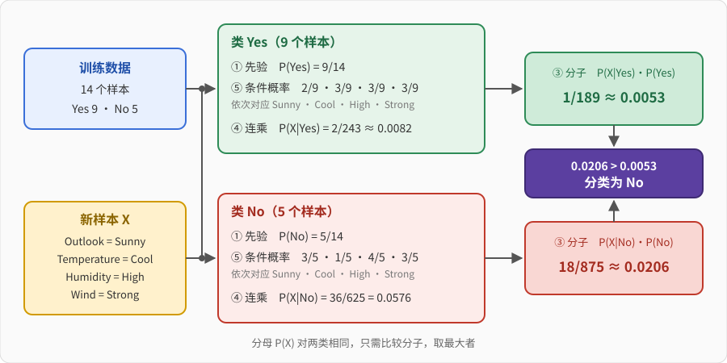

# 基于贝叶斯的分类

## 一、朴素贝叶斯（Naive Bayes）分类器

- **朴素贝叶斯分类器**：用**概率**表达一切不确定性的分类器，学习和推理都由概率规则完成。
- **怎么建立朴素贝叶斯分类器**：从训练数据统计**先验概率$P(Y)$**和**类条件概率$P(X\mid Y)$**，用**贝叶斯定理**得到**后验概率$P(Y\mid X)$**。$$P(Y\mid X)=\frac{P(X\mid Y)\,P(Y)}{P(X)}$$再加上**条件独立假设**，就是**朴素贝叶斯**。
    - 条件独立假设：已知类别 $Y$ 之后，各个属性之间互不影响，可以分开估计再相乘。$$P(x_1,x_2,\dots,x_d\mid Y=y)=\prod_{i=1}^{d}P(x_i\mid Y=y)$$
- **朴素贝叶斯分类器如何分类**：已有条件$X$（即属性向量），$X$ 是多个属性的集合，要根据条件$X$ 来判断最终选择哪个类别
- **目标**：根据现有数据学一个映射 $f:X\to Y$。$X$ 是属性向量，$Y$ 是类别。例：$X=(\mathrm{Outlook},\mathrm{Temperature},\mathrm{Humidity},\mathrm{Wind})$，$Y\in\{\mathrm{Yes},\mathrm{No}\}$（是否打网球）。

---

## 二、核心概念

全部概念都用下面这份数据说明（14 天，是否打网球）。

| Day | Outlook | Temperature | Humidity | Wind | PlayTennis |
|---|---|---|---|---|---|
| D1 | Sunny | Hot | High | Weak | No |
| D2 | Sunny | Hot | High | Strong | No |
| D3 | Overcast | Hot | High | Weak | Yes |
| D4 | Rain | Mild | High | Weak | Yes |
| D5 | Rain | Cool | Normal | Weak | Yes |
| D6 | Rain | Cool | Normal | Strong | No |
| D7 | Overcast | Cool | Normal | Strong | Yes |
| D8 | Sunny | Mild | High | Weak | No |
| D9 | Sunny | Cool | Normal | Weak | Yes |
| D10 | Rain | Mild | Normal | Weak | Yes |
| D11 | Sunny | Mild | Normal | Strong | Yes |
| D12 | Overcast | Mild | High | Strong | Yes |
| D13 | Overcast | Hot | Normal | Weak | Yes |
| D14 | Rain | Mild | High | Strong | No |

| 符号 | 含义 |
|---|---|
| $Y$，$y$ | **类别**变量及其取值 |
| $X=(x_1,\dots,x_d)$ | 样本的**属性向量**，$x_i$ 是第 $i$ 个属性的取值 |
| $d$ | **属性个数** |
| $N$ | 训练样本**总数** |
| $n$ | 类 $y$ 的**样本数** |
| $n_c$ | 类 $y$ 中取值为 $x_i$ 的**样本数** |
| $P(Y=y)$ | **先验概率** |
| $P(X\mid Y=y)$ | **类条件概率**：类 $y$ 下出现 $X$ 的概率 |
| $P(Y=y\mid X)$ | **后验概率**：看到 $X$ 后属于类 $y$ 的概率 |
| $P(X)$ | $X$ 本身出现的概率（**证据**） |

| 符号 | 在例子中 |
|---|---|
| $Y$ | PlayTennis，$y\in\{\mathrm{Yes},\mathrm{No}\}$ |
| $N$ | 14 |
| $n$ | Yes 类 9，No 类 5 |
| $d$ | 4（四个属性） |
| $x_1,x_2,x_3,x_4$ | 待分类样本的 Sunny、Cool、High、Strong |

> 约定：待分类样本固定为 $X=(\mathrm{Sunny},\mathrm{Cool},\mathrm{High},\mathrm{Strong})$。训练集里没有哪一行恰好是它。

> 计数写成 Yes/No，例如 $3/2$ 表示 Yes 有 3 个、No 有 2 个。

### ① 先验概率 $P(Y)$

$$P(Y=y)=\frac{n}{N}$$

- 分子 $n$ 是类 $y$ 的样本数，分母 $N$ 是全部样本数。
- 数各类样本占全部样本的比例。
- 例：$P(\mathrm{Yes})=\dfrac{9}{14}\approx0.6429$，$P(\mathrm{No})=\dfrac{5}{14}\approx0.3571$。

### ② 后验概率 $P(Y\mid X)$

$$P(Y=y\mid X)$$

- **意义**：确定属性向量 $X$ 的条件下，对"属于类 $y$"的**确信程度**。

    | 概率 | 数的是什么 |
    |---|---|
    | 先验 $P(\mathrm{Yes})$ | **全部样本**里 Yes 的占比 | 
    | 后验 $P(\mathrm{Yes}\mid X)$ | **符合 $X$ 的样本**里 Yes 的占比 |

### ③ 贝叶斯定理

$$P(Y\mid X)=\frac{P(X\mid Y)\,P(Y)}{P(X)},\qquad P(X)=\sum_{y}P(X\mid y)\,P(y)$$

- 我们更关心 $P(Y\mid X)$，它很难直接得到；而 $P(X\mid Y)$ 可以直接统计。贝叶斯定理把两者连起来。

- $P(X)$ 对所有类相同，分类时**不必算**，只比较分子 $P(X\mid y)P(y)$。

    | 概率 | 数的是什么 | 例子 |
    |---|---|---|
    | $P(\mathrm{Sunny}\mid\mathrm{Yes})$ | **Yes 的天数**里 Sunny 的占比 | $2/9$（Yes 共 9 天，Sunny 有 2 天） |
    | $P(\mathrm{Yes}\mid\mathrm{Sunny})$ | **Sunny 的天数**里 Yes 的占比 | $2/5$（Sunny 共 5 天，Yes 有 2 天） |
### ④ 条件独立假设与 $P(X\mid Y)$

$$P(X\mid Y=y)=P(({x_1,x_2... x_d})\mid Y=y)=\prod_{i=1}^{d}P(x_i\mid Y=y)$$

- $\prod_{i=1}^{d}$ 表示 $i$ 从 1 到 $d$ **连乘**。每一项是类 $y$ 下第 $i$ 个属性取该值的概率。
- 例：
    - $d=4$，
    - $X=(\mathrm{Outlook},\mathrm{Temperature},\mathrm{Humidity},\mathrm{Wind})$
    - $P(X\mid Y=y)= P(\mathrm{Sunny}\mid y)\,P(\mathrm{Cool}\mid y)\,P(\mathrm{High}\mid y)\,P(\mathrm{Strong}\mid y)$
- **"朴素"的来历**：现实中属性往往不独立，但是仍假设它们无关。例：文章 "Good good study, Day day up." 直接表示成词向量 $x=(\text{Good, good, study, Day, day, up})$，不考虑词的上下文联系。
- **缺点**：假设常不成立，会影响精度。

### ⑤ 条件概率估计 $P(x_i\mid Y)$

$$P(x_i\mid Y=y)=\frac{n_c}{n}$$

- 分母 $n$ 是**类 $y$ 的样本数**（不是全部样本数），分子 $n_c$ 是其中取值为 $x_i$ 的样本数。
---

## 三、分类步骤

假设对新样本 $X=(x_1,\dots,x_d)$，既定数据类别有两个$Y=(y_1, y_2)$需要决定结果分类：
- **核心**：比较 $P(X\mid y_1)\,P(y_1)$，$P(X\mid y_2)\,P(y_2)$
- **计算**：
    1. 统计各类先验 ①：$P(Y=y)=n/N$。
    2. 对每个类、每个属性值，用 ⑤ 统计 $P(x_i\mid Y=y)$。
    3. 用 ④ 连乘$$P(X\mid Y=y)=\prod_{i=1}^{d}P(x_i\mid Y=y)$$
    4. 乘上 ①，得到 ③ 的分子 $P(X\mid y)\,P(y)$。
    5. 比较各类的分子，**取最大者**为分类结果。分母 $P(X)$ 各类相同，不必算。

---

## 四、例题：PlayTennis

**题目**：训练数据见第二节。判断 $X=(\mathrm{Sunny},\mathrm{Cool},\mathrm{High},\mathrm{Strong})$ 时是否打网球。

**表 1：计算 $P(Y=\mathrm{Yes}\mid X)$**

$$P(Y=\mathrm{Yes}\mid X)=\frac{P(X\mid\mathrm{Yes})\,P(Y=\mathrm{Yes})}{P(X)}\ \propto\ P(X\mid\mathrm{Yes})\,P(Y=\mathrm{Yes})$$

| 量 | 计算 | 结果 |
|---|---|---|
| ① $P(Y=\mathrm{Yes})$ | Yes 共 9 天，总共 14 天 | $\dfrac{9}{14}$ |
| ⑤ $P(\mathrm{Sunny}\mid\mathrm{Yes})$ | Yes 的 9 天里 Sunny 有 2 天 | $\dfrac{2}{9}$ |
| ⑤ $P(\mathrm{Cool}\mid\mathrm{Yes})$ | Yes 的 9 天里 Cool 有 3 天 | $\dfrac{3}{9}$ |
| ⑤ $P(\mathrm{High}\mid\mathrm{Yes})$ | Yes 的 9 天里 High 有 3 天 | $\dfrac{3}{9}$ |
| ⑤ $P(\mathrm{Strong}\mid\mathrm{Yes})$ | Yes 的 9 天里 Strong 有 3 天 | $\dfrac{3}{9}$ |
| ④ $P(X\mid\mathrm{Yes})$ | $\dfrac{2}{9}\times\dfrac{3}{9}\times\dfrac{3}{9}\times\dfrac{3}{9}=\dfrac{54}{6561}$ | $\dfrac{2}{243}$ |
| **③ 分子** $P(X\mid\mathrm{Yes})\,P(Y=\mathrm{Yes})$ | $\dfrac{2}{243}\times\dfrac{9}{14}=\dfrac{18}{3402}$ | $\mathbf{\dfrac{1}{189}}$ |

**表 2：计算 $P(Y=\mathrm{No}\mid X)$**

$$P(Y=\mathrm{No}\mid X)=\frac{P(X\mid\mathrm{No})\,P(Y=\mathrm{No})}{P(X)}\ \propto\ P(X\mid\mathrm{No})\,P(Y=\mathrm{No})$$

| 量 | 计算 | 结果 |
|---|---|---|
| ① $P(Y=\mathrm{No})$ | No 共 5 天，总共 14 天 | $\dfrac{5}{14}$ |
| ⑤ $P(\mathrm{Sunny}\mid\mathrm{No})$ | No 的 5 天里 Sunny 有 3 天 | $\dfrac{3}{5}$ |
| ⑤ $P(\mathrm{Cool}\mid\mathrm{No})$ | No 的 5 天里 Cool 有 1 天 | $\dfrac{1}{5}$ |
| ⑤ $P(\mathrm{High}\mid\mathrm{No})$ | No 的 5 天里 High 有 4 天 | $\dfrac{4}{5}$ |
| ⑤ $P(\mathrm{Strong}\mid\mathrm{No})$ | No 的 5 天里 Strong 有 3 天 | $\dfrac{3}{5}$ |
| ④ $P(X\mid\mathrm{No})$ | $\dfrac{3}{5}\times\dfrac{1}{5}\times\dfrac{4}{5}\times\dfrac{3}{5}$ | $\dfrac{36}{625}$ |
| **③ 分子** $P(X\mid\mathrm{No})\,P(Y=\mathrm{No})$ | $\dfrac{36}{625}\times\dfrac{5}{14}=\dfrac{180}{8750}$ | $\mathbf{\dfrac{18}{875}}$ |

**比较两个分子**（分母 $P(X)$ 相同，只比分子）：交叉相乘，$18\times189=3402>875=1\times875$，所以 $\dfrac{18}{875}>\dfrac{1}{189}$。

**所以 $P(Y=\mathrm{No}\mid X)>P(Y=\mathrm{Yes}\mid X)$，该样本分类为 No（不打网球）。**

<!-- 
---

## 五、零概率与 m 估计

### ⑤ 的修正：m 估计 $P(x_i\mid Y)$

$$P(x_i\mid Y=y)=\frac{n_c+mp}{n+m}$$

- $n$、$n_c$ 同 ⑤。$m$ 是**等价样本大小**，$p$ 是用户指定的**先验概率**（该取值在类里出现的先验）。
- **问题**：⑤ 的比例估计太脆弱。训练样本少、属性多时，常有取值没出现过，$n_c=0$，连乘后**整个类的得分为 0**。
- 例：新样本 $X'=(\mathrm{Cloudy},\mathrm{Cool},\mathrm{High},\mathrm{Strong})$，Cloudy 在训练集里没有。$P(\mathrm{Cloudy}\mid\mathrm{Yes})=\frac{0}{9}=0$，$P(\mathrm{Cloudy}\mid\mathrm{No})=\frac{0}{5}=0$。两类得分都是 0，**相等，无法分类**。训练集里的 Overcast 也有同样的隐患：$P(\mathrm{Overcast}\mid\mathrm{No})=\frac{0}{5}=0$。
- **算法**：分子加 $mp$，分母加 $m$。相当于补 $m$ 个按先验 $p$ 分布的虚拟样本。
- **意义**：在**观测比例** $n_c/n$ 和**先验** $p$ 之间折中，$m$ 决定各占多少。$m$ 越大越信先验，越小越信数据。$m=0$ 时退回 ⑤ 的比例；$n=0$（没有训练样本）时结果就是 $p$。

取 $m=3$，$p=\frac13$（Outlook 有 3 个取值，等概率先验）为例：

| 量 | 计算 | 结果 |
|---|---|---|
| $P(\mathrm{Cloudy}\mid\mathrm{Yes})$ | $\frac{0+3\times\frac13}{9+3}=\frac{1}{12}$ | 0.0833 |
| $P(\mathrm{Cloudy}\mid\mathrm{No})$ | $\frac{0+3\times\frac13}{5+3}=\frac{1}{8}$ | 0.1250 |
| $P(\mathrm{Sunny}\mid\mathrm{Yes})$（对照） | $\frac{2+3\times\frac13}{9+3}=\frac{3}{12}=\frac14$ | 0.2500（原 0.2222） |

- 不再出现 0，其他属性的差异就能继续起作用。已有的取值也被轻微拉向 $p$。
- 取 $m=\lvert V\rvert$、$p=1/\lvert V\rvert$，就是分子加 1、分母加 $\lvert V\rvert$（拉普拉斯平滑），下一节用的正是它。

---

## 六、多项式模型

- **是什么**：朴素贝叶斯用于**文本分类**的一种具体形式，**不是**独立于朴素贝叶斯的另一个算法。
- **怎么建**：文档 $d=(t_1,t_2,\dots,t_k)$，$t_j$ 是文中出现的单词，**允许重复**。按**词频**计数估计概率，其余仍是 ①、⑤、④。

数据：4 篇训练文档，类别表示"是否属于 China"。

| id | doc | 类别（是否属于 China） |
|---|---|---|
| 1 | Chinese Beijing Chinese | yes |
| 2 | Chinese Chinese Shanghai | yes |
| 3 | Chinese Macao | yes |
| 4 | Tokyo Japan Chinese | no |

| 符号 | 含义 |
|---|---|
| $d=(t_1,\dots,t_k)$ | 一篇**文档**，$t_j$ 是第 $j$ 个词（可重复），共 $k$ 个 |
| $c$ | **类别** |
| $V$ | 训练集的**词表**，每个词只算一个 |
| $\lvert V\rvert$ | 词表里**不同单词的个数** |

| 符号 | 在例子中 |
|---|---|
| $d$ | (Chinese, Chinese, Chinese, Tokyo, Japan)，$k=5$ |
| $c$ | $\{\mathrm{yes},\mathrm{no}\}$ |
| $V$ | {Chinese, Beijing, Shanghai, Macao, Tokyo, Japan}，$\lvert V\rvert=6$ |

> 约定：先验按**词数**算，与课件一致（有的教材按文档数算，即 3/4、1/4）。计数写成 yes/no。

### ① 先验概率 $P(c)$（文本形式）

$$P(c)=\frac{\text{类 }c\text{ 下单词总数}}{\text{整个训练集单词总数}}$$

- 分子是类 $c$ 所有文档里词的个数（重复也算），分母是全部文档词的总数。
- **意义**：类别 $c$ 在整体上占多大比例。
- 例：yes 类 3 篇共 $3+3+2=8$ 个词，no 类 1 篇 3 个词，合计 11 个词。$P(\mathrm{yes})=\frac{8}{11}$，$P(\mathrm{no})=\frac{3}{11}$。

### ⑤ 条件概率 $P(t\mid c)$（文本形式）

$$P(t\mid c)=\frac{\text{类 }c\text{ 下单词 }t\text{ 在各文档中出现的次数}+1}{\text{类 }c\text{ 下单词总数}+\lvert V\rvert}$$

- 分子：词 $t$ 在类 $c$ 全部文档里出现的**次数**之和，再 **+1**。分母：类 $c$ 的词总数，加词表大小。
- **算法**：就是 m 估计取 $m=\lvert V\rvert$、$p=1/\lvert V\rvert$，没出现过的词也不会得到 0。
- **意义**：$P(t\mid c)$ 表示词 $t$ 为"文档属于类 $c$"提供了**多大的证据**。
- 例：Tokyo 在 yes 类里 0 次，$P(\mathrm{Tokyo}\mid\mathrm{yes})=\frac{0+1}{8+6}=\frac{1}{14}$，不是 0。

### ④ 连乘与分类

$$P(c\mid d)\ \propto\ P(c)\prod_{j=1}^{k}P(t_j\mid c)$$

- $\propto$ 表示"正比于"，只比较分子。$j$ 从 1 到 $k$，对文档里**每个词**各乘一次，**重复的词重复乘**。
- 例：$d$ 有 5 个词，每类连乘 5 项：Chinese 乘 3 次，Tokyo、Japan 各乘 1 次。

---

## 七、例题：文本分类（多项式模型）

**题目**：训练文档见第六节。判断新文档 $d=(\mathrm{Chinese},\mathrm{Chinese},\mathrm{Chinese},\mathrm{Tokyo},\mathrm{Japan})$ 属于 yes 还是 no。

**步骤 1：统计计数**（"yes/no"列写 yes 次数/no 次数；位置格式"文档 id×次数"，先写 yes 再写 no）

| 词 | 合计 | yes/no | 出现位置（yes ｜ no） |
|---|---:|---|---|
| Chinese | 6 | 5/1 | 1×2, 2×2, 3×1 ｜ 4×1 |
| Beijing | 1 | 1/0 | 1×1 ｜ — |
| Shanghai | 1 | 1/0 | 2×1 ｜ — |
| Macao | 1 | 1/0 | 3×1 ｜ — |
| Tokyo | 1 | 0/1 | — ｜ 4×1 |
| Japan | 1 | 0/1 | — ｜ 4×1 |

类大小（词数）：yes 8，no 3，共 11；$\lvert V\rvert=6$。

**步骤 2：计算**（比例取 4 位小数；两个分子很小，取 8 位）

| 量 | 计算 | 结果 |
|---|---|---|
| ① $P(\mathrm{yes})$ | $8/11$ | 0.7273 |
| ① $P(\mathrm{no})$ | $3/11$ | 0.2727 |
| ⑤ $P(\mathrm{Chinese}\mid\mathrm{yes})$ | $\frac{5+1}{8+6}=\frac{6}{14}=\frac37$ | 0.4286 |
| ⑤ $P(\mathrm{Tokyo}\mid\mathrm{yes})$ | $\frac{0+1}{8+6}=\frac{1}{14}$（0 次，仍有 +1） | 0.0714 |
| ⑤ $P(\mathrm{Japan}\mid\mathrm{yes})$ | $\frac{0+1}{8+6}=\frac{1}{14}$ | 0.0714 |
| ⑤ $P(\mathrm{Chinese}\mid\mathrm{no})$ | $\frac{1+1}{3+6}=\frac{2}{9}$ | 0.2222 |
| ⑤ $P(\mathrm{Tokyo}\mid\mathrm{no})$ | $\frac{1+1}{3+6}=\frac{2}{9}$ | 0.2222 |
| ⑤ $P(\mathrm{Japan}\mid\mathrm{no})$ | $\frac{1+1}{3+6}=\frac{2}{9}$ | 0.2222 |
| **④ 分子（yes）** | $\frac{8}{11}\times\left(\frac37\right)^3\times\frac1{14}\times\frac1{14}=\frac{54}{184877}$（Chinese 出现 3 次，乘 3 次） | **0.00029209 ← 最大** |
| ④ 分子（no） | $\frac{3}{11}\times\left(\frac29\right)^3\times\frac29\times\frac29=\frac{32}{216513}$ | 0.00014780 |

**因为 $0.00029209>0.00014780$，所以文档 $d$ 属于类 yes（China）。**

- Chinese 出现 3 次，强烈支持 yes。Tokyo、Japan 各 1 次，支持 no，但证据弱。

---

## 八、效率分析

- **理论上**：与所有分类算法相比，贝叶斯分类的**出错率最小**。
- **实践中**不总是如此：类条件独立这类假设**不准确**，而且常缺少可用的概率数据。
- 实验表明，在某些领域它可以与**判定树、神经网络**媲美。 -->