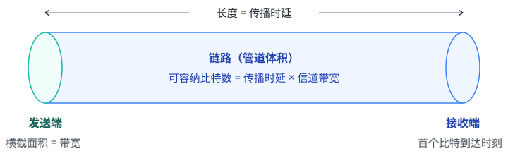
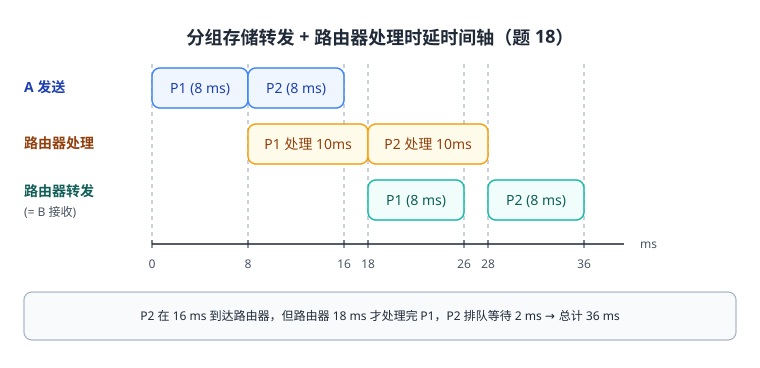

# 报文交换基本概念

## 报文交换（Message Switching）

- **数据交换的单位是报文**：用户数据加上源地址、目的地址等信息，封装成**报文（message）**。
- 采用**存储转发**技术：整个报文先传送到相邻结点，**全部存储后**再查找转发表，转发到下一个结点，如此重复直到目的结点。
- 每个报文可以**单独选择**到达目的结点的路径。

| 优点 | 缺点 |
|---|---|
| ① **无需建立连接**，通信前无建立连接时延，用户可随时发送报文 | ① **转发时延高**：交换结点必须把报文整体接收完才能查表转发 |
| ② **动态分配线路**：存储整个报文后选择空闲线路转发 | ② **缓存开销大**：报文大小无限制，交换结点需要较大缓冲空间 |
| ③ **线路可靠性高**：某条传输路径故障可改走另一条路径 | ③ **错误处理低效**：报文越长出错概率越大，重传整个报文代价大 |
| ④ **线路利用率高**：报文在哪段链路上传输才占用哪段通信资源 | |
| ⑤ 提供**多目标服务**：一个报文可同时发给多个目的地址 | |

---

## 分组交换（Packet Switching）

> **核心思路**：把报文拆成更小的数据段（分组），分别存储转发。

- 源结点把分组发送到分组交换网中。
- 分组交换机收到分组后：**先缓存 → 从首部提取目的地址 → 查转发表 → 转发给下一个分组交换机**。
- 经过多个分组交换机的存储转发后，分组最终到达目的结点。
- 分组可以**流水线式**传输（后一个分组不必等前一个分组到达终点），所以总时间通常比报文交换更短。

---

## 计算机网络的性能指标

| 指标 | 含义 | 单位 / 公式 |
|---|---|---|
| **速率**（数据率、比特率） | 结点在数字信道上传送数据的速率 | $\mathrm{b/s}$（bps）；$k=10^3$，$M=10^6$，$G=10^9$ |
| **带宽** | 网络通信线路所能传送数据的能力，即**最高数据传输速率** | $\mathrm{b/s}$（原指信号频率范围，单位 $\mathrm{Hz}$） |
| **吞吐量** | 单位时间内通过某个网络（信道、接口）的**实际**数据量，受带宽限制 | $\mathrm{b/s}$ |
| **时延** | 数据从网络一端传送到另一端所需的总时间 | 由 4 部分构成（见下） |
| **时延带宽积** | 发送端发出的第一个比特即将到达终点时，发送端已发出了多少比特 | $\text{时延带宽积} = \text{传播时延} \times \text{信道带宽}$（单位：比特） |
| **往返时延 RTT** | 发送端发出短分组，到收到接收端确认所经历的总时间 | 在互联网中还包含中间结点的处理、排队及转发时的发送时延 |
| **信道利用率** | 某信道有百分之多少的时间有数据通过 | $\text{利用率} = \dfrac{\text{有数据通过时间}}{\text{有数据通过时间} + \text{无数据通过时间}}$ |

### 时延的四个组成部分

| 时延 | 含义 | 公式 |
|---|---|---|
| **发送时延**（传输时延） | 结点把分组的所有比特推向链路所需的时间 | $\text{发送时延} = \dfrac{\text{分组长度}}{\text{发送速率}}$ |
| **传播时延** | 电磁波在信道中传播一定距离花的时间 | $\text{传播时延} = \dfrac{\text{信道长度}}{\text{电磁波传播速率}}$ |
| **处理时延** | 交换结点为存储转发所做的必要处理（分析首部、差错检验、查路由等） | 通常**忽略不计**（除非另有说明） |
| **排队时延** | 分组在输入队列、输出队列中排队等待 | 通常**忽略不计**（除非另有说明） |

$$\text{总时延} = \text{发送时延} + \text{传播时延} + \text{处理时延} + \text{排队时延}$$

> **区分发送时延和传播时延**：
> - **发送时延**：路由器把分组**推出去**所需的时间，**只与分组长度、发送速率有关**。
> - **传播时延**：一个比特从一端**传到另一端**所需的时间，**只与距离、传播速率有关**，与分组长度、发送速率无关。

---

## 存储转发与时延计算题

### 题 16：链路带宽与网卡速率

主机 A 网卡 1 Gbps，链路 100 Mbps，主机 B 网卡 10 Mbps。A 给 B 发数据的最高理论速率？

- 端到端速率取**瓶颈**：$\min\{100\text{ Mbps},\ 1\text{ Gbps},\ 10\text{ Mbps}\} = 10\text{ Mbps}$
- **答案：B（10 Mbps）**

### 题 17：发送时延 = 传播时延时的带宽

链路长 50 km，传播速率 $2\times10^8\text{ m/s}$，分组 512 B。

- 传播时延：$\dfrac{5\times10^4\text{ m}}{2\times10^8\text{ m/s}} = 2.5\times10^{-4}\text{ s}$
- 发送时延等于传播时延：$\text{带宽} = \dfrac{512\times8\text{ bit}}{2.5\times10^{-4}\text{ s}} = \dfrac{4096}{2.5\times10^{-4}} \approx 16.38\text{ Mb/s}$
- **答案：C（16.38 Mb/s）**

### 题 18：存储转发 + 路由器处理时延

A →（路由器）→ B，两个 1000 B 的分组，链路 1 Mb/s，路由器处理单个分组 10 ms（同时只能处理一个），忽略传播时延。

- 每个分组的发送时延：$\dfrac{1000\times8\text{ bit}}{10^6\text{ b/s}} = 8\text{ ms}$

- **答案：B（36 ms）**

### 题 19【2010 统考】：分组交换的文件传输

链路 100 Mb/s，分组 1000 B（其中头 20 B），文件 980000 B，H1 → 两个交换结点 → H2（共 **3 段链路**），不考虑拆装时间和传播时延。

- 每组数据部分：$1000 - 20 = 980\text{ B}$
- 分组数：$980000 / 980 = 1000$ 个
- 每组发送时延：$\dfrac{1000\times8}{100\times10^6} = 0.08\text{ ms}$
- 流水线总时间 $=(n+k-1)\times t$，其中 $n=1000$ 个分组，$k=3$ 段链路：

$$(1000 + 3 - 1) \times 0.08 = 80.16\text{ ms}$$

- **答案：C（80.16 ms）**

> **流水线公式**：$n$ 个分组、$k$ 段链路、每组发送时延 $t$ → 总时间 $=(n+k-1)\,t$，即“第一个分组走完 $k$ 段”再加“后面 $n-1$ 个分组依次到达”。

### 题 20【2013 统考】：报文交换 vs 分组交换

甲 → 路由器 → 乙，两段链路均为 10 Mb/s，报文 8 Mb；分组交换的分组大小 10 kb。忽略传播延迟、分组头开销。

| 方式 | 计算 | 结果 |
|---|---|---|
| **报文交换** | 每段 $\dfrac{8\text{ Mb}}{10\text{ Mb/s}} = 0.8\text{ s}$，共 2 段 → $0.8\times2$ | **1600 ms** |
| **分组交换** | 每组 $\dfrac{10\text{ kb}}{10\text{ Mb/s}} = 1\text{ ms}$；分组数 $\dfrac{8\text{ Mb}}{10\text{ kb}} = 800$；$(800+2-1)\times1\text{ ms}$ | **801 ms** |

- **答案：D（1600 ms、801 ms）**

### 习题 01：分组大小与“开销 + 丢失”

每个分组引入 100 B 开销（首部 + 组帧），发送 $10^6\text{ B}$ 数据，传输中有一个字节被破坏，**该字节所在的整个分组丢弃**。

- 设分组数据大小为 $D$：
  - 开销字节数 $= \dfrac{10^6}{D} \times 100 = \dfrac{10^8}{D}$
  - 丢失字节数 $= D$（丢掉一个分组的数据）
  - 总数 $= D + \dfrac{10^8}{D}$
- $D = 1000$：$1000 + \dfrac{10^8}{1000} = \mathbf{101000\text{ B}}$
- $D = 20000$：$20000 + \dfrac{10^8}{20000} = \mathbf{25000\text{ B}}$
- 最小化：当 $D = \dfrac{10^8}{D}$，即 $D = \sqrt{10^8} = \mathbf{10^4\text{ B}}$ 时总开销最小（此时总数为 20000 B）。

### 习题 02：局域网中传播时延 = 发送时延

最大距离 2 km，传播速率 $2\times10^8\text{ m/s}$。

- 传播时延：$\dfrac{2\times10^3\text{ m}}{2\times10^8\text{ m/s}} = 10^{-5}\text{ s}$
- 100 B 分组：$\dfrac{100\times8}{n} = 10^{-5} \Rightarrow n = 8\times10^7\text{ b/s} = \mathbf{80\text{ Mb/s}}$
- 512 B 分组：$\dfrac{512\times8}{n} = 10^{-5} \Rightarrow n \approx \mathbf{409.6\text{ Mb/s}}$
