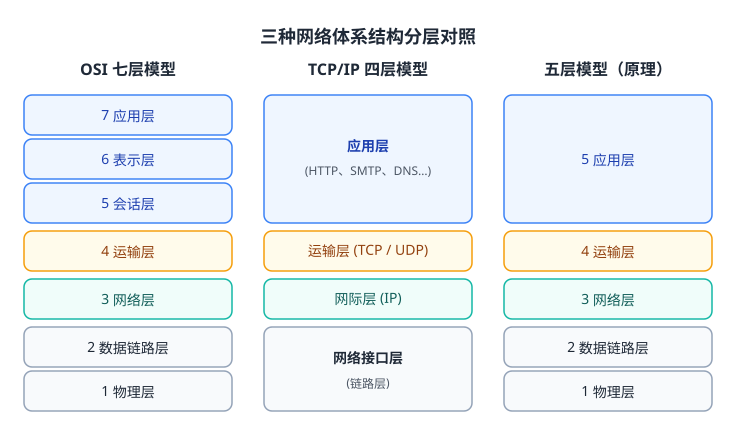
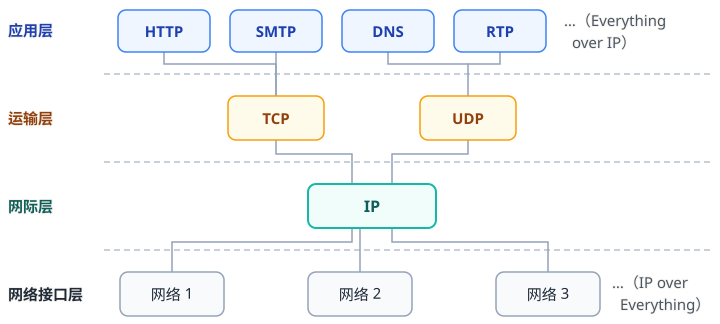
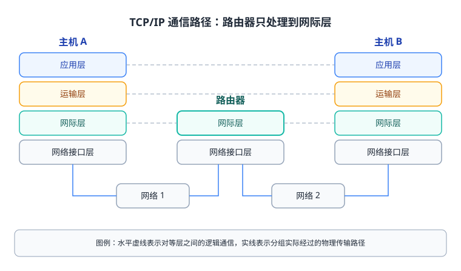

# TCP/IP 体系结构

## 三种分层模型对照

---

## TCP/IP 协议族（沙漏形：IP 是核心）

> **everything over IP, IP over everything**：IP 之上可以跑多种运输层 / 应用层协议，IP 之下可以跑多种底层网络，这是互联网能发展到全球规模的根本原因。

- **端到端通信**（应用层、运输层）只在**源主机与目的主机**之间进行；
- **中间路由器**通常只用到下三层（物理层、数据链路层、网际层），根据 IP 分组首部查转发表转发，不解封运输层与应用层。

---

## 各层功能与典型协议

| 层次 | 任务 | 数据单元 | 典型协议 / 标准 |
|---|---|---|---|
| **应用层** | 通过**应用进程间的交互**完成特定网络应用；协议定义的是应用进程间通信和交互的规则（进程 = 正在运行的程序） | **报文** (message) | HTTP、SMTP、DNS、FTP、TFTP、SNMP、Telnet、RTP |
| **运输层** | 为**两台主机中进程之间**的通信提供通用的数据传输服务；**复用和分用**；流量控制、差错控制 | TCP：**报文段** (segment) UDP：**用户数据报** | **TCP**（面向连接、可靠） **UDP**（无连接、尽最大努力） |
| **网络层** | 为分组交换网上的不同主机提供通信服务；**路由选择、分组转发**、流量控制、拥塞控制、差错控制、异构网络互联 | **IP 数据报 / 分组** | IP、ICMP、RIP、OSPF、BGP、IGMP |
| **数据链路层** | 管理相邻结点间的数据传输；**组装成帧**、差错检测、流量控制 | **帧** (frame) | PPP、SLIP、CSLIP、ARP、RARP、以太网（注：MTU 为最大传输单元参数，非协议） |
| **物理层** | 以二进制比特流形式在物理媒体上传输数据 | **比特** | ISO2110、IEEE 802、IEEE 802.2 |

> OSI 的**表示层**（数据格式化、代码转换、加密/解密、压缩）和**会话层**（建立/管理会话、利用检查点 checkpoints 实现断点续传）在 TCP/IP 中**没有独立协议**，其功能并入应用层由应用程序自行处理。

---

## 逐层核心要点

### 应用层

- 体系结构中的最高层，任务是通过**应用进程间的交互**完成特定网络应用。
- 不同的网络应用需要不同的应用层协议。

### 运输层

- 提供**端到端（进程到进程）**的逻辑通信。“端” = **IP 地址 + 端口号 + 传输层协议**。
- **复用**：多个应用进程可同时使用同一个运输层服务；**分用**：运输层把收到的数据分别交付给上层相应进程。
- 核心功能：**流量控制、差错控制、服务质量、数据传输**。
- 注意：**不要把运输层的 UDP 与网络层的 IP 数据报混淆**。无论哪一层传送的数据单元，都可笼统地称为“分组”。

### 网络层

- 核心功能：**流量控制、拥塞控制、差错控制、网际互连**。
- 两个具体任务：
  1. 通过一定路由算法，在每个路由器上生成**转发表**；
  2. 每个路由器收到分组时，依据转发表指明的路径把分组转发到**下一个路由器**。

### 数据链路层

- 两台主机之间的数据传输总是在**一段一段的链路**上传送的，需要专门的链路层协议。
- 把网络层下来的 IP 数据报**组装成帧（framing）**，在相邻结点间的链路上传送。
- 帧包括：数据 + 必要的控制信息（同步信息、地址信息、差错控制等）。
- 控制信息使接收端能知道帧**从哪个比特开始、到哪个比特结束**，并能**检测是否有差错**：发现差错就**直接丢弃**该帧，避免在网络中继续传播浪费资源。
