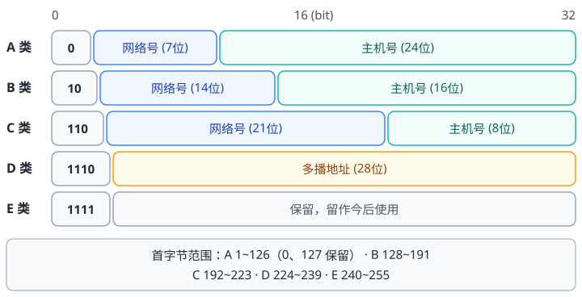
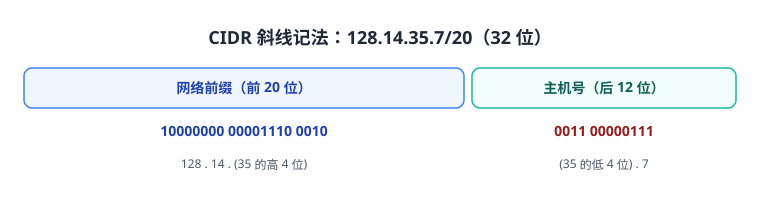
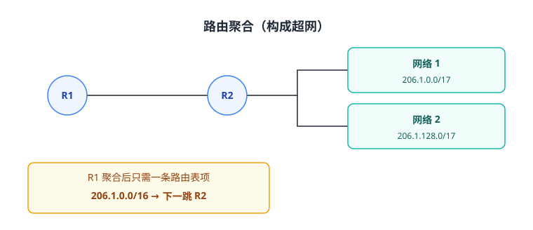
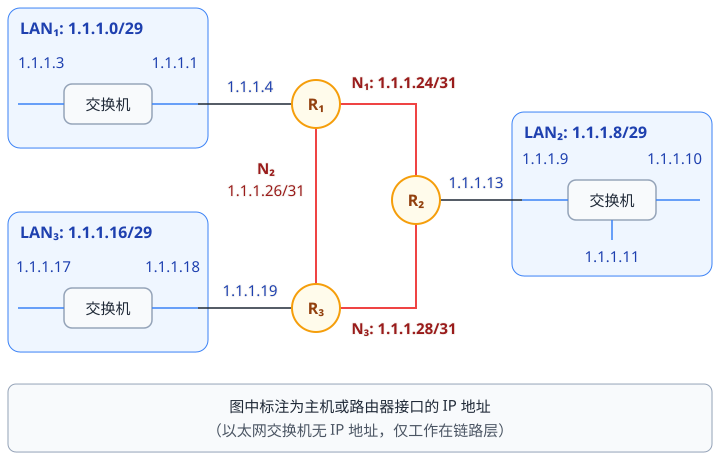

# IP 地址与子网

## IPv4 分类地址



| 类别 | 前缀位 | 最大可用网络数 | 第一个可用网络号 | 最后一个可用网络号 | 每网最大主机数 |
|---|---|---|---|---|---|
| **A** | `0` | $2^7-2$ | `1` | `126` | $2^{24}-2$ |
| **B** | `10` | $2^{14}$ | `128.0` | `191.255` | $2^{16}-2$ |
| **C** | `110` | $2^{21}$ | `192.0.0` | `223.255.255` | $2^8-2$ |

- **A 类网络数减 2**：网络号**全 0** 表示“本网络”；网络号 **127**（`01111111`）保留作环回测试。故可指派网络号 126 个。
- **主机数减 2**：主机号**全 0** 表示网络地址本身，**全 1** 表示该网络上的所有主机（广播）。
- 例：主机 IP 为 `5.6.7.8`，网络号是 `5`，网络地址是 `5.0.0.0`。

### 特殊地址（不指派）

| 地址 | 含义 |
|---|---|
| 主机号全 0（如 `202.98.174.0`） | **本网络**本身（网络地址） |
| 主机号全 1（如 `202.98.174.255`） | 本网络的**广播地址**（直接广播地址） |
| `127.x.x.x` | **环回自检（Loopback）**地址，表示本主机，数据报永远不会出现在任何网络上 |
| `0.0.0.0` | **本网络上的本主机** |
| `255.255.255.255` | 整个 TCP/IP 网络的广播地址（**受限广播地址**） |

> **记忆口诀**：网络号全 0 / 网络号全 1（127）→ 保留不指派。

---

## 子网划分

- **子网掩码**：与 IP 地址对应的 32 位二进制串，**一串 1 + 一串 0**。
  - `1` 对应 IP 地址中的**网络号 + 子网号**；`0` 对应**主机号**。
  - **IP 地址 AND 子网掩码**（逐位与）= **子网的网络地址**。
- **默认网关**：子网与外部网络连接的设备（路由器接口）的 IP 地址。
- 主机发送数据的判断流程：

```text
目的 IP  AND  本机子网掩码  →  得到目的网络地址
    ├─ 与本子网网络地址相同 → 目的主机在本子网 → 直接发送
    └─ 不相同               → 发给默认网关（路由器）转发到其他网络
```

- 现在的标准规定**所有网络都必须使用子网掩码**。未划分子网时使用**默认子网掩码**：

| 类别 | 默认子网掩码 |
|---|---|
| A | `255.0.0.0` |
| B | `255.255.0.0` |
| C | `255.255.255.0` |

- **例**：IP `192.168.5.56`，掩码 `255.255.255.0`：

```text
  11000000.10101000.00000101.00111000   (192.168.5.56)
& 11111111.11111111.11111111.00000000   (255.255.255.0)
= 11000000.10101000.00000101.00000000   (192.168.5.0)  ← 网络地址
```

- 路由器交换路由信息时，**必须把自己所在网络的子网掩码告诉对方**。
- 分组转发时：路由器把分组**目的地址与某网络的子网掩码按位相与**，结果与该网络地址一致，则**路由匹配成功**，转发到该网络。

---

## 无分类编址 CIDR

> **CIDR**（Classless Inter-Domain Routing，无分类域间路由选择），RFC 4632。

### ① 网络前缀

- 把“网络号”改称**网络前缀**，前缀位数 $n$ **不固定**，可在 $0\sim 32$ 间任选。
- 记法：`IP地址 ::= {<网络前缀>, <主机号>}`，使用**斜线记法**：`128.14.35.7/20`。



### ② 地址块

- 把**网络前缀都相同**的所有连续 IP 地址组成一个 **CIDR 地址块**。
- 地址数取决于前缀位数：`/20` 地址块含 $2^{12}$ 个地址，可指派数 $2^{12}-2$。
- 已知块中任一地址就能得出**最小地址**（主机号全 0）和**最大地址**（主机号全 1）：

| `128.14.35.7/20` 所在地址块 | 点分十进制 | 二进制 |
|---|---|---|
| 最小地址 | **`128.14.32.0`** | `10000000 00001110 0010` **`0000`** `00000000` |
| 最大地址 | **`128.14.47.255`** | `10000000 00001110 0010` **`1111`** `11111111` |

- 也可简写为 `10000000 00001110 0010*`：`*` 代表主机号字段（全 0），星号前的二进制位数就是**网络前缀的位数**。不需要指明网络地址时，可简称为“**/20 地址块**”。

> **三种写法区分**：
>
> | 写法 | 能否确定网络地址 | 说明 |
> |---|---|---|
> | `128.14.32.7` | 否 | 只是 IP 地址，没有前缀长度 |
> | `128.14.32.7/20` | 是 | 指明了前缀为 20 位，可推出网络地址 `128.14.32.0` |
> | `128.14.32.0/20` | 是 | **地址块 / 网络前缀**，同时是该块中主机号全 0 的地址（末尾的 0 有时可省略，写成 `128.14.32/20`） |
>
> 不能只写 `128.14.32.0` 来指明一个网络：它也可能是 `/19`、`/21` 等其他网络的地址。

---

## 路由聚合（构成超网）

- 一个 CIDR 地址块含有很多地址，所以路由表中可以**用一个 CIDR 地址块代表多个原来的传统分类网络**，这就是**路由聚合**（也称**构成超网**）。
- 好处：路由表中**一个项目表示多个网络的路由**，减少路由器之间的信息交换，提高网络性能。

**例**：R1 通过 R2 到达网络 1 和网络 2，下一跳都是 R2。



两个网络前缀的二进制（前 16 位相同，**第 17 位分别为 0 和 1**）：

```text
206.1.0.0/17    11001110 00000001 0 0000000 00000000
206.1.128.0/17  11001110 00000001 1 0000000 00000000
                |<---- 共同前 16 位 ---->|
聚合后          206.1.0.0/16
```

> **聚合步骤**：①找出各地址块**最长的公共前缀** → ②公共前缀位数 = 聚合后的前缀长度 → ③公共前缀后补 0 得到聚合网络地址（聚合要求这些网络的**下一跳相同**）。

---

## 最长前缀匹配（最佳匹配）

- 使用 CIDR 时，路由表项由“**网络前缀 + 下一跳地址**”组成。
- 查路由表时可能得到**不止一个匹配结果**，此时应选择**前缀最长**的那条路由。
- 原因：**前缀越长，地址块越小，路由就越具体**。

**示例**：

| 路由表项 | 下一跳 |
|---|---|
| `206.1.0.0/16` | R2 |
| `206.1.128.0/17` | R3 |

目的地址 `206.1.129.5`，转成二进制看第 17 位：

- 与 `206.1.0.0/16` 匹配（前 16 位相同）。
- 与 `206.1.128.0/17` 也匹配（第 17 位为 1，`129 = 1000 0001`）。
- 两条都匹配，**选前缀更长的 `/17` → 下一跳 R3**。

---

## IP 地址的特点



- 同一个局域网上的主机或路由器的 IP 地址中，**网络前缀必须相同**（即具有同样的网络号）。
- **网络地址里的主机号必定全 0**。
  例：$\mathrm{LAN}_1$ 的网络地址 `1.1.1.0/29` = `00000001.00000001.00000001.00000|000`，前 29 位是网络前缀，**后 3 位主机号全 0**。
- 所有设备都有自己的 MAC 地址。图中以太网交换机连线上的小圆圈是**主机或路由器的 IP 地址**，不是交换机的 IP 地址：**以太网交换机是链路层设备，只有 MAC 地址**。
- 用以太网交换机（只工作在链路层）连接的几个网段，合起来**仍然是一个局域网**，只使用同样的网络前缀（如 $\mathrm{LAN}_2$）。
- **路由器总是具有两个或两个以上的 IP 地址**，且**每个接口的 IP 地址的网络前缀都不同**。
- 两个路由器直接相连（如通过租用线路）时，两端接口**可以分配也可以不分配** IP 地址：
  - 分配了，这段连线就构成一种只包含一段线路的特殊“网络”（如图中的 $N_1$、$N_2$、$N_3$），仅需两个 IP 地址，所以使用 **`/31` 地址块**（RFC 3021，主机号只有 1 位，可以是 0 或 1）。
  - 为节省 IP 地址，点对点链路常常**不分配 IP 地址**，这种网络叫**无编号网络（unnumbered network）**或**匿名网络（anonymous network）**。
