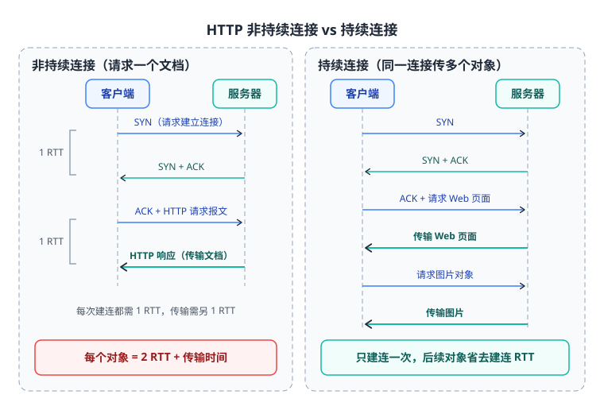
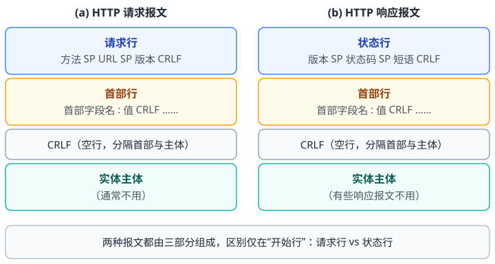

# Web 与 HTTP

## HTTP 协议概述

- **HTTP**（超文本传输协议）定义了浏览器（万维网客户进程）怎样向万维网服务器请求文档，以及服务器怎样把文档传送给浏览器。
- 它是**面向事务（Transaction-oriented）**的应用层协议：
  - 事务 = 一系列信息交换，且这一系列信息交换是**不可分割的整体**：要么全部完成，要么一次交换都不进行。
- 每个万维网站点都有一个**服务器进程**，不断监听 **TCP 的 80 端口**（默认）：
  1. 监听到连接请求 → 与浏览器建立 TCP 连接；
  2. 浏览器发出获取某 Web 页面的 HTTP 请求；
  3. 服务器构建所请求页面，通过 HTTP 响应返回；
  4. 浏览器解释并显示页面；
  5. TCP 连接释放。

---

## HTTP 的三个特点

| 特点 | 含义 |
|---|---|
| **使用 TCP** | 由 TCP 保证数据可靠传输，HTTP 不必考虑数据丢失后怎样重传 |
| **本身无连接**（务必注意） | 虽然用了 TCP 连接，但通信双方在交换 HTTP 报文之前**不需要先建立 HTTP 连接** |
| **无状态** | 同一客户第二次访问同一服务器上的页面时，服务器的响应与第一次相同，因为服务器**不记得**曾经服务过这个客户 |

---

## 非持续连接 vs 持续连接

| 类型 | 做法 | 时间 / 开销 |
|---|---|---|
| **非持续连接** | 每个对象（HTML、JPEG、Flash…）单独建立一个 TCP 连接 | 请求一个文档 = **传输时间 + 2×RTT**（1 个 RTT 用于 TCP 连接，另 1 个用于请求和接收文档；第 3 次握手中捎带 HTTP 请求）；每个对象开销 **2×RTT**；每次建连都要分配缓存和变量，服务器负担重 |
| **持续连接**（非流水线） | 服务器发送响应后**保持连接**，同一客户与服务器可继续在这条连接上传后续请求和响应 | 客户**收到前一个响应后才能发下一个请求**；后续每个对象 **1 个 RTT**；连接在空闲期会浪费服务器资源 |
| **持续连接**（流水线） | 客户可以**连续发出**对各个对象的请求，服务器连续响应 | 后续所有对象**共计只经历 1 个 RTT** 延迟；受 TCP 发送窗口限制 |

- **HTTP/1.1 默认使用持续连接**，并支持非流水线和流水线两种工作方式。

> **示例**：一个页面含 1 个 HTML + 5 张图片，忽略传输时间，不考虑并行连接：
>
> | 方式 | 计算 | 总时间 |
> |---|---|---|
> | 非持续 | 6 个对象 × 2 RTT | **12 RTT** |
> | 持续（非流水线） | 建连 + 首个对象 2 RTT，其余 5 个对象 × 1 RTT | **7 RTT** |
> | 持续（流水线） | 2 RTT（建连 + 首个对象）+ 1 RTT（所有图片一起请求） | **3 RTT** |

---

## HTTP 报文结构

HTTP 是**面向文本（Text-Oriented）**的：报文中每个字段都是 **ASCII 码串**，每个字段长度不确定。

- **开始行**：请求报文中称为**请求行**，响应报文中称为**状态行**。三个字段之间以**空格（SP）**分隔，末尾是 CR（回车）和 LF（换行）。
- **首部行**：说明浏览器、服务器或报文主体的一些信息。可有几行，也可不用。每行有“首部字段名 : 值”，行末有 CRLF；**整个首部结束时还有一个空行（CRLF）**把首部和实体主体分开。
- **实体主体**：请求报文中一般不用，响应报文中也可能没有。

### 请求报文中常用的方法

| 方法（操作） | 意义 |
|---|---|
| **GET** | 请求读取由 URL 标识的信息 |
| **HEAD** | 请求读取由 URL 标识的信息的**首部** |
| **POST** | 给服务器添加信息（如注释、表单数据） |
| **CONNECT** | 用于代理服务器 |

### 状态码（三位数字，分 5 大类）

| 类别 | 含义 | 常见例子 |
|---|---|---|
| **1xx** | 通知信息：请求收到了或正在处理 | `100 Continue` |
| **2xx** | **成功**：接受或知道了 | `200 OK`、`HTTP/1.1 202 Accepted`（接受） |
| **3xx** | **重定向**：要完成请求必须采取进一步行动 | `301 Moved Permanently`、`304 Not Modified` |
| **4xx** | **客户的差错**：请求中有错误的语法或不能完成 | `400 Bad Request`（错误的请求） `404 Not Found`（找不到） |
| **5xx** | **服务器的差错**：服务器失效无法完成请求 | `500 Internal Server Error` |
