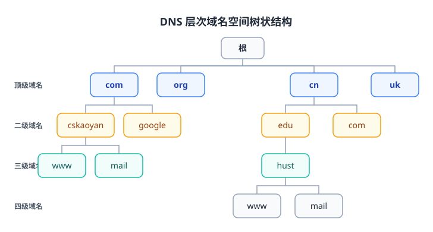
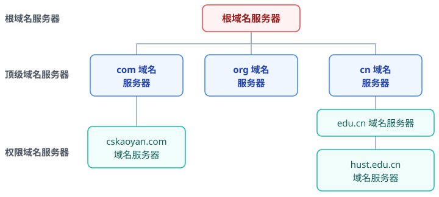
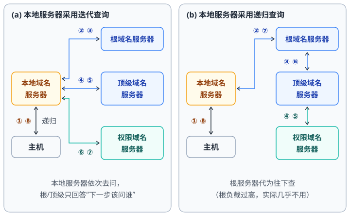
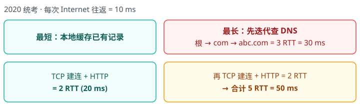

# DNS

## 层次域名空间

- 互联网采用**层次树状结构**的命名方法：每个主机或路由器都有一个唯一的层次结构名称，即**域名（Domain Name）**。
- **域（Domain）**是名字空间中一个可被管理的划分，可继续划分为子域（顶级域 → 二级域 → 三级域…）。
- 例：`www.cskaoyan.com` —— `com`（顶级域名）、`cskaoyan`（二级域名）、`www`（三级域名）。**级别最低写在最左边，最高写在最右边**。

### 标号的规则

- 标号中的英文**不区分大小写**；
- 标号中除**连字符（`-`）**外不能使用其他标点符号；
- **每个标号不超过 63 个字符**，多标号组成的完整域名**最长不超过 255 个字符**。

### 顶级域名（TLD）三大类

| 类别 | 说明 | 例子 |
|---|---|---|
| **国家（地区）顶级域名 nTLD** | 国家和某些地区的域名 | `.cn`（中国）、`.us`（美国）、`.uk`（英国） |
| **通用顶级域名 gTLD** | 按机构性质划分 | `.com`（公司）、`.net`（网络服务机构）、`.org`（非营利性组织）、`.edu`（教育机构）、`.gov`（国家或政府部门） |
| **基础结构域名 arpa** | 用于**反向域名解析**，即 IP 地址反向解析为域名 | `.arpa` |

---

## 域名服务器

- **域名到 IP 地址的解析**由运行在**域名服务器**上的程序完成。
- **区**：一个服务器所负责管辖（或有权限）的范围，**小于或等于“域”**。区中所有结点必须能够连通。**每个区设置相应的权限域名服务器**，保存该区中**所有主机的域名到 IP 地址的映射**。
- DNS 使用大量域名服务器并**层次化组织**：没有一台服务器具有整个互联网所有主机的映射，映射**分布**在所有域名服务器上。

| 类型 | 职责 | 要点 |
|---|---|---|
| **根域名服务器** | 最高层次。所有根服务器都知道**所有顶级域名服务器**的域名和 IP | 不管哪个本地服务器，**解析不了就先求助根**。全球有 **13 个**根服务器（每个实际是**冗余服务器集群**，提高安全性与可靠性）。根服务器通常**不直接**把域名转成 IP，而是告诉本地服务器**下一步应找哪个顶级域名服务器** |
| **顶级域名服务器** | 管理在该顶级域名服务器注册的**所有二级域名** | 收到查询时给出最后结果，或告诉下一步该查哪个服务器 |
| **权限域名服务器** | 每台主机都必须在权限服务器处登记；**总能把管辖的主机名转换为该主机的 IP 地址** | 为可靠，一台主机最好至少有 **2 个**权限服务器。许多服务器同时充当本地和权限域名服务器 |
| **本地域名服务器** | 每个 ISP、大学甚至学校各系都可拥有一个 | 主机发出 **DNS 查询请求**时，**首先发给本地域名服务器**。配置“本地连接”时填的 DNS 地址就是它 |

> **资源记录（RR）的字段**：`name`、`type`、`class`、`TTL`、`rdlength`、`rdata`。

---

## 域名解析过程

- **域名解析**：把域名转化为 IP 地址。客户端通过本机的 DNS 客户端构造一个 DNS 请求报文，以 **UDP 数据报**（目的端口 **53**）方式发往本地域名服务器。
- 两种查询方式：**递归查询**与**迭代查询**。

| 环节 | 方式 | 说明 |
|---|---|---|
| **主机 → 本地域名服务器** | **递归查询** | 本地服务器若不知道，就以 DNS 客户的身份继续向其他服务器查询（**替主机查**），而不是让主机自己去查 |
| **本地服务器 → 根 / 顶级 / 权限服务器** | **迭代查询**（实际常用）或递归查询 | 迭代：服务器收到请求时，**要么给出所要查询的 IP，要么告诉本地服务器“你下一步应向哪个服务器查询”**，由本地服务器进行后续查询（**不替它查**） |

- 递归查询会给根服务器造成**负载过大**，所以实际中几乎不使用。
- 迭代的收尾：知道所要的 IP 后，本地服务器把结果返回给发起查询的主机。

### 高速缓存

- 域名服务器广泛使用**高速缓存**，存放最近查询过的域名以及从何处获得域名映射信息的记录。
  - 若不久前有人查过 `y.abc.com`，本地服务器可**直接返回缓存结果**，不必再问根。
  - 若缓存里有顶级服务器（如 `dns.com`）的 IP，可以**直接向它发查询**，跳过根服务器。
- 好处：大大减轻根服务器的负荷，也大大减少互联网上 DNS 查询和回答报文的数量。
- 为保持缓存内容正确，每项内容设置**计时器（TTL）**，超过合理时间就删除（例如每项只存放两天）。权限服务器回答时会在响应中指明**绑定有效存在的时间值**：
  - 时间值**增大** → 减少网络开销；
  - 时间值**减小** → 提高域名转换的准确性。

---

## 统考真题精讲

### 【2016 统考】题 12：查询次数

所有域名服务器均采用**迭代查询**，主机访问 `www.abc.xyz.com`，域名服务器在完成该域名解析的过程中，可能发出 DNS 查询的最少和最多次数分别是？

- **最少 0 次**：本地域名服务器中已有该域名的 DNS 信息（缓存），不需要再查任何其他服务器。
- **最多 4 次**：本地服务器依次迭代向 **根 → 顶级（`com`）→ 权限（`xyz.com`）→ 权限（`abc.xyz.com`）** 发出查询。
- **答案：C（0，4）**

### 【2020 统考】题 14：最短与最长时间

本地域名服务器只提供**递归**查询服务，其他域名服务器均只提供**迭代**查询服务；局域网内主机访问 Internet 上各服务器的 RTT 均为 10 ms，**忽略其他各种时延**（包括 H 到本地服务器的查询时延）。H 点击链接 `http://www.abc.com/index.html` 后，到收到 `index.html` 为止，所需最短与最长时间？

- **最短**：H 有该域名到 IP 的记录，无需 DNS 查询，直接与 `www.abc.com` **建立 TCP 连接并请求资源**。三次握手需要 **1.5 个 RTT**，并在**第 3 次握手报文中捎带对资源的请求**，然后服务器返回资源需要 **0.5 个 RTT**，共 **2 个 RTT = 20 ms**。
- **最长**：H 递归查询本地域名服务器（延时忽略），本地服务器依次**迭代**查询根、`com` 顶级、`abc.com` 服务器，共 **3 个 RTT**；拿到 IP 后再建立 TCP 连接取资源，**2 个 RTT**。合计 **5 RTT = 50 ms**。
- **答案：D（20 ms，50 ms）**
