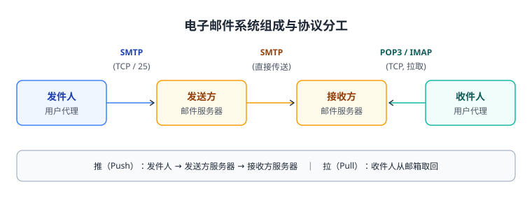
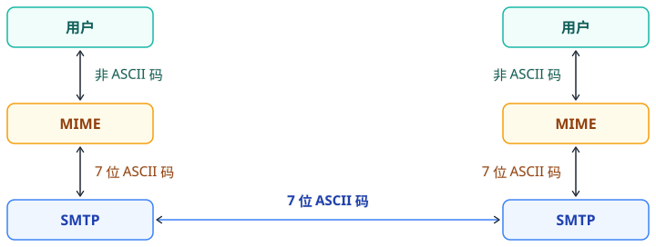

# SMTP（电子邮件）

## 电子邮件系统的组成



| 组成 | 作用 |
|---|---|
| **用户代理（UA）** | 用户与电子邮件系统的**接口**，至少应具有**撰写、显示、处理**邮件的功能。即运行在 PC 上的邮件客户端软件（如 Outlook、Foxmail） |
| **邮件服务器** | 功能是**发送和接收邮件**，并向发件人报告邮件传送情况（已交付、被拒绝、丢失等）。以**客户/服务器模式**工作，但必须能**同时充当客户和服务器**：A 向 B 发邮件时，A 是 SMTP 客户，B 是 SMTP 服务器；反之亦然 |
| **邮件发送协议** | 用于用户代理向邮件服务器发送邮件，或**在邮件服务器之间**发送邮件，如 **SMTP**（“推”） |
| **邮件读取协议** | 用于用户代理**从邮件服务器读取邮件**，如 **POP3**、IMAP（“拉”） |

> **【2012 真题】** 邮件**发送**用 **SMTP**（推），邮件**读取**用 **POP3**（拉）。

---

## 邮件的收发过程

1. 发件人调用用户代理**撰写和编辑**邮件。
2. 点击“发送邮件”，发送工作交给用户代理：用 **SMTP** 把邮件传送给**发送端邮件服务器**。
3. 发送端邮件服务器把邮件放入**邮件缓存队列**，等待发送。
4. 发送端服务器的 **SMTP 客户**与接收端服务器的 **SMTP 服务器**建立 **TCP 连接**，然后依次发送缓存队列中的邮件。邮件是**直接传送给接收端邮件服务器**的，**不会在互联网的某个中间邮件服务器落地**。
5. 接收端的 SMTP 服务器收到邮件后，放入收件人的**用户邮箱**，等待读取。
6. 收件人收信时，调用用户代理，用 **POP3（或 IMAP）**把邮件从接收端邮件服务器的用户邮箱中取回。

---

## SMTP 协议与三个阶段

- **SMTP（简单邮件传输协议）**：提供可靠有效的电子邮件传输，控制两个相互通信的 SMTP 进程交换信息。
- 客户/服务器模式：**发送邮件**的 SMTP 进程是**客户**，**接收邮件**的是**服务器**。
- 使用 **TCP 连接，端口号 25**。

| 阶段 | 过程 |
|---|---|
| **① 连接建立** | 邮件进入发送方缓存后，SMTP 客户每隔一定时间扫描缓存；发现邮件就与接收方 SMTP 服务器（**熟知端口 25**）建立 TCP 连接。连接建立后，服务器发出 **`220 Service ready`**，客户发送 **`HELO`** 命令并附上发送方主机名。<br>**不使用中间邮件服务器**：TCP 连接总是在发送方与接收方两个服务器之间直接建立，不管相隔多远。接收方暂时不能连接时，发送方只能等一段时间后重试 |
| **② 邮件传输** | `MAIL FROM: <发件人地址>` → 服务器回答 **`250 OK`**<br>`RCPT TO: <收件人地址>`（每个收件人一条）→ 回答 **`250 OK`** 或 **`550 No such user here`**（无此用户）<br>`DATA` → 服务器回答 **`354 Start mail input; end with <CRLF>.<CRLF>`**<br>客户发送邮件内容，以 `<CRLF>.<CRLF>` 表示结束<br>**`RCPT` 的作用**：先确认接收方是否已做好接收邮件的准备，避免发了很长的邮件后才知道地址错误，浪费通信资源 |
| **③ 连接释放** | 客户发送 **`QUIT`** 命令，服务器返回 **`221`**（服务关闭），表示同意释放 TCP 连接，邮件传送结束 |

典型会话示意：

```text
S: 220 Service ready
C: HELO hit.edu.cn
S: 250 OK
C: MAIL FROM: <fh@hit.edu.cn>
S: 250 OK
C: RCPT TO: <abc@cskaoyan.com>
S: 250 OK              （若用户不存在则返回 550 No such user here）
C: DATA
S: 354 Start mail input; end with <CRLF>.<CRLF>
C: From: fh@hit.edu.cn
C: To: abc@cskaoyan.com
C: Subject: Say hello to Internet
C:
C: blahblah...
C: .
S: 250 OK
C: QUIT
S: 221 Service closing
```

---

## 电子邮件格式与 MIME

### 电子邮件格式（RFC 822）

- 一个电子邮件分为**信封**和**内容**两部分，内容又分为**首部**和**主体**。
- RFC 822 规定了首部格式，主体则由用户自由撰写。信封上的信息由邮件系统自动从首部提取，用户不需要亲自填写。
- 首部每行由“**关键字: 值**”构成：
  - **To**（必填）：一个或多个收件人地址，格式 `收件人邮箱名@邮箱所在主机的域名`（如 `abc@cskaoyan.com`）。邮箱名在该邮件服务器上必须唯一，保证整个互联网上地址唯一；
  - **Subject**（可选）：邮件主题；
  - **From**（必填）：通常由邮件系统自动填入。
- **首部与主体之间用一个空行分隔**。

```text
From: fh@hit.edu.cn
To: abc@cskaoyan.com          ← 首部
Subject: Say hello to Internet

blahblah…                     ← 主体
```

### MIME（多用途因特网邮件扩展）

> **【2018 真题】SMTP 直接传输的内容**：只能传 **7 位 ASCII 码文本**。

- 问题：SMTP 只能传 7 位 ASCII 文本，中文、俄文、带重音符号的法文德文无法传，可执行文件和其他二进制对象也无法传。
- **MIME 并没有改动 SMTP 或取代它**：发送端邮件包含**非 ASCII 数据**时，先通过 MIME **转换成 ASCII 数据**，再用 SMTP 传输；接收端用 MIME **逆转换**还原。



MIME 主要包括三部分内容：

1. **5 个新的邮件首部字段**：MIME 版本、内容描述、内容标识、传送编码、内容类型。
2. **定义了许多邮件内容的格式**，对多媒体电子邮件的表示方法进行了标准化。
3. **定义了传送编码**，可对任何内容格式进行转换，而**不会被邮件系统改变**。

---

## POP3 与 IMAP

> **【2015、2018 真题】** SMTP 和 POP3 在传输层使用的服务：**都使用 TCP**（可靠传输）。

| 协议 | 端口 | 特点 |
|---|---|---|
| **SMTP** | TCP **25** | **推**；发送邮件，以及邮件服务器之间传邮件；直接传送，不经中间服务器 |
| **POP3**（邮局协议） | TCP **110** | **拉**；非常简单、功能有限的读取协议。两种工作方式：**“下载并保留”**（读取后邮件仍保存在服务器上，可再次读取）；**“下载并删除”**（一旦读取就从服务器上删除） |
| **IMAP**（因特网报文存取协议） | — | 比 POP 复杂得多：为用户提供**创建文件夹、在不同文件夹间移动邮件、在远程文件夹中查询邮件**等联机命令，**服务器维护会话用户的状态信息**；允许用户代理**只获取报文的某些部分**（如只读首部，或 MIME 报文中的一部分），适用于低带宽的情况 |
| **基于万维网的邮件**（Hotmail、Gmail 等） | — | 用户浏览器与邮件服务器之间发送和接收邮件使用 **HTTP**；**仅在不同邮件服务器之间传送邮件时才使用 SMTP** |
