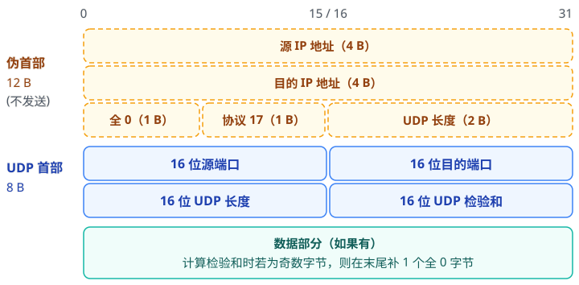

# UDP

## 运输层概述与端口

### 运输层的四个基本功能

| 功能 | 说明 |
|---|---|
| **应用进程间的逻辑通信** | IP 数据报首部只给出两台**主机**的 IP 地址，而通信的真正端点是**主机中的进程**，即**端到端的逻辑通信**。IP 分组停留在网络层，没有交付给进程 |
| **复用和分用** | **复用**：发送方不同的应用进程都可使用同一个运输层协议传送数据；**分用**：接收方运输层剥去首部后，把数据正确交付给目的应用进程（指本层与上一层之间的关系） |
| **差错检测** | 对收到的报文（**首部和数据部分**）进行检错。TCP 发现出错 → 要求发送方**重发**；UDP 发现出错 → **直接丢弃**。（IP 首部检验和**只检验首部**，不检查数据） |
| **面向连接 / 无连接** | TCP：上层看到的是一条**全双工的可靠逻辑信道**；UDP：仍是一条**不可靠**的逻辑信道。网络层不能同时提供两种服务，运输层可以 |

### 端口

- 端口让应用进程把数据通过端口**向下交付给运输层**，也让运输层知道该把数据**向上交付给哪个进程**。端口号长度 **16 bit**，共 $2^{16}=65536$ 个，只有**本地意义**。
- IP 地址标识**主机**，端口号标识**主机中的应用进程**；运输层用的是**软件端口**。

| 类别 | 范围 | 说明 |
|---|---|---|
| **熟知端口号** | **0 ~ 1023** | IANA 指派给 TCP/IP 最重要的应用程序 |
| **登记端口号** | **1024 ~ 49151** | 供没有熟知端口号的应用程序使用，需 IANA 登记以防重复 |
| **客户端（短暂）端口号** | **49152 ~ 65535** | 客户进程运行时才动态选择；通信结束后即可被其他进程使用 |

| 应用 | FTP | TELNET | SMTP | DNS | TFTP | HTTP | SNMP |
|---|---|---|---|---|---|---|---|
| 熟知端口 | 21 | 23 | 25 | 53 | 69 | 80 | 161 |

### 应用层协议使用的运输层协议

| 使用 **UDP** | 使用 **TCP** |
|---|---|
| DNS、TFTP、RIP、DHCP、SNMP、IGMP | SMTP、TELNET、HTTP、FTP |
| 特点：对速度、实时性要求高 | 特点：对可靠性要求高 |

---

## UDP 概述与特点

UDP 仅在 IP 数据报服务之上增加了两个最基本的功能：**复用和分用**，以及**差错检测**。

| 特点（2014 真题） | 说明 |
|---|---|
| ① **无需建立连接** | 不引入建连时延（这也是 DNS 用 UDP 的原因；HTTP 用 TCP 是因为网页对可靠性要求高） |
| ② **无连接状态** | 不维护接收/发送缓存、拥塞参数、序号确认号，所以专用服务器用 UDP 时能支持**更多的活动客户** |
| ③ **首部开销小** | TCP 首部 20 B，UDP 仅 **8 B**（$4\times 2\text{ B}$） |
| ④ **没有拥塞控制** | 网络拥塞不会影响源主机发送速率；适合“能容忍丢失、不能容忍大时延”的实时应用 |
| ⑤ **支持多种交互通信** | 一对一、一对多、多对一、多对多 |

> 接收方不会给发送方发任何确认。若接收方发现目的端口不存在对应进程，则**丢弃该报文**，并由 **ICMP** 发送“**端口不可达**”差错报文给发送方。

---

## UDP 首部格式



| 字段 | 长度 | 含义 |
|---|---|---|
| **源端口** | 2 B | 需要对方回信时选用，不需要时可用全 0 |
| **目的端口** | 2 B | 终点交付报文时必须使用 |
| **长度** | 2 B | UDP 数据报总长度（**首部 + 数据**），最小值 **8**（仅首部，2021 真题） |
| **检验和** | 2 B | 检测数据报在传输中是否有错，有错就丢弃；**可选**，不想计算时直接令该字段为全 0 |

---

## UDP 检验（伪首部）

- 计算检验和时，要在 UDP 数据报前面临时加上 **12 B 的伪首部**。伪首部**不是真正的首部**，既不向下传送也不向上递交，只用于计算检验和。
- 与 IP 检验和的区别：IP 只检验**首部**；UDP 检验的是**首部 + 数据**。

| 伪首部字段 | 源 IP 地址 | 目的 IP 地址 | 全 0 | 协议号 | UDP 长度 |
|---|---|---|---|---|---|
| 字节数 | 4 | 4 | 1 | 1（**UDP = 17**） | 2 |

| 发送方 | 接收方 |
|---|---|
| ① 检验和字段先填 **0**，添加伪首部<br>② 数据部分不是偶数字节则**末尾填一个全 0 字节**（填充和伪首部都**不发送**）<br>③ 把所有内容看成许多 **16 位字**，按**二进制反码**求和（进位回卷加到最低位）<br>④ 把和**取反**，写入检验和字段并发送 | ① 加上伪首部（需要时同样补 0 字节）<br>② 按二进制反码求所有 16 位字的和<br>③ **结果全为 1（`1111 1111 1111 1111`）→ 无差错**，否则有差错 |

**例**（数据报 15 B：UDP 首部 8 B + 数据 7 B，需填充 1 B）：

```text
伪首部  153.19 | 8.104 | 171.3 | 14.11 | 0和17 | 15
UDP首部 1087 | 13 | 15 | 0 (检验和先填 0)
数据    7B + 填充 1B (全 0)
反码求和 = 10010110 11101101
取反     = 01101001 00010010   ← 写入检验和字段
```

> **注意**：
> 1. 填充字节、伪首部**都不发送**；
> 2. 检验出错可以**丢弃**，也可**交付上层但要附错误报告**；
> 3. 有了伪首部，不仅能检查端口和数据，还能检查 **IP 数据报的源 / 目的 IP 地址**。
