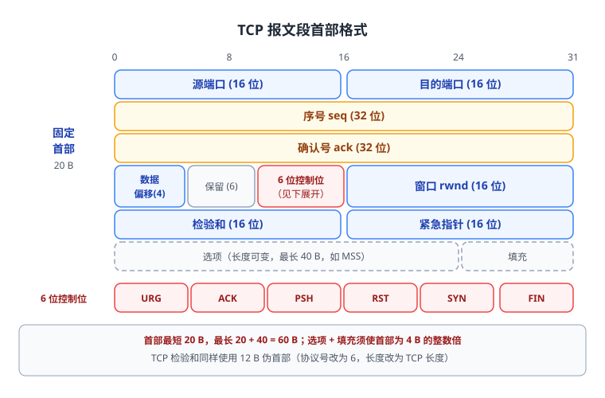
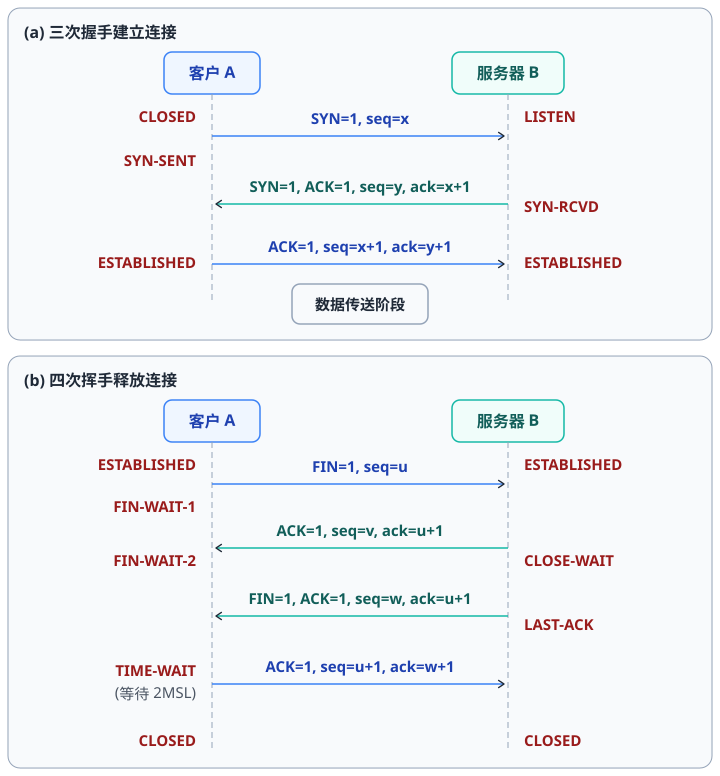
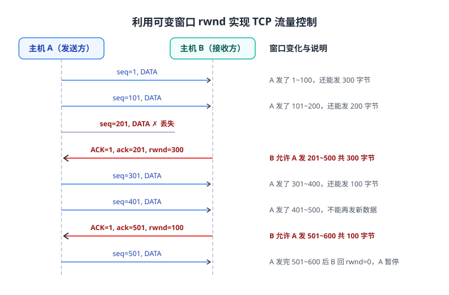

# TCP

## TCP 的特点

TCP 是在不可靠的 IP 层之上实现的**可靠的数据传输协议**，解决传输的**可靠、有序、无丢失和不重复**问题。

1. **面向连接**：TCP 连接是一条**逻辑连接**。
2. 每条 TCP 连接只能有**两个端点**，**一对一**。
3. 可靠交付：数据**无差错、不丢失、不重复且有序**。
4. **全双工通信**：两端都有**发送缓存和接收缓存**。
5. **面向字节流**：应用与 TCP 一次交互一个数据块，但 TCP 把它们看成**无结构的字节流**。

> UDP 报文长度由**发送应用进程**决定；TCP 报文长度则根据**接收方窗口值**和**当前网络拥塞程度**决定。

---

## TCP 报文段首部

| 字段 | 长度 | 要点（含真题考点） |
|---|---|---|
| **源端口 / 目的端口** | 各 2 B | 发送方与接收方使用的端口号 |
| **序号** | 4 B（$0\sim 2^{32}-1$） | 字节流中每个字节都按顺序编号；**序号 = 本报文段所发送数据的第一个字节的序号**。例：序号 301，携带 100 B，则最后一个字节序号 400，**下一个报文段序号从 401 开始** |
| **确认号** | 4 B | **期望收到对方下一个报文段的第一个数据字节的序号**。确认号为 $N$ 表示序号 $N-1$ 及之前的数据都已正确收到。例：收到序号 501~700 的数据，则确认号 = **701** |
| **数据偏移**（首部长度，2021） | 4 bit | 表示**首部长度**，**单位 4 B**。最大值 15 → 首部最长 **60 B** |
| **保留** | 6 bit | 目前应置 0 |
| **URG** | 1 bit | $=1$ 时**紧急指针有效**，紧急数据插在报文段数据最前面 |
| **ACK** | 1 bit | $=1$ 时**确认号才有效**；连接建立后所有报文段都必须把 ACK 置 1 |
| **PSH** | 1 bit | 要求接收方 TCP **尽快交付**给接收应用进程，不必等缓存填满 |
| **RST** | 1 bit | $=1$ 表示连接出现严重差错，必须**释放连接后重建**；也可用于拒绝非法报文段 |
| **SYN** | 1 bit | $=1$ 且 $\text{ACK}=0$：**连接请求**；$=1$ 且 $\text{ACK}=1$：**连接接受** |
| **FIN** | 1 bit | 用来**释放连接**，表示发送方数据已发送完毕 |
| **窗口** | 2 B（$0\sim 2^{16}-1$） | **接收方让发送方设置其发送窗口的依据**（单位字节）。例：确认号 701、窗口 1000，表示发送方还可发送序号 701~1700 的数据 |
| **检验和** | 2 B | 检验范围包括**首部和数据**，需加 12 B 伪首部（协议号为 6） |
| **紧急指针** | 2 B | 仅 $\text{URG}=1$ 时有意义，指出紧急数据的字节数 |
| **选项** | 最长 40 B | 如 **MSS（最大报文段长度）**：TCP 报文段中**数据字段**的最大长度 |

---

## TCP 连接管理

TCP 连接的三个阶段：**连接建立 → 数据传送 → 连接释放**。

- TCP 连接的端点是**套接字（Socket）** = IP 地址 + 端口号；一条 TCP 连接由**两个套接字**唯一确定。
- 同一个 IP 地址可有多个不同的 TCP 连接，同一个端口号也可出现在多个不同的 TCP 连接中。
- 采用**客户/服务器模式**：主动发起连接的是客户，被动等待的是服务器。

### 三次握手（2020、2023 真题）

| 步骤 | 报文段 | 说明 |
|---|---|---|
| ① | `SYN=1, seq=x` | 客户主动打开，发出连接请求，进入 `SYN-SENT` |
| ② | `SYN=1, ACK=1, seq=y, ack=x+1` | 服务器同意，进入 `SYN-RCVD` |
| ③ | `ACK=1, seq=x+1, ack=y+1` | 客户确认，双方进入 `ESTABLISHED`（**第 3 次握手可携带数据**） |

建连要解决三个问题：①让每一方能确知对方存在；②允许双方协商参数（最大窗口值、窗口扩大、时间戳选项等）；③对运输实体资源（缓存大小、连接表项目等）进行分配。

### 四次挥手

| 步骤 | 报文段 | 说明 |
|---|---|---|
| ① | `FIN=1, seq=u` | 客户主动关闭，进入 `FIN-WAIT-1`。**FIN 报文段即使不携带数据，也要消耗一个序号**（$u=$ 前面已传数据最后一字节序号 $+ 1$） |
| ② | `ACK=1, seq=v, ack=u+1` | 服务器确认，进入 `CLOSE-WAIT`（**半关闭**：客户不再发数据，服务器仍可发） |
| ③ | `FIN=1, ACK=1, seq=w, ack=u+1` | 服务器数据发完，请求释放，进入 `LAST-ACK` |
| ④ | `ACK=1, seq=u+1, ack=w+1` | 客户确认，进入 **`TIME-WAIT`**，**等待 2MSL** 后进入 `CLOSED` |

> TCP 是**全双工**的：发送 FIN 的一端不能再发数据（关闭了其中一条数据通路），但对方还可以发送。
>
> **TIME-WAIT 的作用**：若第④步的 ACK 丢失，服务器会超时重传第③步的 FIN，客户仍在 `TIME-WAIT` 内，能重新收到 FIN 并重传 ACK；若客户直接关闭，重传的 FIN 将得不到响应。

---

## TCP 可靠传输

TCP 通过**检验、序号、确认和重传**实现可靠传输（检验机制与 UDP 相同，2011、2012、2013 真题）。

| 机制 | 要点 |
|---|---|
| **序号** | 建立在传送的**字节流**之上，不是报文段之上。序号字段值 = 本报文段第一个字节的序号。例：发送缓存 10 B（编号 0~9），第一个报文段含 0~2，则其序号为 0，第二个报文段序号为 3 |
| **确认** | 确认号 = **期望收到的下一个字节的序号**。TCP 默认**累积确认**：只确认数据流中**至第一个丢失字节为止**的字节。例：B 收到 0~2、6~7，缺 3~5，则确认号仍为 **3** |
| **超时重传** | 每发一个报文段设一个**超时计时器**，到期未确认就重传。**RTO 应略大于 RTTs**（加权平均往返时间），但不能大太多，否则重传太慢 |
| **冗余 ACK / 快重传** | 收到**失序**报文段时，接收方立即重复确认**期望的序号**。发送方**收到 3 个冗余 ACK**，就认为该报文段之后丢失，**立即重传**而不等超时 |

---

## TCP 流量控制

- **流量控制**：让发送方的发送速率不要太快，使接收方来得及接收，是**速度匹配服务**，是端到端的问题（2016、2021 真题）。
- TCP 用**滑动窗口**实现：接收方在**确认报文首部的窗口字段**里通知发送方 **rwnd**（接收窗口，单位**字节**），**发送窗口不能超过 rwnd**。

- **零窗口死锁**：每个连接设有**持续计时器**。只要发送方收到**零窗口通知**就启动它；超时则发送一个**零窗口探测报文段**，对方在确认该探测报文段时给出现在的窗口值；若窗口仍为零，则重新设置持续计时器。
- **运输层 vs 数据链路层的流量控制**：运输层是**端到端**（两个进程之间），数据链路层是**相邻结点之间**；此外，链路层滑动窗口协议的窗口大小**不能动态变化**，运输层的窗口大小**可以动态变化**。
