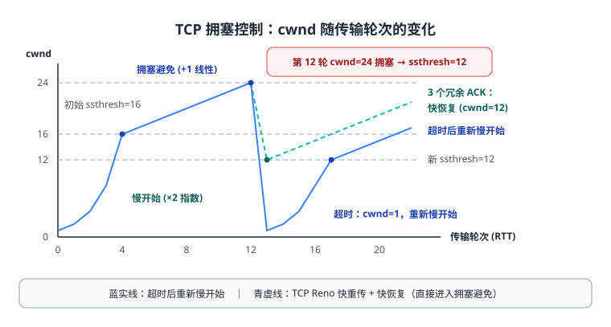

# 拥塞控制

## 拥塞控制 vs 流量控制

| 对比项 | **拥塞控制** | **流量控制** |
|---|---|---|
| **目的** | 防止过多数据注入网络，保证路由器、链路不致过载 | 让接收方来得及接收 |
| **范围** | **全局性**：涉及所有主机、所有路由器 | **点对点**，端到端问题 |
| **决定者** | **发送方自己**通过检测网络状况决定 | 接收方（通过 `rwnd` 通知） |

> 例：链路 10 Gb/s，大型机以 1 Gb/s 向一台 PC 发文件：网络带宽足够，**无拥塞**，但 PC 可能来不及收，需**流量控制**；若 100 万台 PC 在同一链路以 1 Mb/s 发文件，则要**拥塞控制**。

TCP 拥塞控制有四种算法：**慢开始、拥塞避免、快重传、快恢复**。

---

## 发送窗口与拥塞窗口的关系

- 发送方维持一个**拥塞窗口 cwnd**，大小取决于网络拥塞程度并动态变化（2010、2014、2015、2016 真题）。原则：**未拥塞则增大，拥塞则减小**。
- 发送窗口的上限值取决于接收方和网络两者：

$$\text{发送窗口上限} = \min\{\mathrm{rwnd},\ \mathrm{cwnd}\}$$

- 以下讨论假设：数据单向传输，接收方缓存足够，因此发送窗口只由 `cwnd` 决定；窗口以 **MSS** 为单位。

---

## 慢开始与拥塞避免

| 算法 | 做法 | 增长规律 |
|---|---|---|
| **慢开始** | 开始时 **$\mathrm{cwnd} = 1\text{ MSS}$**，每经过一个传输轮次（RTT），`cwnd` **加倍** | **指数增长**：1, 2, 4, 8, 16… |
| **拥塞避免** | 每经过一个 RTT，`cwnd` **只加 1** | **加法增大**（线性） |

- “慢”并不是指 `cwnd` 增长慢，而是指开始发送时**先设 $\mathrm{cwnd} = 1$**，一开始注入网络的报文段少，再逐渐增大。
- 设置**慢开始门限 `ssthresh`**（2014、2015、2017、2020、2023 真题）：

| `cwnd` 与 `ssthresh` | 使用算法 |
|---|---|
| `cwnd < ssthresh` | 慢开始 |
| `cwnd > ssthresh` | 拥塞避免 |
| `cwnd = ssthresh` | 两者皆可（通常做法：拥塞避免） |

### 网络拥塞的处理（超时）

无论在慢开始还是拥塞避免阶段，**只要发送方判断网络出现拥塞**（未按时收到确认，即**超时**）：

$$\mathrm{ssthresh} = \max\left\{\left\lfloor\frac{\mathrm{cwnd}}{2}\right\rfloor,\ 2\right\},\qquad \mathrm{cwnd} = 1$$

然后重新执行**慢开始**。目的是迅速减少注入网络的分组数，让路由器有足够时间处理积压的分组。

> 拥塞避免**并不能完全避免拥塞**，它只是把 `cwnd` 控制为线性增长，使网络比较不容易出现拥塞。

---

## 快重传与快恢复

有时个别报文段在网络中丢失，但网络并未拥塞。若发送方死等超时，会误以为拥塞而启动慢开始，**降低传输效率**（2019 真题）。

| 算法 | 做法 |
|---|---|
| **快重传** | 要求接收方**立即发送确认**，即使收到的是失序报文段，也立即重复确认。发送方一旦**连续收到 3 个冗余 ACK**，立即重传相应报文段，不等其超时计时器到期 |
| **快恢复** | 发送方连续收到 3 个冗余 ACK 时，执行“乘法减小”：**$\mathrm{ssthresh} = \mathrm{cwnd} / 2$**，同时 **$\mathrm{cwnd} = \mathrm{ssthresh}$**（新的 `ssthresh`），然后执行**拥塞避免**（线性增大） |

- 快恢复认为网络很可能没有发生严重拥塞（否则不会有几个报文段连续到达接收方并产生重复确认），所以 `cwnd` 不降到 1。因为**跳过了从 1 开始的慢开始过程**，所以叫快恢复。
- **TCP Reno**：快重传 + 快恢复，`cwnd` 回到 `ssthresh` 后线性增长。**TCP Tahoe**（已废弃不用）：收到 3 个冗余 ACK 也 $\mathrm{cwnd}=1$ 重新慢开始。

### 两种拥塞情况的处理对比

| 拥塞信号 | 采用算法 | `ssthresh` | `cwnd` | 之后 |
|---|---|---|---|---|
| **超时**（含连接建立阶段） | 慢开始 + 拥塞避免 | $= \mathrm{cwnd} / 2$（**不小于 2**） | $= \mathbf{1}$ | 慢开始，到 `ssthresh` 后转拥塞避免 |
| **收到 3 个冗余 ACK** | 快重传 + 快恢复 | $= \mathrm{cwnd} / 2$ | $= \mathbf{\text{新 }ssthresh}$ | 直接进入拥塞避免 |

> **流量控制 vs 拥塞控制的“谁来决定”**：发送窗口由 `rwnd`（接收方缓存，流量控制）和 `cwnd`（发送方自己检测网络，拥塞控制）**共同决定，取较小者**。

---

## 计算与考试要点

### E1：`cwnd` 序列怎么写

1. 慢开始：第 $k$ 轮 $\mathrm{cwnd}=2^k$（第 0 轮为 1）。
2. **若翻倍后会超过 `ssthresh`，则这一轮取 `ssthresh`**（图中 $8 \to 12$，而不是 16）。
3. 到达 `ssthresh` 后每轮 **+1**：第 $n$ 轮拥塞避免 $\mathrm{cwnd}=\mathrm{ssthresh}+n$。
4. 出现超时：$\mathrm{ssthresh} = \mathrm{cwnd}/2$，$\mathrm{cwnd} = 1$；收到 3 个冗余 ACK：$\mathrm{ssthresh} = \mathrm{cwnd}/2$，$\mathrm{cwnd} = \mathrm{ssthresh}$。

**例**：$\mathrm{ssthresh}=16$，第 12 轮 $\mathrm{cwnd}=24$ 时超时。

| 轮次 | 0 | 1 | 2 | 3 | 4 | 5 | … | 12 | 13 | 14 | 15 | 16 | 17 | 18 |
|---|---|---|---|---|---|---|---|---|---|---|---|---|---|---|
| `cwnd` | 1 | 2 | 4 | 8 | **16** | 17 | … | **24** | **1** | 2 | 4 | 8 | **12** | 13 |

若第 12 轮改为“收到 3 个冗余 ACK”，则第 13 轮 $\mathrm{cwnd} = \mathbf{12}$，之后 13、14……线性增长。

### E2：发送窗口与报文段序号

- 发送窗口上限 $=\min\{\mathrm{rwnd},\mathrm{cwnd}\}$。例：$\mathrm{rwnd} = 8\text{ MSS}$，$\mathrm{cwnd} = 16\text{ MSS}$，则最多发送 **8 MSS**。
- 序号：本报文段序号 = 第一个数据字节序号；**下一报文段序号 = 本序号 + 数据长度**；确认号 = 期望的下一个序号。
- **SYN 和 FIN 各消耗一个序号**，不带数据也一样。所以握手后第一个数据字节的序号是 $x+1$。纯 ACK 报文段不消耗序号。
- 例：`seq=301`，数据 100 B → 最后字节序号 400；接收方正确收到后回复 **`ack=401`**。

### E3：平均传输速率（2016、2023）

速率 $=\dfrac{\mathrm{cwnd}\times\mathrm{MSS}}{\mathrm{RTT}}$。设拥塞时 $\mathrm{cwnd} = W$，则：

- 拥塞避免阶段 `cwnd` 在 $W/2\sim W$ 之间线性变化，**平均窗口 $\approx 0.75 W$**。
- 平均速率 $\approx \dfrac{0.75W\cdot\mathrm{MSS}}{\mathrm{RTT}}$。
- 吞吐量上限：$\le \dfrac{\text{窗口字节数}}{\mathrm{RTT}}$。

### E4：易错辨析

- 确认号是“**期望收到的下一个**”，不是“已收到的最后一个”。
- 数据偏移的单位是 **4 B**（偏移值 $5 \to 20\text{ B}$，最大 $15 \to 60\text{ B}$），与 IP 分片的“片偏移（8 B）”不同。
- 慢开始的“慢”指起点 $\mathrm{cwnd} = 1$，而不是增长慢。
- 慢开始门限 `ssthresh` 不能小于 2。
- UDP 检验和字段全 0 表示**不计算检验和**。
- 超时 → 重新慢开始；3 个冗余 ACK → 快恢复，轻拥塞，不回到 1。
