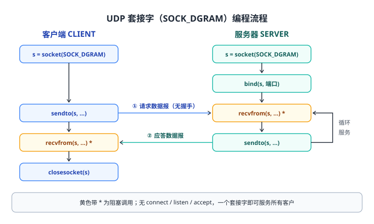

# UDP 编程

## Socket（套接字）基础与通用 API

- 套接字是应用程序与运输层之间的**编程接口**：应用进程通过它把数据交给 TCP/UDP，或从 TCP/UDP 取数据。
- 一个套接字地址 = **IP 地址 + 端口号**。TCP 连接由**两个套接字**（源 IP:源端口，目的 IP:目的端口）唯一确定。
- 数值要使用**网络字节序**（大端）：`htons` / `htonl` 把主机序转网络序，`ntohs` / `ntohl` 反向转换。

| 套接字类型 | 常量 | 对应协议 | 核心调用 | 关键特点 |
|---|---|---|---|---|
| **流式套接字** | `SOCK_STREAM` | **TCP** | `connect / listen / accept / send / recv` | 面向连接、字节流、**无消息边界** |
| **数据报套接字** | `SOCK_DGRAM` | **UDP** | `sendto / recvfrom` | 无连接、保留**数据报边界**、可丢失 |
| **原始套接字** | `SOCK_RAW` | 直接访问较底层 **IP 数据报** | `socket / sendto / recvfrom` | 可自己构造首部（ICMP、自定义协议），通常需**管理员权限** |

### UDP 常用 API 清单

| 函数 | 作用 | 适用对象 |
|---|---|---|
| `WSAStartup` / `WSACleanup` | 初始化 / 终止 socket 库 | **仅 WinSock** |
| `socket` | **创建套接字** | 通用 |
| `bind` | **绑定本地 IP 地址和端口号** | 服务器必需，**客户端通常不需要** |
| `sendto` | 发送数据报（需指定目的地址） | **非连接模式的 UDP 套接字** |
| `recvfrom` | 接收数据报（同时获取发送方地址） | **非连接模式的 UDP 套接字** |
| `closesocket` / `close` | 释放 / 关闭套接字（Windows 为 `closesocket`，Linux 为 `close`） | 通用 |
| `setsockopt` / `getsockopt` | 设置 / 获取套接字选项参数 | 通用 |

> UDP 也可对套接字调用 `connect`（连接模式的客户端 UDP 套接字）：这时只是在本地**记住默认目的地址**，并不发包握手，之后可用 `send` / `recv`。

---

## UDP 套接字编程流程



1. **服务器**：`socket(AF_INET, SOCK_DGRAM, 0)` → `bind()` 绑定本地端口 → 循环 `recvfrom()` 阻塞等待请求（同时获得客户端地址）→ `sendto()` 发回响应。
2. **客户端**：`socket(AF_INET, SOCK_DGRAM, 0)` →（通常不 `bind`，由系统分配临时端口）→ `sendto()` 指定服务器地址发送数据报 → `recvfrom()` 阻塞接收应答 → `closesocket()` / `close()`。

---

## UDP 套接字 vs TCP 套接字

| 对比项 | UDP 套接字（`SOCK_DGRAM`） | TCP 套接字（`SOCK_STREAM`） |
|---|---|---|
| **连接** | **无连接**，直接 `sendto` | 必须先 `connect` / `accept`（三次握手） |
| **服务器套接字数** | **一个套接字**服务所有客户 | 监听套接字 + 每客户一个连接套接字 |
| **收发函数** | `sendto` / `recvfrom`（带对方地址） | `send` / `recv` |
| **数据边界** | **有**：一次 `sendto` 对应一次 `recvfrom` | **无**（字节流） |
| **可靠性** | 可能**丢失、乱序、重复** | 有序、不丢、不重 |
| **阻塞行为** | `recvfrom` 阻塞 | `connect`、`accept`、`recv` 阻塞 |

---

## Python UDP 代码示例

```python
# 服务器：没有 listen / accept
import socket
s = socket.socket(socket.AF_INET, socket.SOCK_DGRAM)
s.bind(("0.0.0.0", 9000))
while True:
    data, addr = s.recvfrom(2048)      # 同时得到对方地址
    s.sendto(data.upper(), addr)

# 客户端：没有 connect
c = socket.socket(socket.AF_INET, socket.SOCK_DGRAM)
c.sendto(b"hello", ("127.0.0.1", 9000))
print(c.recvfrom(2048)[0])
c.close()
```
