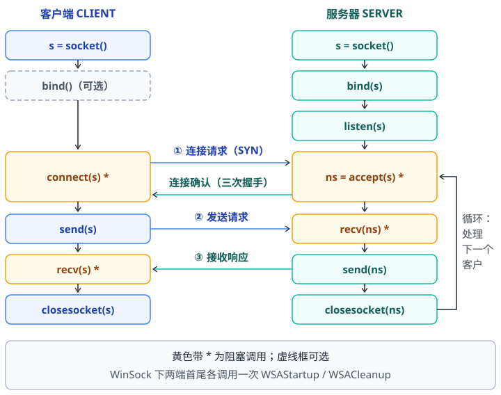

# TCP 编程

## TCP 套接字核心 API

| 函数 | 作用 | 适用对象 |
|---|---|---|
| `WSAStartup` / `WSACleanup` | 初始化 / 终止 socket 库 | **仅 WinSock** |
| `socket` | 创建流式套接字（`SOCK_STREAM`） | 通用 |
| `bind` | **绑定本地 IP 地址和端口号** | 服务器必需，**客户端通常不需要** |
| `listen` | 把 TCP 套接字置为**监听模式**，并设置等待队列大小（backlog） | **仅服务器端 TCP** |
| `accept` | 从已完成握手的队列**取出一个连接请求，创建新套接字 `ns`**，之后通过新套接字通信 | **仅服务器端 TCP** |
| `connect` | “连接”远端服务器（触发**三次握手**） | **仅客户端** |
| `send` / `recv` | 在已连接套接字上发送 / 接收字节流数据 | TCP 套接字 |
| `closesocket` / `close` | 释放 / 关闭套接字（触发四次挥手） | 通用 |

> **重点**：`connect` 只用于客户端；`bind` 客户端通常不需要；`listen` 和 `accept` 只用于服务器端 TCP；`accept` 会**创建新套接字**。

---

## TCP 套接字编程流程



| 步骤 | 服务器 | 客户端 |
|---|---|---|
| ① 创建 | `socket()` 创建**监听套接字 `s`** | `socket()` 创建套接字 `s` |
| ② 绑定 | `bind()` 绑定**众所周知的端口** | 通常**不 `bind`**，由系统分配**临时端口** |
| ③ 监听 | `listen()` 进入监听状态，设置**等待队列长度** | — |
| ④ 建立连接 | `accept()` **阻塞**，直到有客户连接到达；返回**新套接字 `ns`** | `connect()` **阻塞**，触发**三次握手** |
| ⑤ 通信 | `recv(ns)` 阻塞等待请求 → 处理 → `send(ns)` 返回响应 | `send(s)` 发请求 → `recv(s)` 阻塞等待响应 |
| ⑥ 关闭 | `closesocket(ns)` 关闭**这个客户的连接**，回到 `accept` | `closesocket(s)`，触发**四次挥手** |

> Linux/Unix 版本的流程把 `send`/`recv` 写作 `write`/`read`，把 `closesocket` 写作 `close`，其余相同。

---

## 关键概念与常见辨析

- **监听套接字 vs 连接套接字**：`s` 一直用来监听；`accept` 每接受一个客户就返回一个新的 `ns`，专门与该客户通信。这样服务器才能同时服务多个客户。
- **`connect` 与 `accept` 的时机**：`connect` 返回时，三次握手已完成；`accept` 是从**已完成握手的连接队列**里取出一个连接，**不负责握手**。
- **`listen` 的队列**：参数是等待队列长度（backlog），队列满时新的连接请求可能被拒绝或延迟。
- **TCP 是字节流，没有消息边界**：一次 `send(100B)` 的数据可能被拆成多次 `recv` 收到，也可能多次 `send` 合并成一次 `recv`。应用层要自己约定**定长、分隔符或长度前缀**。

### 写流程题的套路

1. 先写**服务器**：`socket → bind → listen → accept → recv/send → closesocket(ns)`，循环回 `accept`。
2. 再写**客户端**：`socket → connect → send → recv → closesocket`。
3. 在 WinSock 下，首尾各加 `WSAStartup` / `WSACleanup`。
4. 标出阻塞点：`connect`、`accept`、`recv`。
5. 画出两端的**对应关系**：`connect ↔ accept`（握手），`send ↔ recv`（请求），`send(ns) ↔ recv(s)`（响应）。

---

## WinSock TCP 代码示例

```c
// ---- 服务器 ----
#include <winsock2.h>
#pragma comment(lib, "ws2_32.lib")
int main() {
    WSADATA wsa; WSAStartup(MAKEWORD(2,2), &wsa);
    SOCKET s = socket(AF_INET, SOCK_STREAM, IPPROTO_TCP);
    struct sockaddr_in addr = {0};
    addr.sin_family = AF_INET;
    addr.sin_port = htons(8080);
    addr.sin_addr.s_addr = htonl(INADDR_ANY);
    bind(s, (struct sockaddr*)&addr, sizeof(addr));
    listen(s, 5);
    while (1) {
        SOCKET ns = accept(s, NULL, NULL);          // 阻塞，返回新套接字
        char buf[1024];
        int n = recv(ns, buf, sizeof(buf) - 1, 0);   // 阻塞
        if (n > 0) send(ns, buf, n, 0);              // 回显
        closesocket(ns);
    }
    closesocket(s); WSACleanup(); return 0;
}
```

```c
// ---- 客户端 ----
#include <winsock2.h>
#include <stdio.h>
#pragma comment(lib, "ws2_32.lib")
int main() {
    WSADATA wsa; WSAStartup(MAKEWORD(2,2), &wsa);
    SOCKET s = socket(AF_INET, SOCK_STREAM, IPPROTO_TCP);
    struct sockaddr_in sa = {0};
    sa.sin_family = AF_INET;
    sa.sin_port = htons(8080);
    sa.sin_addr.s_addr = inet_addr("127.0.0.1");
    connect(s, (struct sockaddr*)&sa, sizeof(sa));   // 触发三次握手
    send(s, "hello", 5, 0);
    char buf[1024];
    int n = recv(s, buf, sizeof(buf) - 1, 0);        // 阻塞
    if (n > 0) { buf[n] = 0; printf("%s\n", buf); }
    closesocket(s); WSACleanup(); return 0;
}
```
