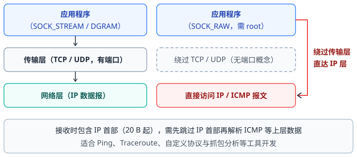

# 原始套接字编程

## 原始套接字（SOCK_RAW）概述

- **作用**：绕过 TCP/UDP，**直接访问 IP 层**（以及 ICMP 等协议）的数据报，由应用程序自己处理协议首部。
- **典型用途**：`ping`（ICMP 回显）、`traceroute`、**抓包 / 嗅探**、自定义协议、网络测试。
- **权限**：一般需要**管理员 / root** 权限（Windows 在较新版本中对原始套接字发送也有限制）。



---

## 核心机制与协议细节

| 项目 | 说明 |
|---|---|
| **创建** | `socket(AF_INET, SOCK_RAW, IPPROTO_ICMP)`，第三个参数指明**要处理的协议号** |
| **构造 IP 首部** | 默认由内核添加；设置 `IP_HDRINCL` 选项后应用要**自己写完整 IP 首部** |
| **接收** | 收到的数据带有 **IP 首部**（20 B 起），应用要先**跳过 IP 首部**（`ihl = (data[0] & 0x0F) * 4`）再解析 ICMP |
| **端口** | 原始套接字**没有端口概念**（ICMP 等协议本身无端口） |
| **ICMP 回显请求 / 应答** | 请求类型 **8**，代码 0；应答类型 **0**；检验和是首部与数据的**16 位反码和取反**（与 UDP 检验和算法相同） |

---

## Python 原始套接字示例（ICMP 回显请求）

```python
import socket, struct

def checksum(data):                     # 16 位反码求和再取反
    if len(data) % 2: data += b"\x00"
    s = sum(struct.unpack("!%dH" % (len(data) // 2), data))
    s = (s >> 16) + (s & 0xFFFF)
    s += s >> 16
    return ~s & 0xFFFF

s = socket.socket(socket.AF_INET, socket.SOCK_RAW, socket.IPPROTO_ICMP)
hdr = struct.pack("!BBHHH", 8, 0, 0, 1, 1)           # type=8, code=0, cksum=0, id, seq
payload = b"abcdefgh"
cs = checksum(hdr + payload)
pkt = struct.pack("!BBHHH", 8, 0, cs, 1, 1) + payload
s.sendto(pkt, ("127.0.0.1", 0))                      # 端口无意义，填 0
data, addr = s.recvfrom(1024)
ihl = (data[0] & 0x0F) * 4                           # 跳过 IP 首部
print("ICMP type =", data[ihl])                      # 应答为 0
```
