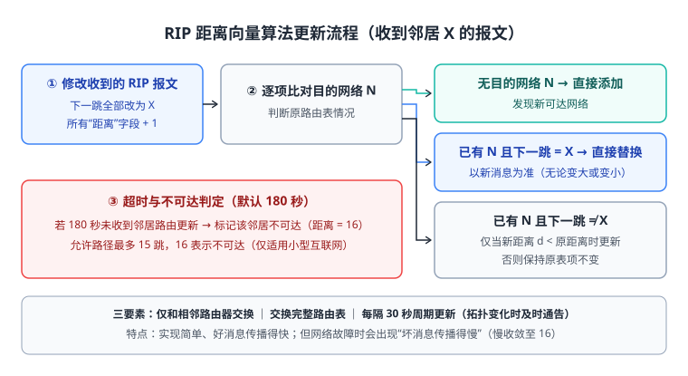

# 距离向量路由协议（RIP）

## RIP 协议的工作原理

**RIP（Routing Information Protocol，路由信息协议）** 是内部网关协议（IGP）中最先得到广泛使用的协议（RFC 1058），是一种分布式的**基于距离向量的路由选择协议**，封装在 **UDP 数据报**（端口 520）中传送。

### 距离（跳数）的定义

- 从一路由器到**直接连接**的网络的距离定义为 **1**。
- 从一主机到非直接连接的网络的距离定义为**所经过的路由器数加 1**（“加 1”是因为到达目的网络后还需进行直接交付，不需要再经过路由器）。
- 协议 RIP 的“距离”也称为**跳数（hop count）**，每经过一个网络，跳数加 1。
- **16 表示不可达**：RIP 认为好的路由就是它通过的路由器数目少（“距离短”）。RIP 允许一条路径最多只能包含 **15 个网络**，“距离”等于 **16** 时即相当于**不可达**。因此 RIP **只适用于小型互联网**。

### RIP 的三个特点

1. **仅和相邻路由器交换信息**：不相邻的路由器之间不交换信息（如果两个路由器之间的通信不需要经过另一个路由器，则它们是相邻的）。
2. **交换路由器所知道的全部信息**：即**自己的整个路由表**（“我到本自治系统中所有网络的最短距离，以及到每个网络应经过的下一跳路由器”）。
3. **按固定时间间隔交换路由信息**：例如每隔 **30 秒**。当网络拓扑发生变化时，路由器也及时向相邻路由器通告拓扑变化后的路由信息。（网络中的主机虽然也运行 RIP，但只被动接收路由器发来的路由信息。）

---

## RIP 的距离向量算法

对每个相邻路由器发送来的 RIP 报文，执行如下步骤：

1. 对地址为 $X$ 的相邻路由器发来的 RIP 报文，先修改此报文中的所有项目：把**“下一跳”字段中的地址都改为 $X$**，并把**所有“距离”字段的值加 1**。
2. 对修改后的 RIP 报文中的每个项目，执行如下步骤：
   - **IF**（若原来的路由表中没有目的网络 $N$）：则把该项目**添加**到路由表中（表明这是新的目的网络）。
   - **ELSE IF**（若原来的路由表中有目的网络 $N$，且下一跳路由器的地址是 $X$）：用收到的项目**替换**原路由表中的项目（因为要以更新的消息为准，即使距离变大也要更新）。
   - **ELSE IF**（若原来的路由表中有目的网络 $N$，且下一跳路由器的地址不是 $X$）：若收到的项目中的距离 $d$ **小于**原路由表中的距离，则**更新**；否则什么也不做。
3. 若 **180 秒**（RIP 默认超时时间）还没有收到相邻路由器的更新路由表，则把此相邻路由器记为不可达的路由器，即**把距离设置为 16**。
4. 返回。

---

## 路由表更新例题演算

已知路由器 R6 和 R4 互为相邻路由器，表 4.4(a) 所示为 R6 的原路由表，现在收到相邻路由器 R4 发来的路由更新信息表 4.4(b)：

**更新前路由表与收到报文**：

| R6 原路由表：目的网络 | 距离 | 下一跳 | R4 发来的报文：目的网络 | 距离 | 下一跳 |
|---|---|---|---|---|---|
| `Net2` | 3 | R4 | `Net1` | 3 | R1 |
| `Net3` | 4 | R5 | `Net2` | 4 | R2 |
| `…` | … | … | `Net3` | 1 | 直接交付 |

**更新过程**：先把 R4 发来的路由表中各项距离都加 1，下一跳都改为 R4，得到修改后的表 4.5(a)，再逐行与 R6 原表比较：

1. `Net1`：原表中没有 → **直接添加** `(Net1, 4, R4)`；
2. `Net2`：原表中有，且下一跳也是 R4 → **直接替换**为 `(Net2, 5, R4)`（距离增大也要更新）；
3. `Net3`：原表中有，但下一跳不同（原为 R5）→ 比较距离，新距离 $2 < 4$ → **更新**为 `(Net3, 2, R4)`。

| 修改后 R4 报文：目的网络 | 距离 | 下一跳 | R6 更新后路由表：目的网络 | 距离 | 下一跳 |
|---|---|---|---|---|---|
| `Net1` | 4 | R4 | `Net1` | **4** | **R4** |
| `Net2` | 5 | R4 | `Net2` | **5** | **R4** |
| `Net3` | 2 | R4 | `Net3` | **2** | **R4** |

---

## RIP 的优缺点

| 优点 | 缺点 |
|---|---|
| ① **实现简单、开销小、收敛过程较快** | ① **限制了网络规模**：能使用的最大距离为 **15**（16 表示不可达） |
| ② **好消息传播得快**：若一个路由器发现了更短的路由，这种更新信息可在较短时间内传至所有路由器 | ② **交换开销随规模增大**：路由器之间交换的是完整路由表，网络规模越大开销越大 |
| | ③ **坏消息传播得慢（慢收敛）**：当网络出现故障时，路由器之间需反复多次交换信息才能完成收敛，需要较长时间才能把故障消息传到所有路由器 |
