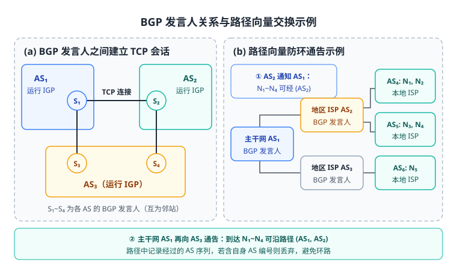

# 边界网关协议（BGP）

## BGP 的作用与设计原因

**边界网关协议（Border Gateway Protocol, BGP）** 是**不同自治系统（AS）的路由器之间**交换路由信息的协议，是一种**外部网关协议（EGP）**，常用于互联网的网关之间（2013 真题）。

内部网关协议（IGP）主要设法使数据报在一个 AS 中尽可能有效地从源站传送到目的站，在 AS 内部不需要考虑其他方面策略。但 AS 之间的路由选择环境截然不同：

1. **互联网规模太大**：使 AS 之间路由选择非常困难，每个主干网路由器表中的项目数都非常庞大，寻找“最佳路由”很不现实。
2. **必须考虑策略因素**：AS 之间的路由选择必须考虑**政治、安全或经济**等有关因素。

因此：
- **BGP 只能力求寻找一条能够到达目的网络且比较好的路由（不能兜圈子）**，而非寻找一条最佳路由。
- **BGP 采用的是路径向量（Path Vector）路由选择协议**，与距离向量（如 RIP）和链路状态（如 OSPF）都有很大区别。
- **协议定位（2013、2017 真题）**：**BGP 是应用层协议**，它基于 **TCP**（熟知端口 **179**）封装 BGP 报文。

---

## BGP 的工作原理与路径向量

1. **配置 BGP 发言人**：每个 AS 的管理员要选择至少一个路由器，作为该 AS 的 **“BGP 发言人（BGP Speaker）”**，BGP 发言人往往就是 BGP 边界路由器。
2. **建立 TCP 会话**：一个 BGP 发言人与其他 AS 中的 BGP 发言人交换路由信息前，要先建立 **TCP 连接**，在此连接上交换 BGP 报文以建立 **BGP 会话**，再利用会话交换路由信息。使用 TCP 连接交换路由信息的两个 BGP 发言人，彼此成为对方的**邻站或对等站**。每个 BGP 发言人除了运行 BGP 外，还必须运行该 AS 所用的内部网关协议（如 OSPF 或 RIP）。
3. **交换网络可达性信息（路径向量）**：所交换的是“要到达某个网络所要经过的一系列自治系统”。各 BGP 发言人根据所用策略，从收到的路由信息中找出到达各自治系统的较好路由。
   - **防环机制**：路由更新携带完整 AS 路径序列；若收到的路径中已包含本 AS 编号，说明存在环路，直接丢弃。

---

## BGP-4 的四种报文与协议特点

### BGP 特点

1. **数量级小**：交换路由信息的结点数量级是 **AS 个数**的数量级，比这些 AS 中的网络数少得多。
2. **发言人数目少**：每个 AS 中 BGP 发言人（或边界路由器）的数目很少，使 AS 之间的路由选择不致过分复杂。
3. **支持 CIDR**：BGP 的路由表包括**目的网络前缀、下一跳路由器**，以及**到达该目的网络所要经过的各个自治系统序列**。
4. **增量更新**：BGP 刚运行时，邻站交换**整个 BGP 路由表**；以后**只在发生变化时更新有变化的部分**，节省网络带宽并减少处理开销。

### BGP-4 共使用 4 种报文

| 报文 | 作用 | 要点 |
|---|---|---|
| **打开（Open）** | 与相邻的另一个 BGP 发言人**建立关系**，使通信初始化 | 对方若接受该邻站关系，则用 Keepalive 报文响应 |
| **更新（Update）** | **通知某一条路由的信息**，以及**列出要撤销的多条路由** | **BGP 的核心内容**，可撤销旧路由并宣布新路由 |
| **保活（Keepalive）** | 周期性地**证实邻站的连通性** | 报文只有 **19 B**，一般每隔 **30 秒**发送一次，开销极小 |
| **通知（Notification）** | 发送**检测到的差错** | 发生协议错误或中断连接时使用 |

---

## 三种路由协议比较（RIP / OSPF / BGP）

| 比较项 | RIP | OSPF | BGP |
|---|---|---|---|
| **类型** | 内部（IGP） | 内部（IGP） | 外部（EGP） |
| **路由算法** | 距离向量 | 链路状态 | 路径向量 |
| **传送协议** | **UDP** | **IP** | **TCP** |
| **路径选择** | 跳数最少 | 代价最低 | 较好，非最佳 |
| **交换结点** | 和本结点相邻的路由器 | 网络中的所有路由器 | 和本结点相邻的路由器（BGP 发言人） |
| **交换内容** | 当前本路由器知道的全部信息（即自己的路由表） | 与本路由器相邻的所有路由器的链路状态 | **首次**：整个路由表 **非首次**：有变化的部分 |
