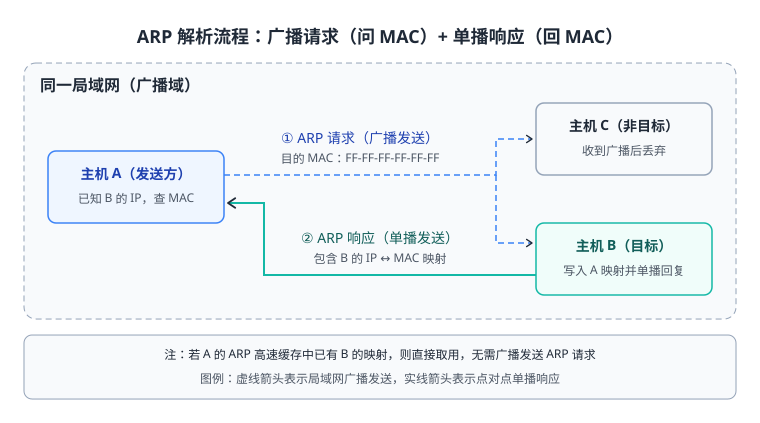
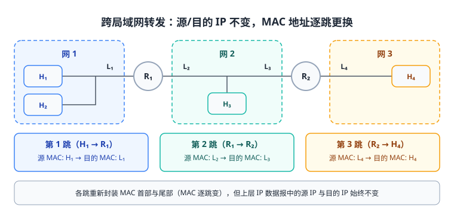

# 地址解析协议（ARP）

## ARP 的功能与应用

无论网络层使用什么协议，在实际网络的链路上传送数据帧时，最终必须使用**硬件地址（MAC 地址）**。因此需要一种方法来完成 **IP 地址到 MAC 地址的映射**，这就是**地址解析协议（Address Resolution Protocol, ARP）**（2011、2012、2021 真题）。

- 每台主机都设有一个 **ARP 高速缓存（ARP 表）**，用来存放**本局域网上**各主机和路由器的 IP 地址到 MAC 地址的映射表。
- 主机通过 ARP 自动、动态地维护 ARP 表（存在生存时间 TTL，到期刷新以适应网卡更换等变化）。

---

## ARP 工作原理与协议层次

假设主机 A 欲向**本局域网上**的某台主机 B 发送 IP 数据报：

1. 先在主机 A 的 **ARP 高速缓存**中查看有无主机 B 的 IP 地址：
   - **若有**：查出对应的硬件地址，将其写入 MAC 帧首部，通过局域网发往该硬件地址。
   - **若没有**：使用目的 MAC 地址为 **`FF-FF-FF-FF-FF-FF`** 的帧来封装并**广播发送 ARP 请求分组**，使同一个局域网里的所有主机都收到此 ARP 请求（2011、2015 真题）。
2. 主机 B 收到该 ARP 请求后，向主机 A 发出 **ARP 响应分组（单播发送）**，分组中包含主机 B 的 IP 地址与 MAC 地址的映射关系（非目标主机收到后直接丢弃）。
3. 主机 A 收到 ARP 响应分组后，将该映射写入自己的 ARP 缓存，然后按查询到的硬件地址发送 MAC 帧。

> **为什么说 ARP 工作在网络层？**
> ARP 因为在分组中**“看到了” IP 地址**，通常被归为**网络层**协议（或介于网络层与数据链路层之间的协议）；同理，NAT 路由器因为“看到了”传输层**端口号**，所以工作在传输层。

---

## 使用 ARP 的四种典型情况（MAC 地址变化）

**ARP 仅用于解决同一局域网上的主机或路由器的 IP 地址和硬件地址的映射问题**。若目的主机和源主机不在同一个局域网上，则必须通过 ARP 找到**本局域网上的默认网关（路由器接口）**的硬件地址，把分组发给该路由器转发。

| 情况 | 源方 → 目标方 | 在哪段网络发起 ARP | 解析谁的 MAC 地址 |
|---|---|---|---|
| **①** | 主机 $H_1$ → 同网主机 $H_2$ | 在网 1 用 ARP | 主机 $H_2$ 的 MAC 地址 |
| **②** | 主机 $H_1$ → 跨网主机 $H_4$ | 在网 1 用 ARP | 与网 1 相连的路由器 $R_1$ 接口的 MAC 地址（$L_1$），剩余工作由 $R_1$ 完成 |
| **③** | 路由器 $R_1$ → 直连网 2 主机 $H_3$ | 在网 2 用 ARP | 主机 $H_3$ 的 MAC 地址 |
| **④** | 路由器 $R_1$ → 非直连网 3 主机 $H_4$ | 在网 2 用 ARP | 与网 2 相连的路由器 $R_2$ 接口的 MAC 地址（$L_3$），剩余工作由 $R_2$ 完成 |

### 跨局域网传输时的 MAC 帧首部变化（2015 真题）

以 $H_1 \to H_4$ 为例：
1. 在 $H_1$ 和 $R_1$ 之间传送时：MAC 帧首部中**源 MAC 是 $H_1$**，**目的 MAC 是 $L_1$**；
2. $R_1$ 收到此 MAC 帧后，在数据链路层**丢弃原 MAC 的首部和尾部**，查路由表后在网 2 重新封装，此时**源 MAC 变为 $L_2$**，**目的 MAC 变为 $L_3$**；
3. $R_2$ 收到此帧后再次更换 MAC 首部和尾部，变为**源 MAC $L_4$**，**目的 MAC $H_4$**。
4. **MAC 帧首部的这种逐跳变化，在上面的 IP 层中是看不见的**（IP 数据报的源 IP 始终是 $H_1$，目的 IP 始终是 $H_4$）。
