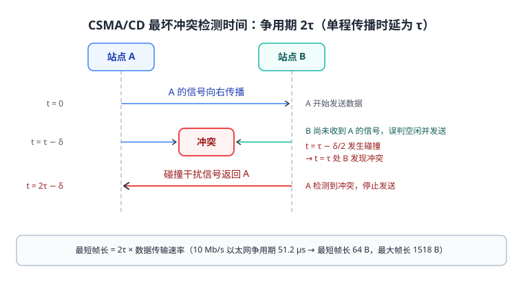
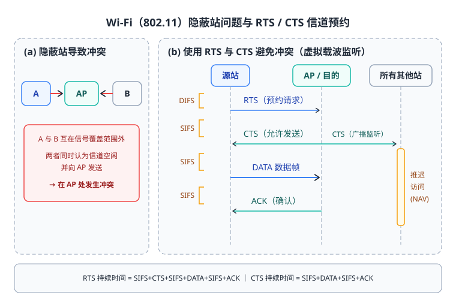

# Wi-Fi 与随机访问控制（CSMA/CA）

## 随机访问与 ALOHA / CSMA 协议

在随机访问协议（争用型协议）中，胜利者通过争用获得信道发送权，实质上是将广播信道转换为点对点信道（2014 真题）。

### ALOHA 协议

- **纯 ALOHA**：任何站点想发就发；若一段时间内未收到确认则认为发生冲突，等待一段随机时间后重发。信道利用率很低。
- **时隙 ALOHA**：把时间划分为等长时隙（Slot），规定站点**只能在每个时隙开始时**发送帧（帧传输时间 $\le T_0$），降低了冲突可能性，提高了信道利用率。

### 三种 CSMA（载波监听多路访问）协议

| 协议 | 信道空闲时 | 信道忙时 | 特点 |
|---|---|---|---|
| **1-坚持 CSMA** | 立即发送数据（概率为 1） | 继续坚持监听直到空闲 | 多个站等待空闲时会**同时发送导致冲突** |
| **非坚持 CSMA** | 立即发送数据 | 放弃监听，等待一个随机时间后再监听 | 减少冲突概率，但**平均等待延迟较长** |
| **$p$-坚持 CSMA** | 以概率 $p$ 发送，概率 $1-p$ 推迟到下一时隙 | 持续监听（等下一时隙再监听）直到空闲 | 1-坚持与非坚持的折中（用于时分信道） |

---

## CSMA/CD 协议（有线以太网对比基础）

**CSMA/CD（载波监听多路访问 / 冲突检测）** 适用于总线形网络或半双工有线以太网，工作流程概括为：**先听后发，边听边发，冲突停发，随机重发**（2015 真题）。全双工网络不会产生冲突，因此不需要 CSMA/CD。

- **争用期（冲突窗口）**：单程端到端传播时延为 $\tau$，A 发送数据后**最多经过 $2\tau$** 就能知道是否发生冲突。这段时间 $2\tau$ 称为**争用期**（2010 真题）。
- **最短帧长与最长帧长**（2009、2016、2019、2022 真题）：

$$\text{最短帧长} = \text{总线传播时延} \times \text{数据传输速率} \times 2$$

  - 以太网规定争用期 $51.2\ \mu\text{s}$。对于 $10\text{ Mb/s}$ 以太网，**最短帧长为 64 B**（$512\text{ bit}$）；凡长度小于 64 B 的帧都因冲突而异常中止，收到后应立即丢弃。若数据太短则需在 MAC 层填充至不少于 64 B。
  - **最长帧长**：标准以太网（Ethernet II）MAC 帧最大长度为 **1518 字节**（对应 MTU 1500 字节数据 + 18 字节首尾）。

- **截断二进制指数退避算法**（2023 真题）：
  1. 基本退避时间为争用期 $2\tau$；
  2. 令参数 $k = \min[\text{重传次数},\ 10]$，从离散整数集合 $\{0, 1, \dots, 2^k - 1\}$ 中随机取数 $r$，重传推迟时间为 **$r \times 2\tau$**；
  3. 当**重传 16 次仍不成功**时，认为网络太拥挤，抛弃该帧并向高层报告出错。

---

## Wi-Fi 与 CSMA/CA 协议

### 无线局域网为何不能直接照搬 CSMA/CD？

1. **硬件冲突检测代价过高**：接收信号强度往往远小于发送信号强度，无线介质信号动态范围大，边发边检测硬件花费过大。
2. **存在“隐蔽站”问题**：无线通信中并非所有站点都能互相听见对方。

因此 **IEEE 802.11（Wi-Fi）** 在 MAC 层采用 **CSMA/CA（冲突避免，Collision Avoidance）**，同时配合**链路层确认/重传（ARQ）**（停止-等待协议，收到对方 ACK 才算发送成功，2011 真题）。

### 三种帧间间隔（IFS）

所有站发送完后必须等待一段短暂时间（继续监听）才能发下一帧，按长短分为三种（2020 真题）：

| 帧间间隔 | 长短 | 用途 |
|---|---|---|
| **SIFS（短 IFS）** | **短** | 分隔属于**同一次对话**的各帧：如 **ACK 帧、CTS 帧、分片后的数据帧**，以及所有回答 AP 探询的帧 |
| **PIFS（点协调 IFS）** | **中** | 在 PCF（点协调功能）集中控制操作中使用 |
| **DIFS（分布协调 IFS）** | **长** | 用于**异步帧竞争访问**的起始等待时延 |

### 虚拟载波监听（NAV）与退避规则

- **虚拟载波监听**：源站在帧中通告将要占用信道的持续时间（包含接收方回发 ACK 所需时间），其他站收到后即使不监听物理信道，也在该持续时间内抑制发送。
- **退避算法执行时机**：**仅当检测到信道空闲且该数据帧是要发送的第一个数据帧时，才不使用退避算法**；以下三种情况**必须使用退避算法**：
  1. 发送第一个帧之前检测到信道忙；
  2. 每次重传；
  3. 每次成功发送后要发送下一帧。
- **退避计时器规则**：选取随机退避值，信道空闲时倒计时，**一旦检测到信道忙就冻结（保持不变）**，信道再次空闲并等待 DIFS 后继续倒计时，归零时立即发送。

---

## 隐蔽站问题与 RTS / CTS 机制

- **隐蔽站问题**：站 A 与站 B 都在 AP 的覆盖范围内，但 A、B 相距较远彼此听不见对方。若两者同时检测到信道空闲并向 AP 发送数据，就会在 AP 处发生冲突。
- **RTS / CTS 信道预约流程**：
  1. 源站先监听信道，空闲并等待 **DIFS** 后广播 **RTS（请求发送）**控制帧（含源地址、目的地址、本次通信持续时间）；
  2. 若 AP 正确收到 RTS 且信道空闲，等待 **SIFS** 后发送 **CTS（允许发送）**控制帧；
  3. 源站收到 CTS 后等待 **SIFS** 发送数据帧；AP 覆盖范围内的其他站听到 CTS 后，在 CTS 指明的时间内抑制发送（**推迟访问 NAV**）；
  4. 目的站正确收到数据后等待 **SIFS** 回发 **ACK** 确认帧。

> **持续时间字段计算（常考易错）**：
> - **RTS 中填写的持续时间** $= \text{SIFS} + \text{CTS} + \text{SIFS} + \text{数据帧} + \text{SIFS} + \text{ACK}$（从 RTS 发送完毕到最终收到 ACK 为止）；
> - **CTS 中填写的持续时间** $= \text{SIFS} + \text{数据帧} + \text{SIFS} + \text{ACK}$（从 CTS 发送完毕到最终收到 ACK 为止）。

---

## CSMA/CD 与 CSMA/CA 对比

| 对比项 | CSMA/CD | CSMA/CA |
|---|---|---|
| **适用网络** | **有线**总线形以太网 | **无线**局域网 Wi-Fi（IEEE 802.11） |
| **核心策略** | **边听边发，冲突停发**（能检测冲突，无法避免） | **先预约/退避，尽量避免冲突**（发数据时不检测冲突） |
| **检测方式** | 检测电缆中的**电压变化** | **能量检测、载波检测、能量载波混合检测** |
| **确认机制** | 不必每帧确认（靠冲突检测判断发送成败） | 必须使用 **ARQ 确认重传**（等待 **ACK**） |
