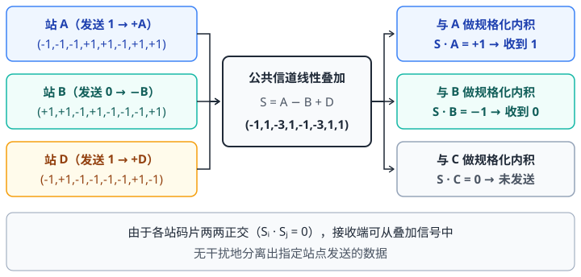

# 码分多址（CDMA）

## 静态信道划分复用对比

信道复用技术把物理信道划分给多个用户共享（2014 真题考过静态划分与动态随机访问的区别）：

| 复用方式 | 划分维度 | 核心特征 |
|---|---|---|
| **频分多路复用（FDM）** | **频率** | 所有用户在**同样时间**占用**不同带宽**资源 |
| **时分多路复用（TDM）** | **时间** | 所有用户在**不同时间**占用**同样频带宽度**（同步 TDM 易出现时隙空闲浪费，统计 TDM 按需分配） |
| **波分多路复用（WDM）** | **光波长（频率）** | 在同一根光纤中同时传输多个不同波长的光信号 |
| **码分多路复用（CDM / CDMA）** | **正交码片序列** | 所有用户在**同样时间**使用**同样频带**通信，靠**互不干扰的正交码序列**区分用户 |

---

## CDMA 基本原理与正交性

**码分多址（Code Division Multiple Access, CDMA）** 是码分复用的一种典型应用，每个站被指派一个唯一的 **$m\text{ bit}$ 码片序列（Chip Sequence）**。

### 1. 发送规则（双极性表示）

习惯上将码片序列中的 `0` 写为 **`-1`**，将 `1` 写为 **`+1`**：
- 若某站要发送比特 **`1`**，则发送它自己的 **$m$ 位码片序列 $\mathbf{S}$**；
- 若某站要发送比特 **`0`**，则发送该码片序列的**反码 $-\mathbf{S}$**；
- 若某站**不发送数据**，则发送全 **`0`** 向量。

> **带宽变化**：发送 1 bit 信息需要发送 $m$ 个码片（码片速率是原始比特速率的 $m$ 倍），占用频带扩展为原来的 $m$ 倍（因此 CDMA 也称扩频通信）。

### 2. 正交性条件与内积公式

设站 S、站 T 的 $m$ 位码片向量分别为 $\mathbf{S}=(S_1, S_2, \dots, S_m)$ 与 $\mathbf{T}=(T_1, T_2, \dots, T_m)$（每个分量为 $\pm 1$），**规格化内积**定义为：

$$\mathbf{S} \cdot \mathbf{T} \equiv \frac{1}{m}\sum_{i=1}^{m} S_i T_i$$

CDMA 要求各站码片序列满足三条核心性质：

| 性质 | 公式 | 含义 |
|---|---|---|
| **两两正交** | $\mathbf{S} \cdot \mathbf{T} = \mathbf{0}$（$S \neq T$） | 不同站点的码片序列互相正交，接收端过滤掉其他站干扰 |
| **自身内积** | $\mathbf{S} \cdot \mathbf{S} = \mathbf{+1}$ | 站 S 发送比特 `1` 时，与 $\mathbf{S}$ 做内积得 **`+1`** |
| **反码内积** | $(-\mathbf{S}) \cdot \mathbf{S} = \mathbf{-1}$ | 站 S 发送比特 `0` 时，与 $\mathbf{S}$ 做内积得 **`-1`** |

---

## 多站叠加与解码计算例题

### 计算例题

设共有 A、B、C、D 四个站进行 CDMA 通信，各自的 8 位码片序列为：
- $\mathbf{A} = (-1, -1, -1, +1, +1, -1, +1, +1)$
- $\mathbf{B} = (-1, -1, +1, -1, +1, +1, +1, -1)$
- $\mathbf{C} = (-1, +1, -1, +1, +1, +1, -1, -1)$
- $\mathbf{D} = (-1, +1, -1, -1, -1, -1, +1, -1)$

某时刻接收端在公共信道上收到的叠加码片序列为：

$$\mathbf{S}_{\text{收}} = (-1,\ +1,\ -3,\ +1,\ -1,\ -3,\ +1,\ +1)$$

问：此时 A、B、C、D 四个站分别发送了什么数据？

**解答步骤**（将 $\mathbf{S}_{\text{收}}$ 依次与各站码片向量求规格化内积）：

1. **站 A**：
   $$\frac{\mathbf{S}_{\text{收}} \cdot \mathbf{A}}{8} = \frac{(-1)(-1)+(+1)(-1)+(-3)(-1)+(+1)(+1)+(-1)(+1)+(-3)(-1)+(+1)(+1)+(+1)(+1)}{8} = \frac{1 - 1 + 3 + 1 - 1 + 3 + 1 + 1}{8} = \frac{8}{8} = \mathbf{+1}$$
   → 站 A 发送了比特 **`1`**。

2. **站 B**：
   $$\frac{\mathbf{S}_{\text{收}} \cdot \mathbf{B}}{8} = \frac{1 - 1 - 3 - 1 - 1 - 3 + 1 - 1}{8} = \frac{-8}{8} = \mathbf{-1}$$
   → 站 B 发送了比特 **`0`**。

3. **站 C**：
   $$\frac{\mathbf{S}_{\text{收}} \cdot \mathbf{C}}{8} = \frac{1 + 1 + 3 + 1 - 1 - 3 - 1 - 1}{8} = \frac{0}{8} = \mathbf{0}$$
   → 站 C **没有发送数据**。

4. **站 D**：
   $$\frac{\mathbf{S}_{\text{收}} \cdot \mathbf{D}}{8} = \frac{1 + 1 + 3 - 1 + 1 + 3 + 1 - 1}{8} = \frac{8}{8} = \mathbf{+1}$$
   → 站 D 发送了比特 **`1`**。

> **考研判断口诀**：规格化内积结果为 **`+1` → 发送 `1`**；**`-1` → 发送 `0`**；**`0` → 未发送**；若出现非 $\pm 1, 0$ 的分数，则说明题目给出的序列存在传输误码或题设条件异常。
